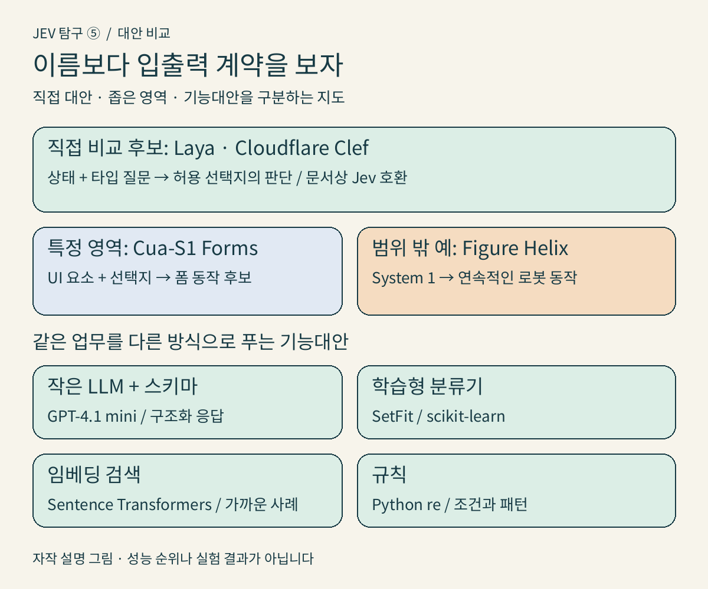
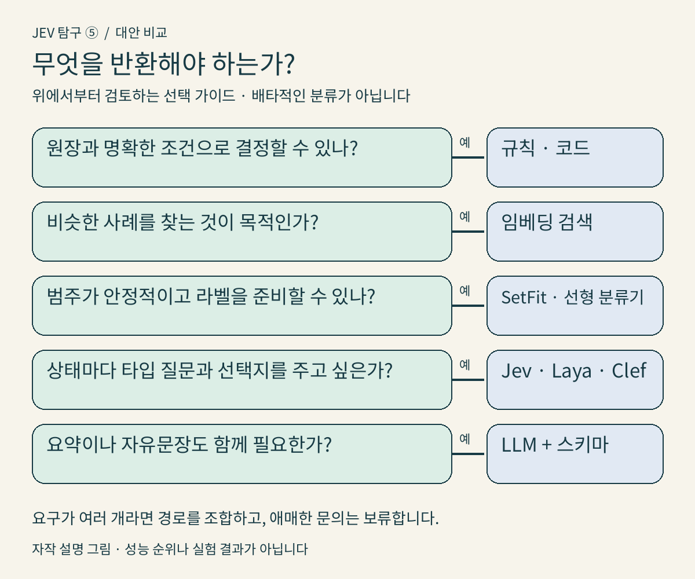
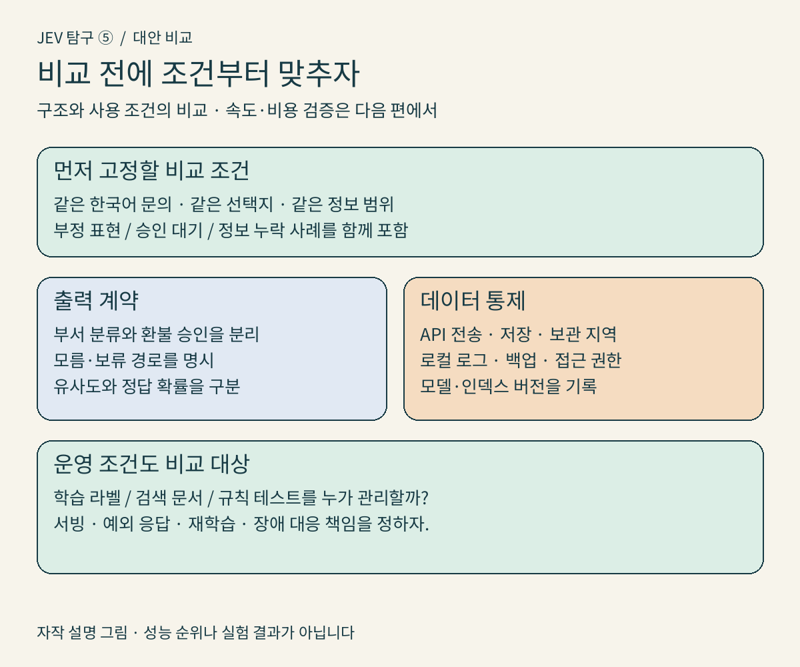
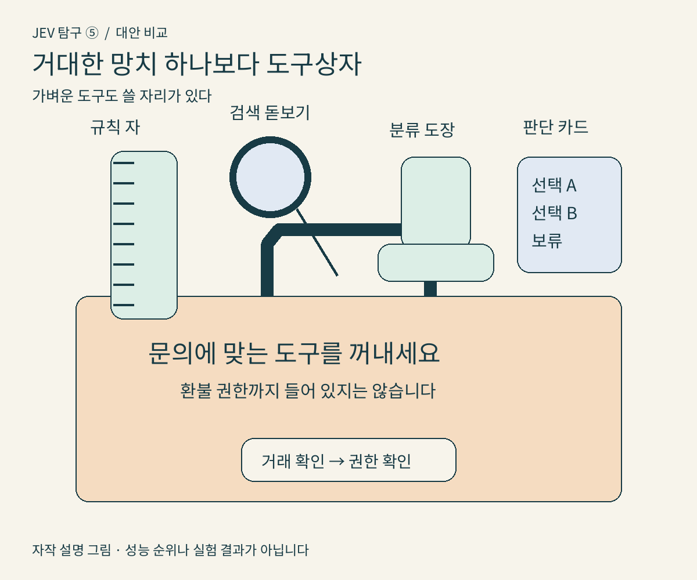

<nav id="jev-series-nav" aria-label="JEV 탐구 연재 nav">
  
<strong>JEV 탐구 · 7편 읽는 순서</strong>

  <ol>
    <li><a href="/posts/jev-system-1-vs-system-2/">JEV 탐구 ① — System 1 vs System 2: AI는 언제 깊이 생각해야 할까?</a></li>
    <li><a href="/posts/jev-structure-vs-llm/">JEV 탐구 ② — 문장 대신 판단을 반환하는 AI: JEV는 LLM과 무엇이 다를까?</a></li>
    <li><a href="/posts/jev-designing-small-questions/">JEV 탐구 ③ — ‘알아서 처리해줘’를 작은 질문으로 바꾸는 법</a></li>
    <li><a href="/posts/jev-strengths-limits-trust/">JEV 탐구 ④ — 빠른 판단은 어디까지 믿어도 될까?</a></li>
    <li><strong aria-current="page">JEV 탐구 ⑤ — 꼭 JEV여야 할까? 같은 문제를 푸는 다른 선택지들</strong></li>
    <li><a href="/posts/jev-public-performance-evidence/">JEV 탐구 ⑥ — 정말 빠르고 경제적일까? 공개 성능 주장의 근거를 따져보다</a></li>
    <li><a href="/posts/jev-adoption-system-design/">JEV 탐구 ⑦ — 그래서, 우리 서비스에 JEV를 넣어야 할까?</a></li>
  </ol>
  
<a href="/posts/jev-strengths-limits-trust/">← 이전 편</a> · <a href="/posts/jev-public-performance-evidence/">다음 편 →</a>

</nav>

고객이 이렇게 썼다고 하자. "이번 달 요금이 두 번 나갔어요. 중복 결제를 돌려주세요. 해결되지 않으면 해지하겠습니다." 앞선 글과 이어지는 가상 문의다. 우리가 만들려는 것은 답장을 잘 쓰는 챗봇이 아니라, 이 문의를 결제 담당에게 보내고 필요한 확인 절차를 시작하는 기능이다.

TypeSafe는 Jev를 비정형 상태를 받아 타입이 정해진 확률적 판단을 돌려주는 모델로 설명한다.<a href="#source-1">[1]</a> 하지만 필요한 출력이 `billing` 하나라면 선택지는 넓어진다. 다른 판단 모델을 쓸 수도 있고, 익숙한 분류기나 검색, 코드로 풀 수도 있다. 이번 편에서는 승자를 고르지 않는다. 입력과 출력, 준비할 데이터, 운영 책임이 어떻게 달라지는지 비교한다. 속도와 비용 주장의 검증은 다음 편의 몫이다.

## 직접 대안은 있다. 다만 같은 이름이 같은 용도를 뜻하지는 않는다

공개 검색으로 후보를 찾은 뒤 제작자의 저장소와 모델 카드를 확인했다. **Laya와 Cloudflare Clef는 Jev와 직접 비교할 근거가 있는 후보**다. Laya는 자신을 비자기회귀 System 1 판단 엔진으로 소개하며, 상태와 `choice`·`score`·`noul` 질문을 받고 Jev와 같은 `/v1/systemone` 프로토콜로 서비스할 수 있다고 문서화했다.<a href="#source-2">[2]</a> 모델 카드에는 배포된 체크포인트와 자체 데이터로 미세조정하는 경로도 있다.<a href="#source-15">[15]</a>

Clef 역시 상태와 타입이 정해진 질문을 받아 각 허용 선택지의 확률을 반환하며, Jev/SystemOne API 호환성을 명시한다.<a href="#source-3">[3]</a> 따라서 두 후보는 단지 작은 모델이라서가 아니라, **같은 종류의 질문을 비슷한 계약으로 받기 때문에** 비교 대상이다. 호환성은 제작자의 문서상 설명이지, 이 글에서 SDK를 연결해 확인한 결과는 아니다. 한국어 문의 정확도나 확률 보정의 우열도 여기서 확정할 수 없다.

비슷해 보이지만 범위가 좁은 후보도 있다. Cua-S1 계열의 `cua-s1-forms`는 UI 요소와 선택지를 받아 선택지별 확률을 내는 폼 입력용 모델이다. 실행 순서는 모델 밖 코드가 정한다.<a href="#source-4">[4]</a> 판단 인터페이스를 비교하기에는 유용하지만, 일반 고객 문의 분류기를 그대로 대신한다고 읽으면 안 된다.

Figure Helix는 다른 경우다. 공식 설명에서 System 1은 로봇의 연속적인 동작을 만드는 시각·운동 정책이다.<a href="#source-5">[5]</a> 같은 어휘를 쓴다는 이유로 로보틱스나 월드모델을 고객 문의 판단 API의 직접 경쟁자로 묶을 수는 없다. 이 글의 목록은 시장 전체의 전수조사도 아니다. 직접 대안의 존재를 확인하고, 작업 범위가 다른 사례를 구분한 결과다.

<figure>
  
  <figcaption>그림 1. 이름보다 입출력 계약으로 나눈 대안 지도. 성능 순위가 아니다. 자작, 근거 <a href="#source-2">[2]</a>–<a href="#source-13">[13]</a>. · 직접 제작, 이 연재 게시 허용 · <a href="/assets/img/posts/jev-alternatives-comparison/01-alternative-map.png">원본 PNG 보기</a></figcaption>
</figure>

## 작은 LLM에 출력 형식을 지정하기

구체적인 예는 `gpt-4.1-mini`와 OpenAI Structured Outputs의 조합이다. 공식 모델 문서에서 지원 여부를 확인할 수 있고, Structured Outputs는 지정한 JSON Schema에 맞는 응답을 생성하도록 하는 기능이다.<a href="#source-6">[6]</a><a href="#source-7">[7]</a> 여기서 "작은"은 해당 제품군 안의 상대적 표현이다. 공개되지 않은 파라미터 수나 로컬 실행 가능성을 뜻하지 않는다.

가상 문의와 함께 `department`, `refund_requested`, `needs_payment_check` 필드를 정의하면 분류와 정보 추출을 한 응답으로 받는 설계를 시도할 수 있다. 업무별 추가 학습 없이 지시와 예시로 시작하는 경로다. 다만 출력 스키마를 지켰다고 중복 결제가 사실이 되는 것은 아니다. 거절 등 별도 응답 경로도 처리해야 한다.<a href="#source-7">[7]</a> `confidence`라는 숫자 필드를 만들었다고 그 값이 검증된 정답 확률이 되지도 않는다.

이 조합은 분류뿐 아니라 자유문장 요약이나 답장 초안도 필요한 팀에 검토할 만하다. 대신 프롬프트와 스키마, 모델 버전, 예외 처리를 함께 관리해야 한다. API를 쓰면 문의 데이터가 외부 서비스로 간다. OpenAI는 명시적 동의 없이 API 데이터를 모델 학습에 쓰지 않는다고 설명하지만, 이는 저장하지 않는다는 뜻이 아니다. 문서는 악용 감시 로그와 기능별 상태 보관을 별도로 설명한다.<a href="#source-14">[14]</a>

## 고정된 분류라면 SetFit과 선형 분류기

문의마다 선택지를 새로 정의할 필요 없이 결제·기술·기타 같은 분류가 안정되어 있다면, 학습형 분류기를 검토할 수 있다. Hugging Face SetFit은 Sentence Transformer를 소량의 라벨 데이터로 미세조정하는 프레임워크다.<a href="#source-8">[8]</a> 모델은 임베딩 본체와 분류 헤드로 구성되며, 기본 헤드는 scikit-learn 로지스틱 회귀다.<a href="#source-9">[9]</a> SetFit 자체가 하나의 고정 모델 이름은 아니라는 점도 구분해 두자.

이 경로에서는 과거 문의에 사람이 붙인 라벨이 중요하다. "환불을 요구하는가"와 "실제로 중복 결제되었는가"를 같은 라벨로 학습시키면, 모델이 잘 학습해도 잘못된 업무를 수행한다. 분류 체계가 바뀔 때는 데이터와 학습·평가 절차도 다시 살펴야 한다. 한국어라면 한국어를 다루는 기반 체크포인트를 선택한 뒤 실제 문의로 확인해야 한다. SetFit 문서는 다국어 Sentence Transformer 활용을 안내하지만, 그것이 우리 문의의 품질 보증은 아니다.<a href="#source-8">[8]</a>

더 단순한 기준선도 있다. scikit-learn 공식 튜토리얼은 `CountVectorizer`·`TfidfTransformer`와 선형 분류기를 연결해 텍스트를 분류하는 방법을 보여준다.<a href="#source-12">[12]</a> 이 방식도 정답 라벨이 필요하다. 문장을 생성할 필요가 없고 범주가 안정적이라면, 복잡한 모델을 도입하기 전에 함께 검토할 만하다. 어느 쪽이 더 정확하거나 저렴한지는 이 문서만으로 정할 수 없다.

## 임베딩은 답보다 가까운 사례를 찾는다

Sentence Transformers의 의미 검색은 문의와 문서를 벡터로 바꾸고 가까운 항목을 찾는 방식이다.<a href="#source-10">[10]</a> 이름 있는 예로 `sentence-transformers/paraphrase-multilingual-MiniLM-L12-v2`가 있다. 모델 카드는 문장·문단을 벡터로 변환하며 의미 검색 등에 쓸 수 있다고 설명하고 한국어를 지원 언어에 포함한다.<a href="#source-11">[11]</a>

우리 문의를 과거의 중복 청구 사례나 담당 부서별 대표 문장과 비교할 수 있다. 이때 모델의 직접 출력은 `billing`이 아니라 벡터다. 검색 결과에 붙은 라벨을 채택하거나 가까운 사례를 상담원에게 보여주는 것은 뒤에 붙이는 로직이다. 처음부터 분류기 학습을 할 필요는 없지만, 대표 사례와 검색 대상의 품질, 인덱스 갱신, 보류 기준을 관리해야 한다.

"두 번 결제된 줄 알았는데 하나는 승인 대기네요. 아직 환불하지 마세요"라는 반례를 넣어 보자. 중복 결제 사례와 문장이 비슷해도 요청은 다르다. 유사도는 업무상 결론의 정답 확률이 아니다. 이 반례를 검색으로 해결할 수 있는지, 추가 분류나 사람 검토가 필요한지 따로 확인해야 한다.

## 규칙은 마지막까지 남는다

Python `re`는 문자열의 정규식 패턴을 찾는 표준 도구다.<a href="#source-13">[13]</a> "중복 결제"라는 표현이나 주문번호 형식을 찾는 데 사용할 수 있지만, 그 패턴만으로 고객의 뜻 전체를 이해했다고 보면 곤란하다. 앞의 "아직 환불하지 마세요"를 놓치는 규칙은 환불 요청을 거꾸로 읽는다.

반대로 결제 원장에 동일 거래가 실제로 중복 기록되어 있는지, 이미 환불했는지, 처리 권한이 있는지는 가능한 한 확인 가능한 데이터와 코드로 다룰 일이다. 의도 분류와 환불 승인을 분리하자는 설계 원칙이다. 규칙은 학습 라벨을 요구하지 않지만, 예외와 우선순위, 변경 이력에 대한 테스트를 요구한다.

<figure>
  
  <figcaption>그림 2. 먼저 필요한 일을 나눈 뒤 후보를 고른다. 여러 경로를 함께 써도 된다. 자작 설계 제안. · 직접 제작, 이 연재 게시 허용 · <a href="/assets/img/posts/jev-alternatives-comparison/02-selection-tree.png">원본 PNG 보기</a></figcaption>
</figure>

## 배포를 바꾸면 맡아야 할 일도 바뀐다

아래 표는 문서에서 확인한 구조를 바탕으로 정리한 검토 항목이다. 운영 부담을 점수로 매긴 표가 아니다.

| 경로 | 입력 → 출력 | 라벨·학습 준비 | 배포·데이터 통제와 운영 책임 |
|---|---|---|---|
| Jev | 상태·질문 → 타입 판단 | 질문·선택지 정의 | 공개 제공 경로는 API. 보관·지역·계약 별도 확인<a href="#source-1">[1]</a> |
| Laya·Clef | 상태·질문 → 선택지별 판단 | 배포 체크포인트로 시작, 업무별 검증 | 로컬 실행 경로 공개. 모델·런타임·서빙 관리 필요<a href="#source-2">[2]</a><a href="#source-3">[3]</a><a href="#source-15">[15]</a> |
| GPT-4.1 mini + 스키마 | 지시·문의 → 구조화 응답 | 프롬프트·스키마·검증 사례 | 호스팅 API. 데이터 정책과 예외 처리 확인<a href="#source-6">[6]</a><a href="#source-7">[7]</a><a href="#source-14">[14]</a> |
| SetFit·선형 분류기 | 텍스트 → 학습한 범주 | 정답 라벨·분리된 평가 자료 | 자체 실행 구성 가능. 데이터·재학습·버전 관리<a href="#source-9">[9]</a><a href="#source-12">[12]</a> |
| 임베딩 검색 | 텍스트 → 벡터 → 가까운 사례 | 대표 문서·라벨 연결, 선택적 추가 학습 | 자체 실행 구성 가능. 인덱스·임계값 관리<a href="#source-10">[10]</a><a href="#source-11">[11]</a> |
| 규칙 | 문자열·레코드 → 일치·분기 | 학습 대신 명세·테스트 | 실행 코드와 로그를 직접 관리<a href="#source-13">[13]</a> |

로컬 실행은 외부 추론 API로 문의를 보내지 않는 구성을 가능하게 한다. 그렇다고 자동으로 개인정보 보호가 끝나는 것은 아니다. 로그, 백업, 모델 다운로드 경로와 접근 권한도 점검해야 한다. 반대로 호스팅을 고르면 모델 서버 관리를 덜 수 있지만 데이터 처리 조건과 서비스 장애에 대한 책임은 남는다. "오픈 모델"과 "운영이 쉬운 모델"은 별개다.

<figure>
  
  <figcaption>그림 3. 비교 전에 고정할 조건. 측정 결과나 성능 차트가 아니다. 자작 설계 제안. · 직접 제작, 이 연재 게시 허용 · <a href="/assets/img/posts/jev-alternatives-comparison/03-comparison-controls.png">원본 PNG 보기</a></figcaption>
</figure>

실제 검토에서는 모두에게 같은 한국어 문의와 같은 선택지를 주자. 명확한 중복 청구 요청뿐 아니라 승인 대기, 부정 표현, 정보 누락도 포함해야 한다. "두 건이 보이는데 하나가 취소된 건지는 모르겠습니다"라는 문의에서 필요한 결과는 성급한 환불 승인이 아니라 결제 확인 또는 보류다. 같은 보류 규칙을 적용하지 않으면 자동 처리 범위를 넓힌 모델과 조심스럽게 멈추는 모델을 공정하게 비교하기 어렵다.

<figure>
  
  <figcaption>그림 4. 모든 문의에 가장 큰 도구가 필요한 것은 아니다. 도구를 골라도 환불 권한은 별도로 둔다. 자작 일러스트. · 직접 제작, 이 연재 게시 허용 · <a href="/assets/img/posts/jev-alternatives-comparison/04-toolbox.png">원본 PNG 보기</a></figcaption>
</figure>

Jev를 고를 이유는 다른 방법이 없어서가 아니다. 반복되는 판단을 어떤 인터페이스로 표현하고, 데이터와 운영 책임을 어디까지 맡을지에 달려 있다. 같은 문의도 검색으로 사례를 찾고 분류기로 부서를 정한 뒤 코드가 거래를 확인하는 식으로 나눌 수 있다. 다음 편에서는 이 구조적 차이를 염두에 두고, 공개된 속도·비용·성능 주장에 실제로 어떤 근거가 붙어 있는지 살펴본다.

<nav id="jev-series-bottom" aria-label="JEV 탐구 연재 bottom">
  
<strong>JEV 탐구 · 7편 읽는 순서</strong>

  <ol>
    <li><a href="/posts/jev-system-1-vs-system-2/">JEV 탐구 ① — System 1 vs System 2: AI는 언제 깊이 생각해야 할까?</a></li>
    <li><a href="/posts/jev-structure-vs-llm/">JEV 탐구 ② — 문장 대신 판단을 반환하는 AI: JEV는 LLM과 무엇이 다를까?</a></li>
    <li><a href="/posts/jev-designing-small-questions/">JEV 탐구 ③ — ‘알아서 처리해줘’를 작은 질문으로 바꾸는 법</a></li>
    <li><a href="/posts/jev-strengths-limits-trust/">JEV 탐구 ④ — 빠른 판단은 어디까지 믿어도 될까?</a></li>
    <li><strong aria-current="page">JEV 탐구 ⑤ — 꼭 JEV여야 할까? 같은 문제를 푸는 다른 선택지들</strong></li>
    <li><a href="/posts/jev-public-performance-evidence/">JEV 탐구 ⑥ — 정말 빠르고 경제적일까? 공개 성능 주장의 근거를 따져보다</a></li>
    <li><a href="/posts/jev-adoption-system-design/">JEV 탐구 ⑦ — 그래서, 우리 서비스에 JEV를 넣어야 할까?</a></li>
  </ol>
  
<a href="/posts/jev-strengths-limits-trust/">← 이전 편</a> · <a href="/posts/jev-public-performance-evidence/">다음 편 →</a>

</nav>

## Sources

[1]  <a href="https://typesafe.ai/blog/introducing-system-one-models-and-jev">Introducing System One Models &amp; Jev - TypeSafe AI Blog</a>

[2]  <a href="https://github.com/NandhaKishorM/laya">GitHub - NandhaKishorM/laya: Non-autoregressive System 1 decision engine. Typed choice, score and yes/no decisions over any text in a single forward pass, in 100+ languages, with a router that picks the right checkpoint per request.</a>

[3]  <a href="https://huggingface.co/Cloudflare/clef">Cloudflare/clef · Hugging Face</a>

[4]  <a href="https://huggingface.co/cua-ai/cua-s1-forms">cua-ai/cua-s1-forms · Hugging Face</a>

[5]  <a href="https://www.figure.ai/news/helix">Helix: A Vision-Language-Action Model for Generalist Humanoid Control</a>

[6]  <a href="https://developers.openai.com/api/docs/models/gpt-4.1-mini">OpenAI · GPT-4.1 Mini</a>

[7]  <a href="https://developers.openai.com/api/docs/guides/structured-outputs">OpenAI · Structured model outputs</a>

[8]  <a href="https://huggingface.co/docs/setfit/en/index">SetFit · Hugging Face</a>

[9]  <a href="https://huggingface.co/docs/setfit/en/how_to/classification_heads">Classification heads · Hugging Face</a>

[10]  <a href="https://sbert.net/examples/sentence_transformer/applications/semantic-search/README.html">Semantic Search — Sentence Transformers documentation</a>

[11]  <a href="https://huggingface.co/sentence-transformers/paraphrase-multilingual-MiniLM-L12-v2">sentence-transformers/paraphrase-multilingual-MiniLM-L12-v2 · Hugging Face</a>

[12]  <a href="https://scikit-learn.org/stable/tutorial/text_analytics/working_with_text_data.html">Working With Text Data — scikit-learn 0.24.2 documentation</a>

[13]  <a href="https://docs.python.org/3/library/re.html">re — Regular expression operations</a>

[14]  <a href="https://developers.openai.com/api/docs/guides/your-data">OpenAI · Data controls in the OpenAI platform</a>

[15]  <a href="https://huggingface.co/convaiinnovations/laya">convaiinnovations/laya · Hugging Face</a>
