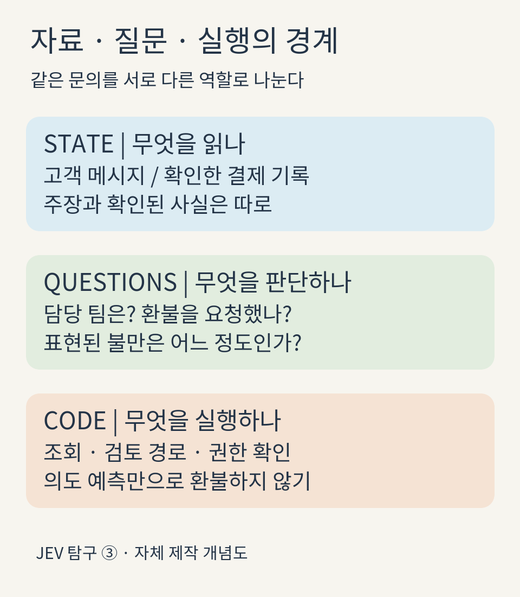
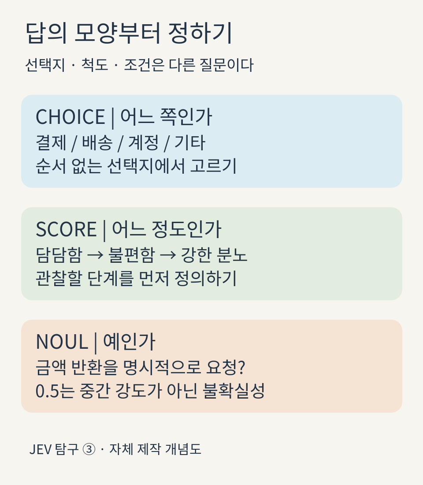
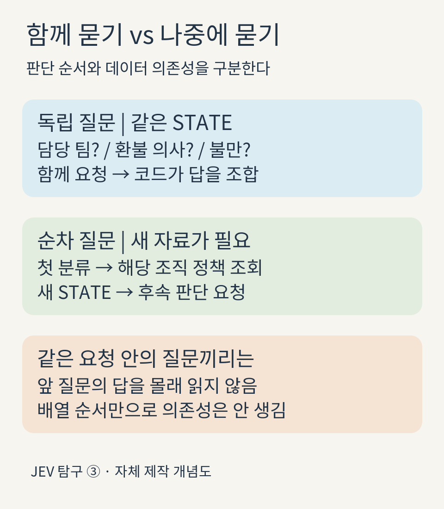
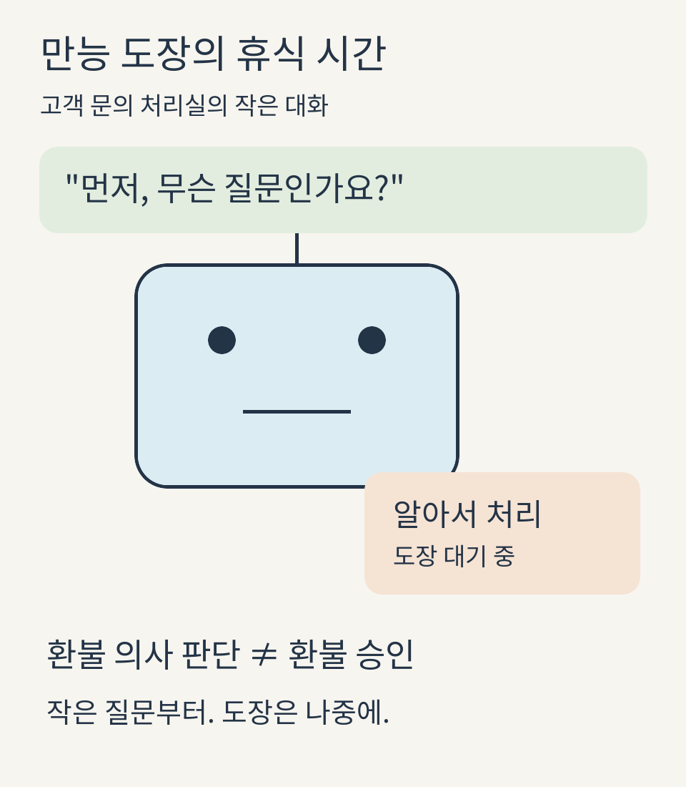

<nav id="jev-series-nav" aria-label="JEV 탐구 연재 nav">
  <p><strong>JEV 탐구 · 7편 읽는 순서</strong></p>
  <ol>
    <li><a href="/posts/jev-system-1-vs-system-2/">JEV 탐구 ① — System 1 vs System 2: AI는 언제 깊이 생각해야 할까?</a></li>
    <li><a href="/posts/jev-structure-vs-llm/">JEV 탐구 ② — 문장 대신 판단을 반환하는 AI: JEV는 LLM과 무엇이 다를까?</a></li>
    <li><strong aria-current="page">JEV 탐구 ③ — ‘알아서 처리해줘’를 작은 질문으로 바꾸는 법</strong></li>
    <li><a href="/posts/jev-strengths-limits-trust/">JEV 탐구 ④ — 빠른 판단은 어디까지 믿어도 될까?</a></li>
    <li><a href="/posts/jev-alternatives-comparison/">JEV 탐구 ⑤ — 꼭 JEV여야 할까? 같은 문제를 푸는 다른 선택지들</a></li>
    <li><a href="/posts/jev-public-performance-evidence/">JEV 탐구 ⑥ — 정말 빠르고 경제적일까? 공개 성능 주장의 근거를 따져보다</a></li>
    <li><a href="/posts/jev-adoption-system-design/">JEV 탐구 ⑦ — 그래서, 우리 서비스에 JEV를 넣어야 할까?</a></li>
  </ol>
  <p><a href="/posts/jev-structure-vs-llm/">← 이전 편</a> · <a href="/posts/jev-strengths-limits-trust/">다음 편 →</a></p>
</nav>

고객이 "두 번 결제됐어요. 하나는 환불해주세요"라고 썼다. 담당자를 정하고, 환불 의사를 파악하고, 실제 결제 내역을 확인한 뒤 돈을 돌려주는 일까지 한 문장에 들어 있다. 사람에게는 익숙한 업무지만, 모델에 "알아서 처리해줘"라고 맡기면 어디까지가 문장 해석이고 어디부터가 권한 행사인지 흐려진다.

JEV를 써서 이 업무를 설계한다면 첫 작업은 프롬프트를 길게 쓰는 것이 아니다. 판단할 자료와 질문을 나누고, 답을 받은 뒤 코드가 할 일을 정하는 것이다. TypeSafe의 설계 문서도 제어 흐름·결정적 규칙·외부 효과는 코드에 두고, 모델에는 좁고 구조화된 판단을 맡기라고 권한다.<a href="#source-6">[6]</a>

이 글의 고객 문의, 업무 규칙과 예제 응답은 모두 설명용으로 만든 **synthetic(합성) 예시**다. 실제 고객 정보가 아니며 JEV API를 호출하지 않았다. 아래 숫자는 성능 측정값이나 이 한국어 문장에 대한 실제 예측값이 아니다.

## 자료와 질문을 서로 다른 칸에 넣는다

이번 문의는 이렇게 고정하자.

> "주문 A-104가 두 번 결제됐어요. 중복된 금액을 환불해주세요."

`State`에는 평가할 내용과 참고 사실을 넣는다. 공식 문서는 문자열뿐 아니라 JSON 객체와 배열을 허용하며, 관련 자료를 이름 있는 필드로 묶을 것을 권한다.<a href="#source-2">[2]</a> 여기서는 고객 메시지를 `ticket.message`에, 내부 시스템이 조회한 결제 내역을 `order.charges`에, 적용할 규정을 `refund_policy`에 둔다. "고객이 두 번 결제됐다고 주장했다"와 "서버에서 두 번의 매입을 확인했다"는 서로 다른 사실이므로 같은 문장으로 뭉개지 않는다.

`Questions`는 그 자료에 대해 무엇을 판단할지 적는 곳이다. "환불을 명시적으로 요청했는가?"와 "메시지에 표현된 불만은 어느 정도인가?"는 질문이다. 주문 번호의 존재 여부나 이미 환불된 거래인지는 구조화된 데이터가 있다면 코드로 확인할 수 있다. 굳이 모델에게 숫자를 세게 할 이유가 없다. 결정적인 작업을 코드에 남긴다는 문서의 원칙을 이 사례에 적용한 설계다.<a href="#source-6">[6]</a>

<figure>
  
  <figcaption>그림 1. 고객의 말, 판단 질문, 실행 권한을 분리한다. 자체 제작, <a href="https://creativecommons.org/licenses/by/4.0/">CC BY 4.0</a>. <a href="/assets/img/posts/jev-designing-small-questions/01-state-questions.png">원본</a></figcaption>
</figure>

질문은 필드까지 가리키면 더 분명해진다. "환불 요청인가?"보다 "`ticket.message`에서 고객이 금액 반환을 명시적으로 요청하는가?"가 낫다. 공식 문서도 백틱으로 감싼 경로를 사용해 특정 필드를 지목하는 방법을 안내한다.<a href="#source-1">[1]</a> 질문 ID를 `refund_requested`라고 잘 지었다고 설명을 생략해서는 안 된다. ID는 응답을 찾는 코드용 키이고 모델에는 전달되지 않는다고 문서에 명시돼 있다.<a href="#source-1">[1]</a>

## Choice는 갈림길, Score는 척도, Noul은 조건

담당 팀을 고르는 일에는 Choice가 맞는다. 순서가 없는 선택지 중 하나를 고르고, 응답에는 선택된 `choice`, 각 선택지의 `probabilities`, `confidence`가 포함된다.<a href="#source-3">[3]</a> 우리 예시의 선택지는 `billing`, `delivery`, `account`, `other`다. 설명에는 각각 결제·환불, 배송, 계정 접근, 그 밖의 문의를 적는다.

여기서 `billing`을 "돈과 관련된 모든 것", `account`를 "구독 계정과 관련된 모든 것"으로 정의하면 구독료 문의가 겹친다. 이 글에서는 계정 접근 문제와 청구 문제의 경계를 적고, "복수 주제면 고객의 주된 해결 요청을 기준으로 고른다"는 규칙을 추가한다. 목록에 안 맞는 입력을 받을 수 있다면 `other`를 두라는 권고도 공식 문서에 있다.<a href="#source-1">[1]</a> 단, 기타 분류와 낮은 확신은 다르다. 명백히 다른 주제인 문의는 자신 있게 `other`일 수 있고, 결제인지 계정인지 헷갈리는 문의는 별도 검토로 보내야 한다.

Score는 순서가 있는 단계에 쓴다. 예를 들어 메시지에 드러난 불만을 "0: 담담한 문의 / 1: 불편을 표현하되 정중함 / 2: 강한 분노나 이탈 의사 표현"으로 정의한다. Score의 `criteria`는 낮은 단계부터 높은 단계까지의 배열이며 번호는 0부터 시작한다. 반환 점수는 단계 사이의 값일 수도 있다.<a href="#source-4">[4]</a> 이 척도는 사건의 금전적 규모가 아니라 표현된 불만을 재려는 것이다. 조용히 쓴 고객의 큰 피해를 낮은 업무 우선순위로 취급하지 않도록, 피해 규모와 감정은 따로 다뤄야 한다.

Noul은 "금액 반환을 명시적으로 요청했는가?"처럼 예·아니요로 정의할 수 있는 조건에 쓴다. 반환하는 `noul`은 예일 확률을 나타내는 0~1의 값이다.<a href="#source-5">[5]</a> "불만이 있는가?"라는 질문에 0.5가 나왔다고 해서 불만의 세기가 절반이라는 뜻은 아니다. 문서는 0.5 부근을 예와 아니요에 비슷한 확률을 부여한 상태로 설명하며, 정도를 재려면 단계가 정의된 Score를 사용하라고 구분한다.<a href="#source-1">[1]</a><a href="#source-5">[5]</a>

<figure>
  
  <figcaption>그림 2. 선택지·척도·조건을 먼저 정하면 질문 타입을 고르기 쉽다. 자체 제작, <a href="https://creativecommons.org/licenses/by/4.0/">CC BY 4.0</a>. <a href="/assets/img/posts/jev-designing-small-questions/02-three-types.png">원본</a></figcaption>
</figure>

Score의 숫자도 단독으로 보면 놓치는 것이 있다. 세 단계의 확률이 합성 예시 A에서는 `[0, 1, 0]`, B에서는 `[0.5, 0, 0.5]`라고 하자. 단계 번호에 확률을 곱해 더하는 문서의 계산법으로는 둘 다 점수가 1이다.<a href="#source-4">[4]</a> A는 가운데 단계에 몰려 있지만 B는 양끝으로 갈렸다. 두 분포의 가중합이 모두 1이라는 계산은 로컬 Python으로 확인했다. 실제 모델 출력이 아니라, 같은 평균이 서로 다른 분포를 숨길 수 있다는 산술 예다. 점수만 저장하지 않고 단계 정의와 분포도 함께 남기자는 이유다.

## 짧은 코드에도 판단 경계를 적는다

다음은 SDK 실행 코드가 아니라 요청 내용을 설명하는 Python 딕셔너리다. 문서의 `state`, `questions`, `type`, `instructions`, `criteria` 형태를 따른다.<a href="#source-1">[1]</a><a href="#source-2">[2]</a> 인증, 네트워크 호출, 환불 실행은 포함하지 않았다.

```python
# Synthetic request design; no API call.
state = {"ticket": {"message":
    "주문 A-104가 두 번 결제됐어요. 중복된 금액을 환불해주세요."}}
questions = {
    "team": {
        "type": "choice",
        "instructions": "`ticket.message`의 주된 요청을 맡을 팀은?",
        "criteria": {
            "billing": "결제, 청구, 환불",
            "delivery": "배송 상태와 배송 사고",
            "account": "로그인과 계정 접근",
            "other": "앞의 범주에 해당하지 않는 문의",
        },
    },
    "refund_requested": {
        "type": "noul",
        "instructions": "`ticket.message`는 금액 반환을 명시적으로 요청하는가?",
        "criteria": {"true": "돈을 돌려달라는 요청",
                     "false": "결제 불만이나 확인 요청만 있고 반환 요구는 없음"},
    },
    "frustration": {
        "type": "score",
        "instructions": "`ticket.message`에 표현된 불만의 정도는?",
        "criteria": ["담담한 문의", "불편을 표현하되 정중함",
                     "강한 분노나 이탈 의사 표현"],
    },
}
```

이 예시에는 결제 기록을 일부러 넣지 않았다. 세 질문 모두 메시지 해석만 필요하기 때문이다. 조회하지 않은 사실을 채워 넣으면 모델이 그 빈칸을 확인해 주는 것처럼 착각하기 쉽다. 정책과 거래 사실을 비교하는 별도 판단이 필요할 때는 실제로 확보한 자료만 State에 추가한다.

설명용 합성 응답에서 `team.choice = "billing"`, `refund_requested.noul = 0.92`라고 놓아 보자. 이 두 값으로 말할 수 있는 것은 "결제 담당에게 전달할 신호가 있다", "환불 의사를 긍정적으로 판단한 값이다"까지다. 이 숫자를 실제 정확도 92%로 읽거나, 중복 청구가 확인됐다고 해석하거나, 환불 승인으로 바꾸면 안 된다. 이 예시의 다음 단계는 검토 큐에 보내는 것이다. 결제 식별자, 실제 매입·취소 상태, 기존 환불 여부와 실행 권한은 다른 절차에서 확인한다. 이는 모델의 기능 설명이 아니라 이 글에서 제안하는 업무 경계다.

## 같은 요청에 넣어도 앞 답을 읽지는 않는다

공식 문서에 따르면 한 요청의 질문들은 같은 State를 보지만 각각 독립적으로 평가된다. 앞 질문의 답이 뒤 질문의 숨은 문맥이 되지 않는다.<a href="#source-1">[1]</a> 따라서 위 코드에서 `team` 다음에 `refund_requested`를 썼다고 해서 "결제 팀이라고 답한 경우에만 환불 여부를 판단하라"는 순서가 생기지 않는다. 같은 메시지로 답할 수 있는 질문은 함께 묻고, 어떤 답을 사용할지는 코드가 정한다.

이때 독립이라는 말은 입력과 평가 흐름에 관한 설명이다. 서로 관련된 업무 신호의 확률을 곱해도 된다는 통계적 독립성 보장으로 확대해서 읽지 않는다. "환불 요청"과 "결제 문의"는 업무상 겹칠 수 있다. 두 답을 합치는 규칙은 별도로 설계해야 한다.

순차 요청이 필요한 경우도 있다. 첫 분류 결과로 담당 조직을 정한 뒤 그 조직만의 최신 정책을 조회해야 한다면, 두 번째 요청은 처음에 없던 정책 자료를 받는다. 또는 첫 선택이 다음 질문의 선택지를 정할 수도 있다. 문서도 앞 답이 추가 자료 조회, State 구성, 다음 선택지 결정에 필요할 때 두 번째 요청을 만들라고 구분한다.<a href="#source-1">[1]</a> 단지 코드에서 먼저 처리한다는 이유만으로 모델 호출까지 줄 세울 필요는 없다.

<figure>
  
  <figcaption>그림 3. 순서는 질문 개수가 아니라 새 정보에 대한 의존성으로 정한다. 자체 제작, <a href="https://creativecommons.org/licenses/by/4.0/">CC BY 4.0</a>. <a href="/assets/img/posts/jev-designing-small-questions/03-independent-dependent.png">원본</a></figcaption>
</figure>

## 애매한 문의를 넣어 보면 질문의 빈틈이 보인다

같은 중복결제 상황에 반례를 넣자.

> "카드 앱에 두 줄이 떠요. 하나는 승인 대기인 것 같기도 해요. 확인해 주실 수 있나요?"

이 합성 문장도 결제 담당이 읽을 만하다. 하지만 금액 반환을 명시적으로 요청한 것은 아니며, 실제 중복 매입 여부도 알 수 없다. 여기서는 숫자 응답을 만들어 붙이지 않는다. 설계자가 기대하는 처리는 '결제 내역 확인'이고, 환불 요청으로 단정하거나 곧바로 환불하는 처리는 막아야 한다.

"불만이 크고 환불을 원하며 정책상 가능한가?"를 한 Noul로 물었다면 어느 부분에서 막혔는지 알기 어렵다. 공식 문서도 두 조건이 있는 질문을 각각의 Noul로 나누고 코드에서 결합하라고 권한다.<a href="#source-5">[5]</a> 이 반례로 질문을 고치면 '명시적인 반환 요구', '메시지의 불만', '거래 기록의 확인 상태'가 따로 보인다. 정보가 없다는 상태도 낮은 확률 하나로 대신하지 말고, 데이터 누락 플래그와 확인 절차로 표현하자.

<figure>
  
  <figcaption>그림 4. "알아서 처리" 도장은 잠시 내려놓고 질문부터 정한다. 자체 제작, <a href="https://creativecommons.org/licenses/by/4.0/">CC BY 4.0</a>. <a href="/assets/img/posts/jev-designing-small-questions/04-small-question-humor.png">원본</a></figcaption>
</figure>

검토할 때는 정상 문의 하나만 보지 않는다. "환불하지 말고 이유만 알려주세요", "지난번 환불은 받았고 이번엔 배송이 늦어요"도 넣어 본다. 부정 표현과 과거 사건을 현재 요청으로 오독하는지 확인하는 데 쓸 수 있는 합성 테스트 문장이다. 문서가 한국어 입력을 허용한다고 해서 이 예시의 품질까지 검증된 것은 아니다. 직접 확인한 Models 문서는 주된 학습 언어가 영어이고 CJK를 포함한 다른 언어는 같은 수준이 아니라고 안내한다.<a href="#source-7">[7]</a> 실제 도입 전에는 팀이 사용하는 한국어 문의와 경계 사례로 별도 평가해야 한다.

이번 편에서 만든 결과물은 자동 환불기가 아니라, 어떤 판단을 어디서 하는지 설명할 수 있는 문의 처리 설계다. 각 질문 옆에 입력 필드, 선택지나 단계, 애매할 때의 처리, 답을 사용할 코드를 적어 보자. 한 칸에 서로 다른 판단이 계속 붙는다면 더 나눌 여지가 있다. 다음 편에서는 이렇게 얻은 확률과 confidence를 어디까지 믿을지 다룬다.

<nav id="jev-series-bottom" aria-label="JEV 탐구 연재 bottom">
  <p><strong>JEV 탐구 · 7편 읽는 순서</strong></p>
  <ol>
    <li><a href="/posts/jev-system-1-vs-system-2/">JEV 탐구 ① — System 1 vs System 2: AI는 언제 깊이 생각해야 할까?</a></li>
    <li><a href="/posts/jev-structure-vs-llm/">JEV 탐구 ② — 문장 대신 판단을 반환하는 AI: JEV는 LLM과 무엇이 다를까?</a></li>
    <li><strong aria-current="page">JEV 탐구 ③ — ‘알아서 처리해줘’를 작은 질문으로 바꾸는 법</strong></li>
    <li><a href="/posts/jev-strengths-limits-trust/">JEV 탐구 ④ — 빠른 판단은 어디까지 믿어도 될까?</a></li>
    <li><a href="/posts/jev-alternatives-comparison/">JEV 탐구 ⑤ — 꼭 JEV여야 할까? 같은 문제를 푸는 다른 선택지들</a></li>
    <li><a href="/posts/jev-public-performance-evidence/">JEV 탐구 ⑥ — 정말 빠르고 경제적일까? 공개 성능 주장의 근거를 따져보다</a></li>
    <li><a href="/posts/jev-adoption-system-design/">JEV 탐구 ⑦ — 그래서, 우리 서비스에 JEV를 넣어야 할까?</a></li>
  </ol>
  <p><a href="/posts/jev-structure-vs-llm/">← 이전 편</a> · <a href="/posts/jev-strengths-limits-trust/">다음 편 →</a></p>
</nav>

## Sources

[1] <span id="source-1" style="display:inline-block;scroll-margin-top:6rem;"></span> <a href="https://docs.typesafe.ai/primitives.md">Primitives (Questions)</a>

[2] <span id="source-2" style="display:inline-block;scroll-margin-top:6rem;"></span> <a href="https://docs.typesafe.ai/concepts/state.md">State</a>

[3] <span id="source-3" style="display:inline-block;scroll-margin-top:6rem;"></span> <a href="https://docs.typesafe.ai/primitives/choice.md">Choice</a>

[4] <span id="source-4" style="display:inline-block;scroll-margin-top:6rem;"></span> <a href="https://docs.typesafe.ai/primitives/score.md">Score</a>

[5] <span id="source-5" style="display:inline-block;scroll-margin-top:6rem;"></span> <a href="https://docs.typesafe.ai/primitives/noul.md">Noul</a>

[6] <span id="source-6" style="display:inline-block;scroll-margin-top:6rem;"></span> <a href="https://docs.typesafe.ai/concepts/how-to-build-with-system-one.md">How to build with TypeSafe</a>

[7] <span id="source-7" style="display:inline-block;scroll-margin-top:6rem;"></span> <a href="https://docs.typesafe.ai/models.md">TypeSafe · Models</a>
