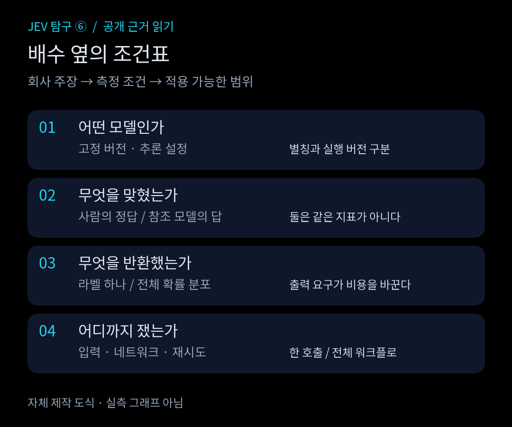
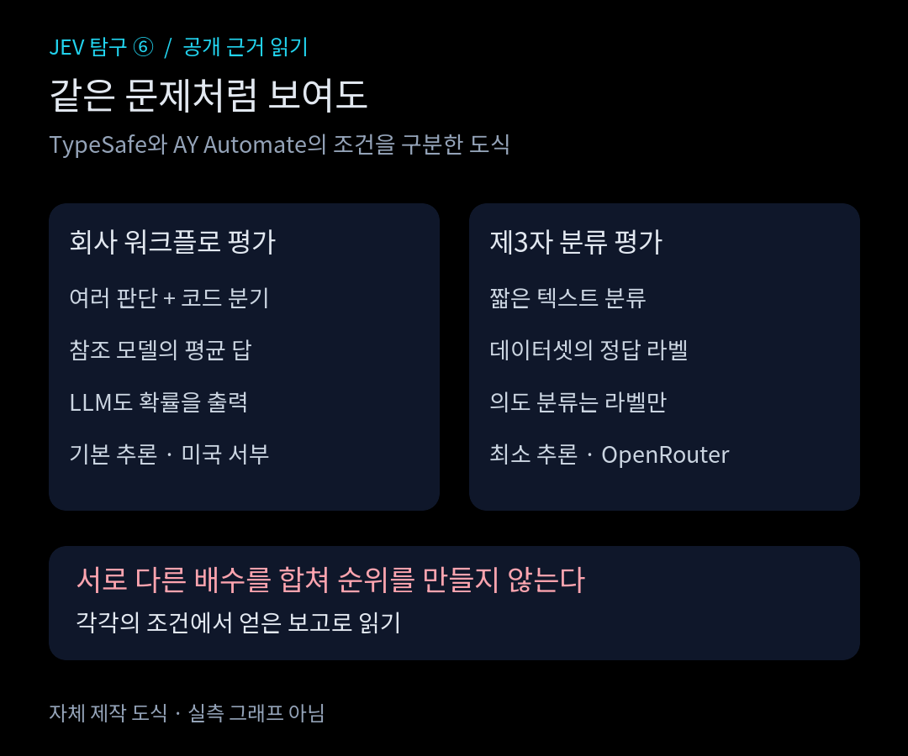
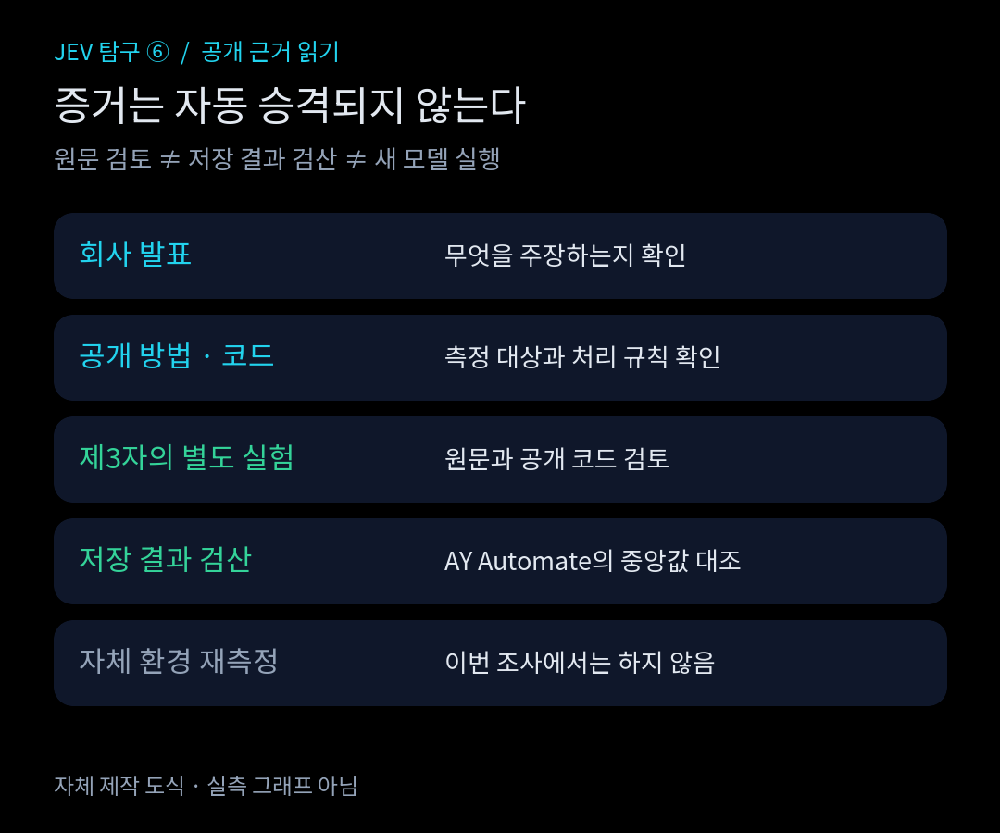
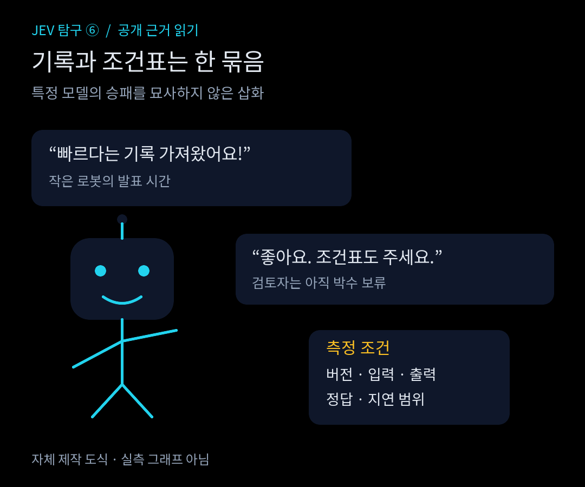

<strong>난이도: 중급</strong>

<nav id="jev-series-nav" aria-label="JEV 9편 연재 목차">
<strong>JEV 탐구 · 9편 읽는 순서</strong>
<ol>
<li><a href="/posts/jev-system-1-vs-system-2/">1. System 1과 역할 분담</a></li>
<li><a href="/posts/jev-structure-vs-llm/">2. 입출력과 LLM의 차이</a></li>
<li><a href="/posts/jev-type-safety-parallel-processing/">3. 타입 안전과 병렬 처리</a></li>
<li><a href="/posts/jev-designing-small-questions/">4. 작은 질문 설계</a></li>
<li><a href="/posts/jev-overconfidence-calibration/">5. 과신과 확률 보정</a></li>
<li><a href="/posts/jev-strengths-limits-trust/">6. 강점과 한계</a></li>
<li><a href="/posts/jev-alternatives-comparison/">7. 다른 선택지</a></li>
<li><strong aria-current="page">8. 공개 성능 근거</strong></li>
<li><a href="/posts/jev-adoption-system-design/">9. 조건부 도입</a></li>
</ol>
<a href="/posts/jev-alternatives-comparison/">← 7편</a> · <a href="/posts/jev-adoption-system-design/">9편 →</a>
</nav>

Jev를 소개하는 숫자는 눈길을 끈다. TypeSafe는 홈페이지의 **193.6배 빠르고 444.6배 저렴하다**는 주장이 자사 워크플로 평가에서 나왔으며, 실제 환경에서 얻을 이득의 높은 쪽에 해당할 것으로 예상한다고 설명한다.<a href="#source-1">[1]</a> 이 단서를 떼어내면 특정 실험의 결과가 모든 서비스에 적용되는 약속으로 바뀐다.

이번 편은 API를 호출해 얻은 벤치마크가 아니다. 공개 발표, 평가 설명, 제3자의 원문과 코드·저장 결과를 읽은 조사다. 확인 시점은 2026년 11월 2일이다. 결론부터 말하면, 회사 밖의 별도 평가가 실제로 공개돼 있다. 다만 그것들이 TypeSafe의 네 워크플로와 광고 배수를 그대로 재현한 것은 아니다.<a href="#source-4">[4]</a><a href="#source-5">[5]</a><a href="#source-6">[6]</a>

## 큰 배수 앞에 붙어야 할 조건

TypeSafe의 평가 사이트는 보안 사고, 에이전트 실행 기록 관찰, 송장 처리, 고객 서비스의 네 워크플로를 제시한다. 그래프의 각 점은 한 모델 설정의 정확도·비용·시간을 네 과제에 같은 가중치로 평균한 값이다. 비교 모델은 제공사의 기본 추론 설정을 사용한다.<a href="#source-2">[2]</a> 따라서 이 그림을 짧은 분류 요청 하나의 응답 시간표로 읽으면 안 된다.

더 중요한 것은 정답의 출처다. 사이트는 코드가 올바르다고 가정한 뒤, GPT-6 Astra와 Claude Fable 5.1을 모두 high thinking으로 실행한 응답의 평균을 참조 라벨로 사용한다고 밝힌다.<a href="#source-2">[2]</a> 이때의 정확도는 사람이 확정한 업무 정답과의 일치율이 아니라 **참조 모델로 만든 답과의 일치 정도**다. 모델들이 같은 오해를 하면 서로 동의하면서도 실제 업무에서는 틀릴 수 있다.

평가를 무가치하다고 볼 이유는 없다. 같은 코드에 여러 모델을 끼워 넣었을 때 판단이 얼마나 달라지는지 볼 수 있기 때문이다. 다만 사람이 검토한 정답 데이터로 얻은 정확도와 같은 표에 합쳐 순위를 매기기는 어렵다. TypeSafe도 워크플로를 자사 모델 역량 팀이 만들었으므로 편향이 있을 수 있다고 명시한다.<a href="#source-1">[1]</a>

<figure>
  
  <figcaption>그림 1. 숫자보다 먼저 읽을 조건. 자체 제작 도식이며 실측 그래프가 아니다. 근거: TypeSafe 발표·평가 설명.<a href="#source-1">[1]</a><a href="#source-2">[2]</a> <a href="/assets/img/posts/jev-public-performance-evidence/01-claim-check.svg">SVG 원본</a> · <a href="/assets/img/posts/jev-public-performance-evidence/01-claim-check.png">PNG 크게 보기</a> · <a href="https://creativecommons.org/licenses/by/4.0/">CC BY 4.0</a></figcaption>
</figure>

193.6배와 444.6배는 이 조건을 붙인 **회사 주장**으로만 인용한다. 이번에 확보한 평가 페이지의 텍스트만으로는 해당 배수의 비교 상대, 고정 모델 ID, 개별 실행값을 완전히 대조하지 못했다. 그러므로 이 글은 두 배수를 독자적으로 재계산했다고 말하지 않는다. 직접 확인한 현재 문서의 모델 `jev-1.14.0`을 과거 평가의 실행 버전으로 소급해서 채워 넣지도 않는다.<a href="#source-1">[1]</a><a href="#source-3">[3]</a>

## LLM에 무엇을 쓰게 했는가

TypeSafe는 LLM이 자사 API와 호환되는 구조화된 결정을 내도록 System One Adapter를 사용했다고 설명한다. 확률 없이 결정만 받는 방식보다 느리고 비싸지는 경향도 인정한다.<a href="#source-1">[1]</a> 공개 저장소에는 확률 분포를 요청하는 `probabilities`와 값만 요청하는 `discrete` 모드, 구조화 출력, 확률 정규화, 재시도 옵션이 있다.<a href="#source-7">[7]</a> 코드가 있다는 사실은 비교 방식을 살필 수 있게 하지만, 특정 평가 실행의 모든 설정까지 입증하지는 않는다.

예컨대 중복 청구 문의를 상담팀으로 보낼지 결정하는 코드라면 라벨 하나만 필요할 수 있다. 반대로 여러 가능성의 확률을 조합해 보류·추가 질문·상담원 연결을 결정한다면 확률 분포 자체가 산출물이다. 두 경우는 LLM에 요구하는 일이 다르다. 모든 라벨의 확률을 생성한 LLM과 라벨 하나만 반환한 LLM의 비용을 같은 작업의 가격으로 취급하지 말아야 한다.

입력과 네트워크도 빠질 수 없다. 회사는 나란히 보여준 데모가 짧고 조밀한 입력이라 Jev에 유리하다고 썼고, 공개 평가는 서비스가 위치한 미국 서부의 노트북에서 대체로 실행했다고 밝혔다. 데모의 GPT-5.6 Terra는 기본 추론 설정이었다.<a href="#source-1">[1]</a> 이 조건을 한국 리전의 긴 고객 대화, 재시도와 데이터 조회가 포함된 처리 시간에 그대로 옮길 수는 없다.

<figure>
  
  <figcaption>그림 2. 서로 다른 실험은 따로 읽는다. 막대 길이와 순위로 성능을 꾸미지 않은 자체 제작 도식.<a href="#source-1">[1]</a><a href="#source-6">[6]</a><a href="#source-8">[8]</a> <a href="/assets/img/posts/jev-public-performance-evidence/02-comparison-traps.svg">SVG 원본</a> · <a href="/assets/img/posts/jev-public-performance-evidence/02-comparison-traps.png">PNG 크게 보기</a> · <a href="https://creativecommons.org/licenses/by/4.0/">CC BY 4.0</a></figcaption>
</figure>

## 독립 평가는 검색 결과가 아니라 원문에서 확인했다

“Jev typesafe independent benchmark reproduction”과 “Jev benchmark github latency evaluation”을 각각 검색하고, AY Automate의 글, PavelRavvich의 `jev-bench`, ejs-5의 `jev-benchmark` 원문을 열었다. 여기서 독립이라는 말은 **제조사와 다른 게시자가 별도 실험을 공개했다**는 뜻이다. 자금 관계까지 감사했다거나, 내가 그 실험을 다시 실행했다는 뜻은 아니다.

가장 구체적으로 따라가 본 자료는 AY Automate다. 이들은 Banking77의 8개 의도 분류 160건, 전체 77개 의도 분류 231건, 프롬프트 주입 탐지 400건을 평가했다고 보고한다. Jev 1.13과 GPT-5.4 nano, Gemini 3.5 Flash-Lite, Claude Haiku 4.5, GPT-5.6 Terra를 OpenRouter로 호출했다. LLM은 temperature 0, 최소 추론, 엄격한 JSON 스키마를 사용했고, 한 노트북에서 시스템별 네 요청을 병렬로 보냈다.<a href="#source-6">[6]</a>

여기서는 회사 워크플로 평가와 다른 요구가 드러난다. 공개 코드를 읽으면 의도 분류의 LLM 출력은 `label` 하나다. 주입 탐지는 참·거짓과 확률을 받는다. 모든 의도에 대한 확률 분포를 쓰게 한 비교가 아니다.<a href="#source-8">[8]</a> 작은 모델에 유리한 조건이라고 무시할 일이 아니라, 실제로 라벨 하나만 필요한 서비스라면 살펴볼 만한 조건이다.

글이 보고한 전체 과제의 중앙 응답 시간은 Jev 0.33초, GPT-5.6 Terra 1.17초다.<a href="#source-6">[6]</a> 저장된 호출 결과 3,955행을 내려받아 성공 응답의 중앙값을 다시 집계했으며, 반올림하면 이 수치와 일치했다.<a href="#source-12">[12]</a> 이는 **타인의 저장 결과 검산**이지 새 모델 측정이 아니다. 저장 파일에는 Jev의 응답 모델 ID `typesafe/jev-1.13-20260917`도 남아 있다.<a href="#source-12">[12]</a>

작은 숫자 옆에도 단서가 있다. 코드의 타이머는 재시도마다 다시 시작하므로 반환된 지연에는 앞선 실패와 대기 시간이 포함되지 않는다. 저장 결과에는 재시도 기록도 있다.<a href="#source-8">[8]</a><a href="#source-12">[12]</a> 그러므로 이 값을 실패 복구까지 포함한 사용자 대기 시간으로 소개하면 과장이다. API 중계 경로와 동시 실행 조건도 회사 평가와 다르다.

정확도 역시 한 줄 우승표로 줄이기 어렵다. AY Automate는 77개 의도 분류의 전체 231건 기준 Jev 정확도를 78.8%로 보고하지만, 모든 호출이 성공한 230건을 쓰는 후속 비교에서는 79.1%를 제시한다.<a href="#source-6">[6]</a><a href="#source-10">[10]</a> 모순이라기보다 분모 차이다. 이 차이를 지운 채 좋은 쪽 숫자만 고르면 원문의 의미가 바뀐다.

## 재현 가능한 코드도 검토 대상이다

PavelRavvich는 SMS Spam과 Banking77에서 정답 라벨을 이용한 별도 평가를 공개했다. Jev와 GPT-6 Luna는 과제별 500건, GPT-6 Astra와의 비교는 공통 130건을 사용한다. 이스라엘에서 순차 요청을 보냈고, LLM의 확신도는 텍스트로 답하게 했으며, frontier 모델에는 최소 추론을 사용했다고 명시한다.<a href="#source-4">[4]</a> 읽어 본 코드에서는 요청 오류가 나면 해당 항목을 건너뛴다.<a href="#source-9">[9]</a> 실패를 오답으로 세는 평가와는 분모가 달라질 수 있다.

ejs-5는 n8n 커밋에서 패키지 경로, 커밋 접두사, 변경 줄 수, 특정 설정 파일 변경 여부로 라벨을 만든 평가를 공개했다. 이전 비공개 저장소에서 제시했던 큰 성능 격차가 공개 저장소에서는 그대로 재현되지 않았다고 스스로 정정했다.<a href="#source-5">[5]</a> 이 정정은 “항상 그렇다”는 설명보다 유용하다. 입력 문체와 과제 구성이 바뀌면 결론도 달라질 수 있음을 드러내기 때문이다.

다만 여기서도 라벨을 만드는 규칙을 읽어야 한다. 설정 파일 변경 여부로 만든 위험 라벨은 실제 장애 발생 기록이 아니다.<a href="#source-5">[5]</a> 모델 생성 라벨을 벗어났다고 곧바로 업무의 진실이 되는 것은 아니다. 이런 이유로 세 평가의 수치를 합산해 Jev의 종합 순위를 만들지 않았다.

<figure>
  
  <figcaption>그림 3. 이번 조사는 공개 방법·제3자 실험과 일부 저장 결과 검산까지 진행했다. 자체 환경 재측정은 하지 않았다. 각 단계는 서로 다른 증거이며 자동 승격되지 않는다. <a href="/assets/img/posts/jev-public-performance-evidence/03-evidence-ladder.svg">SVG 원본</a> · <a href="/assets/img/posts/jev-public-performance-evidence/03-evidence-ladder.png">PNG 크게 보기</a> · <a href="https://creativecommons.org/licenses/by/4.0/">CC BY 4.0</a></figcaption>
</figure>

검색 결과에 나온 다른 저장소와 기사 전체를 검토한 것은 아니다. 이번 범위에서 제조사 밖의 평가가 존재함은 확인했지만, TypeSafe의 네 워크플로와 광고 배수를 같은 조건으로 다시 실행한 독립 보고서는 확인하지 못했다. “외부 실험이 있다”와 “광고 수치가 독립 재현됐다”를 구분해야 한다.

## 우리 서비스가 물어야 할 다음 질문

현재 TypeSafe 문서는 입력 백만 토큰당 0.042달러, 출력 무료를 안내한다. `jev-latest`와 `jev-preview`는 직접 확인한 현재 본문에서 `jev-1.14.0`을 가리키며, 별칭은 새 릴리스 때 바뀔 수 있다고 설명한다.<a href="#source-3">[3]</a> 이것은 현재 공개 요금과 모델 선택 방식의 근거다. 서비스 전체가 얼마를 절약할지 보여주는 청구서는 아니다.

중복 청구 문의라면 “두 번 빠져나간 것 같다”는 문장만으로 환불을 승인할 수 없다. 결제 원장에 확정 청구가 둘인지, 하나는 승인 대기인지 확인해야 한다. 이 예시는 합성 사례이며 어떤 모델의 실측 출력도 아니다. 분류 모델의 판단과 돈을 돌려줄 권한을 분리한 상태에서, 정상·모호·정보 부족 사례를 함께 평가하는 편이 맞다.

후속 검증 계획에는 고정 모델 버전과 입력 길이, 확률 필요 여부, 정답 작성자, 실패 처리, 요청 리전·동시성, 재시도 포함 지연, 상담원 이관 비용을 적어야 한다. 이번 글에서는 그 계획을 실행하지 않았다. 공개 근거만으로 내릴 결론은 이 정도다. Jev의 빠르고 저렴한 판단이라는 방향을 지지하는 제3자 보고는 있지만, 이득의 크기와 오류 양상은 과제와 비교 설정에 따라 달라졌다.<a href="#source-4">[4]</a><a href="#source-5">[5]</a><a href="#source-6">[6]</a> 도입 판단에는 광고 배수보다 자기 업무에서 무엇을 같은 조건으로 비교할지가 더 필요하다.

<figure>
  
  <figcaption>그림 4. “기록은 알겠고, 조건표도 주세요.” 특정 벤치마크의 승패를 묘사하지 않은 자체 제작 삽화. <a href="/assets/img/posts/jev-public-performance-evidence/04-show-the-conditions.svg">SVG 원본</a> · <a href="/assets/img/posts/jev-public-performance-evidence/04-show-the-conditions.png">PNG 크게 보기</a> · <a href="https://creativecommons.org/licenses/by/4.0/">CC BY 4.0</a></figcaption>
</figure>

<nav id="jev-series-bottom" aria-label="JEV 9편 연재 목차">
<strong>JEV 탐구 · 9편 읽는 순서</strong>
<ol>
<li><a href="/posts/jev-system-1-vs-system-2/">1. System 1과 역할 분담</a></li>
<li><a href="/posts/jev-structure-vs-llm/">2. 입출력과 LLM의 차이</a></li>
<li><a href="/posts/jev-type-safety-parallel-processing/">3. 타입 안전과 병렬 처리</a></li>
<li><a href="/posts/jev-designing-small-questions/">4. 작은 질문 설계</a></li>
<li><a href="/posts/jev-overconfidence-calibration/">5. 과신과 확률 보정</a></li>
<li><a href="/posts/jev-strengths-limits-trust/">6. 강점과 한계</a></li>
<li><a href="/posts/jev-alternatives-comparison/">7. 다른 선택지</a></li>
<li><strong aria-current="page">8. 공개 성능 근거</strong></li>
<li><a href="/posts/jev-adoption-system-design/">9. 조건부 도입</a></li>
</ol>
<a href="/posts/jev-alternatives-comparison/">← 7편</a> · <a href="/posts/jev-adoption-system-design/">9편 →</a>
</nav>

## Sources

[1]  <a href="https://typesafe.ai/blog/introducing-system-one-models-and-jev">Introducing System One Models &amp; Jev - TypeSafe AI Blog</a>

[2]  <a href="https://evals.typesafe.ai">Workflow evals</a>

[3]  <a href="https://docs.typesafe.ai/models.md">TypeSafe Models</a>

[4]  <a href="https://github.com/PavelRavvich/jev-bench">GitHub - PavelRavvich/jev-bench: Independent benchmark of TypeSafe Jev (System One) vs cheap and frontier LLMs: accuracy, calibration, latency, cost</a>

[5]  <a href="https://github.com/ejs-5/jev-benchmark">GitHub - ejs-5/jev-benchmark: An independent benchmark of TypeSafe&#x27;s Jev on 868 real decisions from a public repo, with mechanical (non-model-generated) labels.</a>

[6]  <a href="https://www.ayautomate.com/blog/jev-vs-llm-benchmark">Jev vs GPT and Claude: Independent Benchmark (2026)</a>

[7]  <a href="https://github.com/typesafe-ai/system-one-adapter-python">GitHub - typesafe-ai/system-one-adapter-python: Drop-in TypeSafeClient replacement backed by LLM APIs</a>

[8]  <a href="https://www.ayautomate.com/benchmarks/jev-vs-llm/jev_benchmark.py">AY Automate benchmark harness</a>

[9]  <a href="https://raw.githubusercontent.com/PavelRavvich/jev-bench/main/jev_bench.py">PavelRavvich benchmark harness</a>

[10]  <a href="https://www.ayautomate.com/benchmarks/jev-vs-llm/summary.json">AY Automate published summary</a>

[12]  <a href="https://www.ayautomate.com/benchmarks/jev-vs-llm/results.jsonl">AY Automate published per-call results</a>
