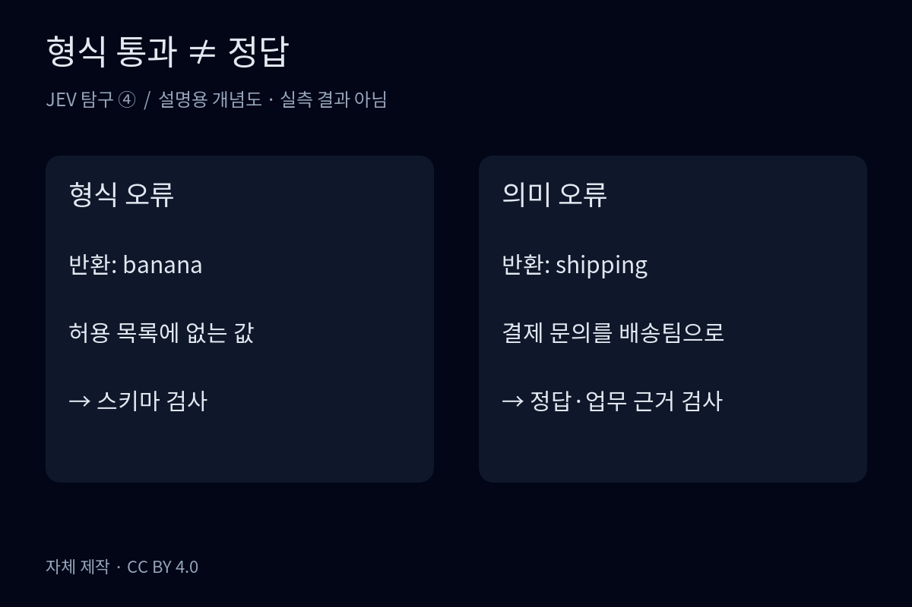
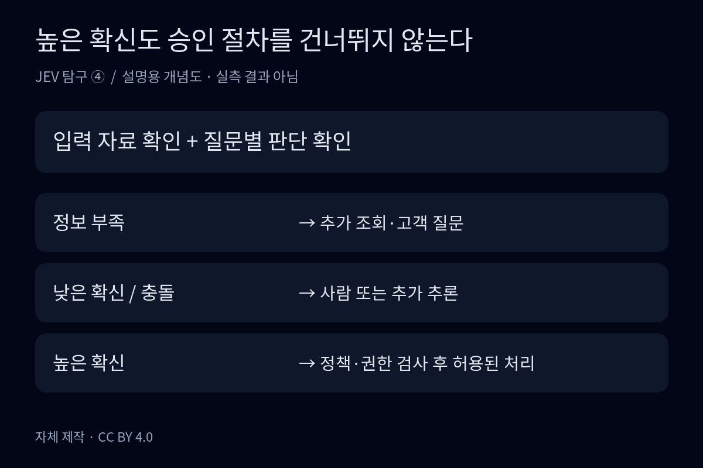
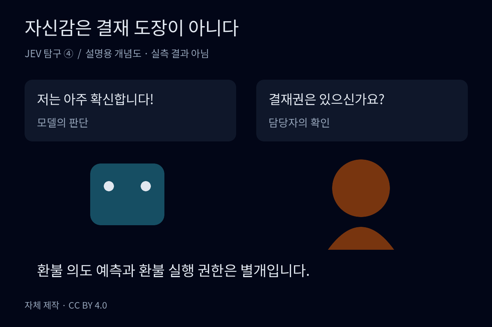

<strong>난이도: 중급</strong>

<nav id="jev-series-nav" aria-label="JEV 9편 연재 목차">
<strong>JEV 탐구 · 9편 읽는 순서</strong>
<ol>
<li><a href="/posts/jev-system-1-vs-system-2/">System 1과 역할 분담</a></li>
<li><a href="/posts/jev-structure-vs-llm/">입출력과 LLM의 차이</a></li>
<li><a href="/posts/jev-type-safety-parallel-processing/">타입 안전과 병렬 처리</a></li>
<li><a href="/posts/jev-designing-small-questions/">작은 질문 설계</a></li>
<li><a href="/posts/jev-overconfidence-calibration/">과신과 확률 보정</a></li>
<li><strong aria-current="page">강점과 한계</strong></li>
<li><a href="/posts/jev-alternatives-comparison/">다른 선택지</a></li>
<li><a href="/posts/jev-public-performance-evidence/">공개 성능 근거</a></li>
<li><a href="/posts/jev-adoption-system-design/">조건부 도입</a></li>
</ol>
<a href="/posts/jev-overconfidence-calibration/">← 5편</a> · <a href="/posts/jev-alternatives-comparison/">7편 →</a>
</nav>

고객이 "같은 주문이 두 번 결제됐어요. 하나는 취소해 주세요"라고 썼다. 문의를 결제 담당에게 보내는 판단과 실제로 돈을 돌려주는 판단 사이에는 꽤 긴 거리가 있다. 앞의 일에는 문장의 뜻을 파악하는 능력이 필요하다. 뒤의 일에는 실제 거래 기록, 이미 처리한 환불, 고객의 권한과 회사 정책이 필요하다. 이 글의 고객 문의는 설명을 위해 만든 가상 사례다. JEV에 호출해 얻은 결과나 실제 고객 기록이 아니다.

JEV를 살펴보면서 눈여겨볼 강점은 바로 앞쪽이다. TypeSafe 문서에 따르면 JEV는 자연어를 읽고, 자유로운 답변 대신 정해진 형태의 판단과 확률을 반환한다. 답장을 쓰거나 판단 이유를 길게 설명하는 모델은 아니다.<a href="#source-1">[1]</a> 따라서 "이 고객을 알아서 도와줘"보다 "어느 팀이 맡아야 하는가", "환불을 명시적으로 요청했는가" 같은 질문이 인터페이스에 잘 맞는다.<a href="#source-5">[5]</a> 판단 결과를 코드에서 다루기 쉽다는 장점은 분명하다. 다만 그 편리함이 정답 보증으로 바뀌는 순간부터 사고가 시작된다.

## JSON이 멀쩡해도 판단은 틀릴 수 있다

결제 문의에 `billing`이라는 값이 왔다고 가정하자. 반환값이 허용된 선택지에 속한다면 코드는 문자열을 다시 해석할 필요 없이 담당팀으로 보낼 수 있다. Choice가 정해진 선택지와 각 선택지의 확률을 반환한다는 것은 문서로 확인되는 기능이다.<a href="#source-8">[8]</a> 그러나 같은 문장을 보고 `shipping`을 골랐더라도 형식은 여전히 정상일 수 있다. 스키마 검증은 "배송팀이라는 값이 허용되는가"를 검사할 뿐, "이 고객을 배송팀으로 보내는 것이 맞는가"를 판정하지 않는다.

<figure>
  
  <figcaption>그림 1. 형식 오류와 의미 오류는 다른 검사 대상이다. 가상 사례를 그린 자체 제작 개념도. <a href="/assets/img/posts/jev-strengths-limits-trust/01-format-meaning.svg">원본 SVG</a> · <a href="https://creativecommons.org/licenses/by/4.0/">CC BY 4.0</a>. · <a href="/assets/img/posts/jev-strengths-limits-trust/01-format-meaning.png">원본 PNG 보기</a></figcaption>
</figure>

이 구분은 JEV를 폄하하려는 말이 아니다. 출력 형태가 제한되면 연결 코드를 단순하게 만들 수 있다. 다만 개발자는 파서 오류를 줄인 성과와 업무 오판을 줄인 성과를 따로 기록해야 한다. 형식 검사 통과율만 보고 "신뢰할 수 있다"고 결론 내리면 가장 중요한 오류가 통계 밖으로 빠진다. 결제팀 분류의 정답은 담당 조직이 붙인 검증 라벨로, 중복 청구 여부는 거래 원장으로 확인하는 식으로 판단마다 근거를 달리 잡아야 한다.

## 한국어, 업무 용어, 긴 입력은 별도 조건이다

현재 Models 문서는 영어가 주된 학습 언어이고 정확도가 가장 좋으며, CJK를 포함한 다른 언어도 처리하지만 동등한 수준은 아니라고 명시한다.<a href="#source-4">[4]</a> 한국어를 입력할 수 있다는 것과 우리 상담 문장의 정확도가 확인됐다는 것은 다르다. "취소는 됐는데 아직 찍혀 있네요"처럼 결제 승인, 매입, 승인 취소가 섞이는 문장은 한국어 능력과 업무 지식 모두를 시험한다. 같은 문의를 영어로 번역해서 성공했다고 한국어 원문에도 성공했다고 기록해서는 안 된다.

문서상 고객별 파인튜닝이나 LoRA 적응은 제공하지 않으며, 같은 가중치에 `state`, 질문 지시문과 판단 기준으로 도메인 내용을 전달한다.<a href="#source-4">[4]</a> 따라서 사내 환불 규정과 예외를 요청에 잘 담는 작업이 중요하다. 그래도 자료가 빠졌거나 규정끼리 충돌하면 분명한 선택지를 만들어 주는 것만으로 해결되지 않는다. 이때의 대안은 자신 있게 답하도록 문구를 고치는 일이 아니라 필요한 사실을 더 조회하는 일이다.

긴 문서도 넣기만 하면 해결되는 조건은 아니다. 조회한 문서에서 Jev 1.14와 1.13의 기본 한도는 요청 전체 64k, 질문별 32k 토큰이다. 질문별 한도에도 state가 포함된다.<a href="#source-4">[4]</a> `TypeSafe-Danger-Zone-Long-Context: true` 헤더로 두 한도를 262k까지 늘릴 수 있지만 기본값은 꺼져 있고, 회사 문서 스스로 기본 한도 안에서 쓸 때보다 느리고 정확도가 낮다고 경고한다.<a href="#source-4">[4]</a> 긴 상담 이력 전체를 무조건 보내기보다 어떤 거래와 어떤 시점의 정책이 필요한지 먼저 좁히는 설계가 낫다는 것이 이 글의 판단이다.

## 애매한 고객에게는 추가 질문이 먼저다

이번에는 고객이 "또 결제된 것 같은데 지난번 건도 아직 보이네요. 확인 좀 해주세요"라고 썼다고 하자. 환불을 명시적으로 요청하지 않았고, 실제 두 번 청구됐는지도 알 수 없다. 단순히 청구 내역을 확인하려는 것일 수 있다. 이 문장에 예측 숫자를 붙여 JEV의 출력처럼 보여 줄 근거는 없다. 대신 애플리케이션이 해야 할 일은 분명하게 정할 수 있다. 관련 주문을 확인하고, 승인 대기와 확정 청구를 구분할 자료를 가져오며, 필요하면 고객에게 어떤 항목을 말하는지 묻는다.

확률이 애매할 때 보류하는 길은 유용하지만, 높은 confidence일 때도 입력 자료의 누락과 처리 권한은 별도로 확인해야 한다. 높은 값은 권한 확인을 생략하라는 지시가 아니다. 공식 문서도 임계값은 업무와 실제 성능에 따라 정하고 자체 데이터로 시험하라고 설명한다.<a href="#source-3">[3]</a> 문서 속 예시 임계값을 결제 시스템의 운영 기준으로 그대로 복사할 이유는 없다.

<figure>
  
  <figcaption>그림 3. 제안하는 검토 분기. 제품에 내장된 환불 정책이나 측정 결과가 아닌 설계 예시다. <a href="/assets/img/posts/jev-strengths-limits-trust/03-review-path.svg">원본 SVG</a> · <a href="https://creativecommons.org/licenses/by/4.0/">CC BY 4.0</a>. · <a href="/assets/img/posts/jev-strengths-limits-trust/03-review-path.png">원본 PNG 보기</a></figcaption>
</figure>

명확한 첫 번째 사례에서는 결제팀 분류까지 자동화할 여지가 있다. 환불 실행은 다른 경로에 둔다. 거래가 실제로 중복인지 코드와 원장으로 확인하고, 이미 환불한 거래가 아닌지 확인하며, 승인 권한을 가진 담당자나 별도로 검증된 정책 절차를 거친다. 사람에게 넘길 때도 "모델이 불확실합니다"만 보여 주면 검토가 어렵다. 원문, 관련 거래, 질문과 선택지, 반환 분포, 실제 모델 버전을 함께 보여 주는 편이 좋다.

<figure>
  
  <figcaption>그림 4. 자신감과 결재권은 다른 칸에 적는다. 가상 캐릭터로 만든 자체 제작 삽화. <a href="/assets/img/posts/jev-strengths-limits-trust/04-confident-clerk.svg">원본 SVG</a> · <a href="https://creativecommons.org/licenses/by/4.0/">CC BY 4.0</a>. · <a href="/assets/img/posts/jev-strengths-limits-trust/04-confident-clerk.png">원본 PNG 보기</a></figcaption>
</figure>

문서에서 `jev-latest`는 현재 `jev-1.14.0`을 가리키지만 별칭은 새 릴리스에 따라 바뀐다. TypeSafe는 임계값을 조정한 버전의 ID를 직접 지정하고 응답의 모델 ID를 기록하라고 안내한다.<a href="#source-4">[4]</a> 검증한 질문과 모델을 고정해야 나중에 오판이 늘었을 때 입력 변화인지 모델 변경인지 조사할 수 있다.

JEV의 강점은 좁은 자연어 판단을 코드가 쓰기 좋은 값으로 연결한다는 데 있다. 지원 범위의 제한도 뚜렷하다. 현재는 텍스트 입력만 받으며 이미지·음성·영상은 지원하지 않고, 설명문이나 답장을 생성하지 않는다.<a href="#source-1">[1]</a> 회사가 내세우는 빠른 판단과 보정 학습은 제품 설명으로 읽되, 우리 서비스의 지연 시간과 오판율은 별도로 확인해야 한다. 이 글은 유료 API를 호출하지 않았고 성능을 측정하지 않았다. 도입의 첫 단계로 추천할 수 있는 것은 환불 자동 실행이 아니라, 사람이 정답을 확인할 수 있는 문의 분류와 검토 보조다. 그 기록을 쌓은 뒤 자동 처리 범위를 넓혀도 늦지 않다.

보강 자료 확인: 2026년 11월 3일(KST). 논문·공식 공개 문서에 근거한 해설이며 새 모델 실측은 수행하지 않았습니다.

<nav id="jev-series-bottom" aria-label="JEV 9편 연재 목차">
<strong>JEV 탐구 · 9편 읽는 순서</strong>
<ol>
<li><a href="/posts/jev-system-1-vs-system-2/">System 1과 역할 분담</a></li>
<li><a href="/posts/jev-structure-vs-llm/">입출력과 LLM의 차이</a></li>
<li><a href="/posts/jev-type-safety-parallel-processing/">타입 안전과 병렬 처리</a></li>
<li><a href="/posts/jev-designing-small-questions/">작은 질문 설계</a></li>
<li><a href="/posts/jev-overconfidence-calibration/">과신과 확률 보정</a></li>
<li><strong aria-current="page">강점과 한계</strong></li>
<li><a href="/posts/jev-alternatives-comparison/">다른 선택지</a></li>
<li><a href="/posts/jev-public-performance-evidence/">공개 성능 근거</a></li>
<li><a href="/posts/jev-adoption-system-design/">조건부 도입</a></li>
</ol>
<a href="/posts/jev-overconfidence-calibration/">← 5편</a> · <a href="/posts/jev-alternatives-comparison/">7편 →</a>
</nav>

## Sources

[1]  <a href="https://docs.typesafe.ai/concepts/system-one.md">System One</a>

[3]  <a href="https://docs.typesafe.ai/confidence.md">Confidence</a>

[4]  <a href="https://docs.typesafe.ai/models.md">Models</a>

[5]  <a href="https://docs.typesafe.ai/primitives.md">Primitives</a>

[8]  <a href="https://docs.typesafe.ai/primitives/choice.md">Choice</a>
