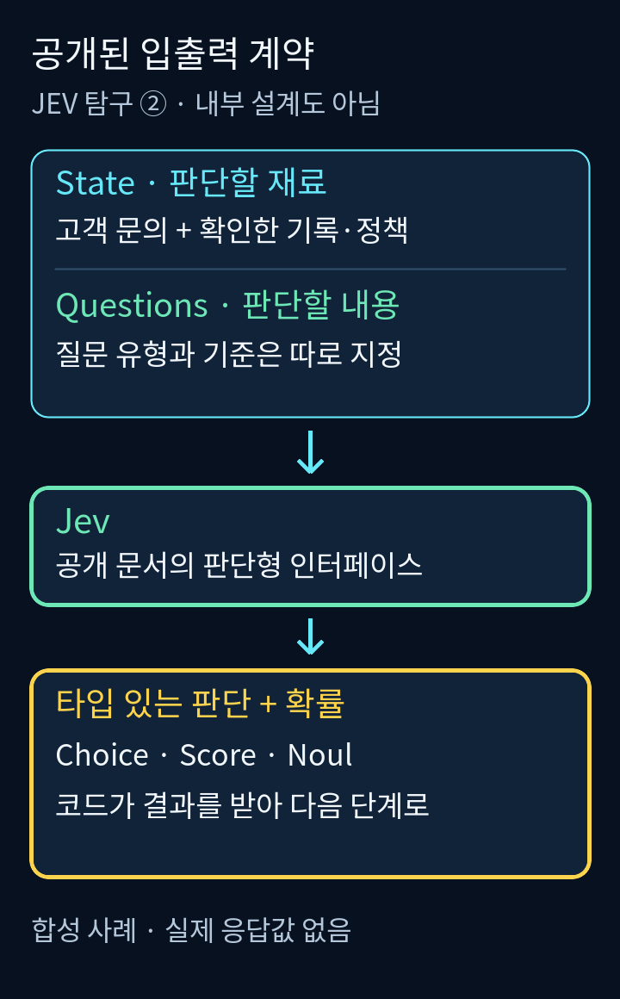
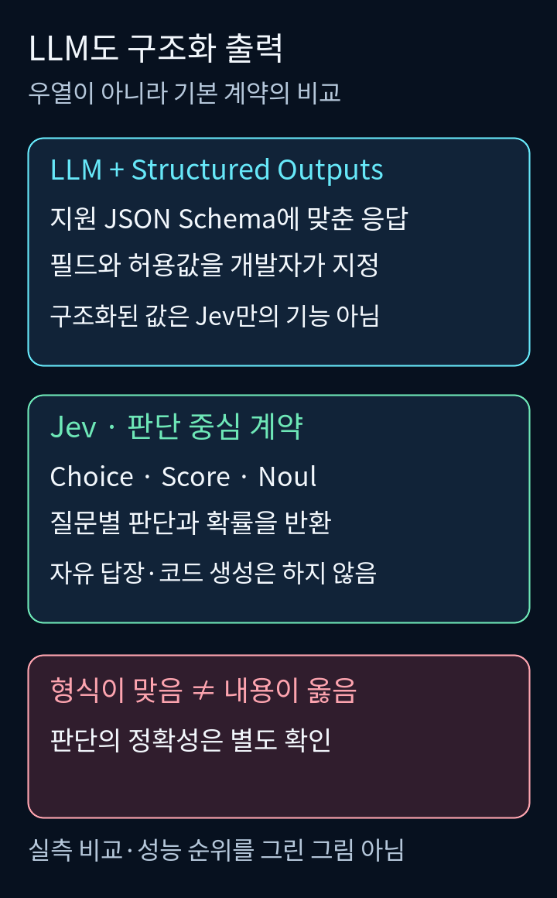
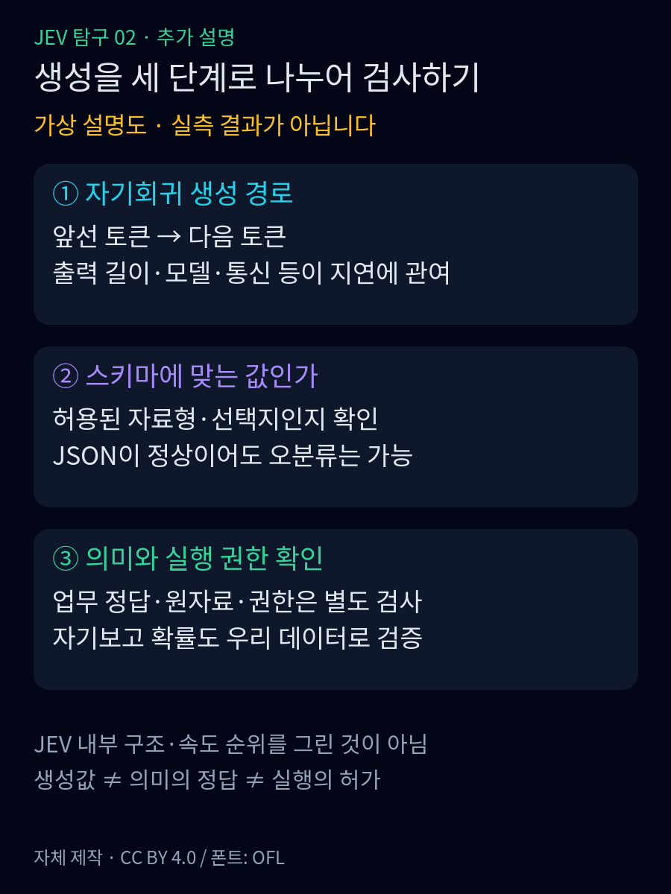
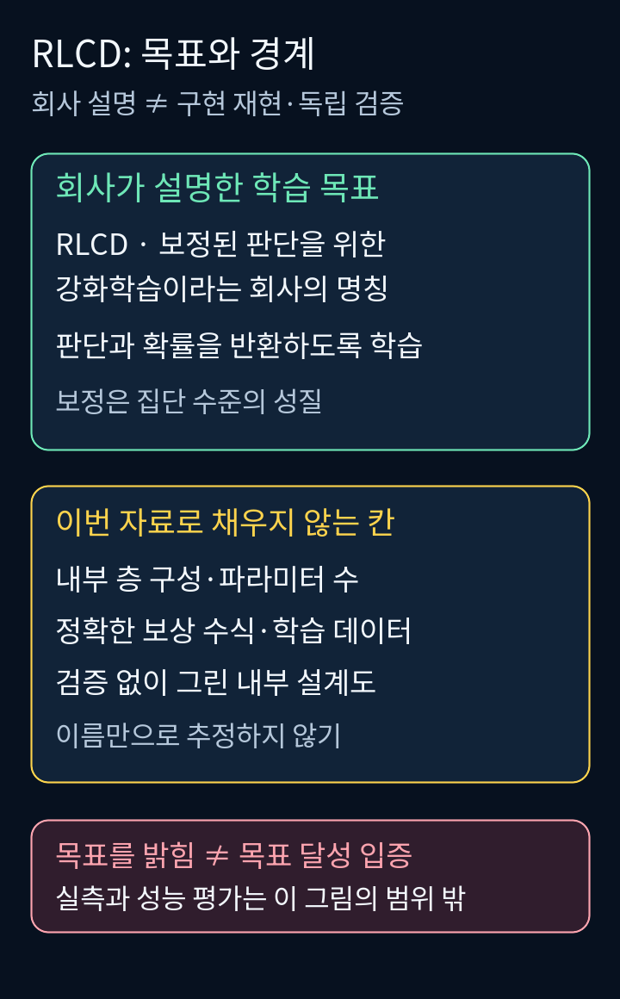

<strong>난이도: 중급</strong>

<nav id="jev-series-nav" aria-label="JEV 9편 연재 목차">
<strong>JEV 탐구 · 9편 읽는 순서</strong>
<ol>
<li><a href="/posts/jev-system-1-vs-system-2/">System 1과 역할 분담</a></li>
<li><strong aria-current="page">입출력과 LLM의 차이</strong></li>
<li><a href="/posts/jev-type-safety-parallel-processing/">타입 안전과 병렬 처리</a></li>
<li><a href="/posts/jev-designing-small-questions/">작은 질문 설계</a></li>
<li><a href="/posts/jev-overconfidence-calibration/">과신과 확률 보정</a></li>
<li><a href="/posts/jev-strengths-limits-trust/">강점과 한계</a></li>
<li><a href="/posts/jev-alternatives-comparison/">다른 선택지</a></li>
<li><a href="/posts/jev-public-performance-evidence/">공개 성능 근거</a></li>
<li><a href="/posts/jev-adoption-system-design/">조건부 도입</a></li>
</ol>
<a href="/posts/jev-system-1-vs-system-2/">← 1편</a> · <a href="/posts/jev-type-safety-parallel-processing/">3편 →</a>
</nav>

> Jev와 LLM의 차이를 ‘문장 대 JSON’으로만 설명하면, 정작 중요한 차이를 놓치게 됩니다.<a href="#source-1">[1]</a><a href="#source-6">[6]</a>

“같은 주문이 두 번 결제됐어요. 확인하고 환불해주세요.”

1편에서 만난 고객 문의입니다. 담당 팀을 정할 때 필요한 것은 분류 결과이지만, 고객에게 상황을 설명할 때는 문장이 필요합니다. 실제 환불에는 결제 기록과 정책, 실행 권한도 필요합니다. 같은 메시지를 읽더라도 소프트웨어가 받아야 할 결과는 업무 단계마다 다릅니다.<a href="#source-1">[1]</a>

TypeSafe는 Jev를 자연어를 이해하되 생성 문장 대신 **타입이 정해진 판단과 확률을 반환하는 모델**로 설명합니다.<a href="#source-1">[1]</a>
이번 편의 ‘구조’는 공개 입출력 계약이며 비공개 신경망 설계도가 아닙니다. 처리 방식은3편, 확률 보정은5편에서 따로 다룹니다.

## 1. 입력은 여전히 자연어입니다

Jev가 문장을 생성하지 않는다고 해서 자연어를 읽지 못하는 것은 아닙니다.<a href="#source-1">[1]</a>
현재 공식 문서는 텍스트 입력을 지원하며, 문자열뿐 아니라 JSON 객체와 텍스트 배열도 평가한다고 설명합니다.<a href="#source-1">[1]</a>
이미지·음성·영상 입력은 현재 지원 범위가 아닙니다.<a href="#source-1">[1]</a>

문서에서 **State**는 모델이 판단할 재료를 뜻합니다.<a href="#source-2">[2]</a>
문의 한 줄도 State가 될 수 있고, 대화·주문 기록·정책을 묶은 객체도 하나의 State가 될 수 있습니다.<a href="#source-2">[2]</a>
여기서 JSON은 모델이 ‘JSON 언어로 생각한다’는 증거가 아니라, 관련 정보를 이름 붙여 전달하는 그릇으로 이해하면 됩니다.<a href="#source-2">[2]</a>

합성 예시에서는 `message`, `verified_transactions`, `refund_policy`로 자료를 나눕니다. 실행 결과가 아니며 고객의 주장과 확인된 거래 기록을 구분한 설계입니다.

공식 문서는 판단 재료인 State와 판단할 내용을 지정하는 Questions를 구분합니다.<a href="#source-2">[2]</a>
한 요청의 질문들은 같은 State를 보고 독립적으로 평가됩니다.<a href="#source-2">[2]</a>
재료를 주는 일과 무엇을 물을지 정하는 일은 별개의 인터페이스입니다.<a href="#source-2">[2]</a>
어떤 질문을 함께 묶고 어떤 질문을 나눌지는 4편에서 다룹니다.

<figure>
  
  <figcaption>그림 1. 공개 문서를 바탕으로 새로 그린 입력·출력 계약입니다. 연결선은 사용 순서이며 내부 신경망의 층이나 실제 실행 화면이 아닙니다.<a href="#source-1">[1]</a><a href="#source-2">[2]</a>
그림: Clark, <a href="https://creativecommons.org/licenses/by/4.0/">CC BY 4.0</a>. <a href="/assets/img/posts/jev-structure-vs-llm/01-public-contract.png">원본 이미지 보기</a></figcaption>
</figure>

## 2. 돌려받는 것은 ‘잘 쓴 설명’이 아닙니다

문서의 기본 질문 유형은 Choice·Score·Noul입니다.<a href="#source-3">[3]</a>
Choice는 선택 결과와 선택지별 확률, confidence를, Score는 정의한 단계 위의 점수와 단계 정보·확률·confidence를 반환합니다.<a href="#source-3">[3]</a>
Noul은 명제가 참일 확률을 반환하며 별도 confidence는 없습니다.<a href="#source-3">[3]</a>

이름보다 중요한 것은 **어떤 종류의 값을 받을지 먼저 정한다는 점**입니다.<a href="#source-3">[3]</a>
문의의 담당 팀을 고르는 일, 불만 정도를 척도에 놓는 일, 환불을 요청했는지 판단하는 일은 서로 다른 출력 계약입니다.<a href="#source-3">[3]</a>
이번 편에서는 각 확률의 해석이나 임계값을 깊게 다루지 않습니다. confidence와 정답 가능성의 차이는 <a href="/posts/jev-overconfidence-calibration/">5편</a>의 주제입니다.

공식 문서상 Jev는 답장·코드·추론 설명을 생성하지 않습니다.<a href="#source-1">[1]</a>
따라서 고객에게 보낼 사과문까지 Jev에서 받아내려는 것은 현재 제품의 출력 범위와 맞지 않습니다.<a href="#source-1">[1]</a>
여기서는 판단 결과를 코드가 읽고, 필요하다면 별도 템플릿이나 생성 모델이 고객용 설명을 맡는 역할 분담을 생각할 수 있습니다. 이는 제품의 숨은 기능이 아니라 필자의 시스템 구성 예시입니다.

## 3. LLM도 구조화된 값을 반환합니다

‘LLM은 문장만, Jev는 JSON만’이라는 대비는 정확하지 않습니다.<a href="#source-1">[1]</a><a href="#source-6">[6]</a>
OpenAI Structured Outputs도 지정한 JSON Schema에 맞는 응답을 생성합니다.<a href="#source-6">[6]</a>
JSON 문법을 맞추는 JSON mode와 스키마 준수는 다릅니다.<a href="#source-6">[6]</a>

차이는 JSON의 독점이 아니라 기본 계약입니다.
Jev는 질문 유형과 판단·확률을, Structured Outputs는 지원 스키마에 따른 생성 응답을 중심으로 합니다.<a href="#source-1">[1]</a><a href="#source-3">[3]</a><a href="#source-6">[6]</a>
설정과 반환 필드는 같지 않으며, 스키마가 맞아도 내용상 실수는 남습니다.<a href="#source-6">[6]</a>

<figure>
  
  <figcaption>그림 2. 서로 다른 제품의 출력 계약을 비교한 직접 제작 설명도입니다. 두 모델의 정확도·속도 순위나 실제 응답을 나타내지 않습니다.<a href="#source-1">[1]</a><a href="#source-3">[3]</a><a href="#source-6">[6]</a>
그림: Clark, <a href="https://creativecommons.org/licenses/by/4.0/">CC BY 4.0</a>. <a href="/assets/img/posts/jev-structure-vs-llm/02-structured-outputs.png">원본 이미지 보기</a></figcaption>
</figure>

## 3-1. 판단 업무에 생성형 LLM을 연결할 때 남는 제약

GPT-3처럼 **자기회귀 방식**으로 문장을 생성하는 LLM은 앞선 토큰을 조건으로 다음 토큰을 이어 갑니다.<a href="#source-7">[7]</a> 여기서 다루는 것은 이런 생성 경로이지, 이름에 LLM이 붙은 모든 시스템의 구현을 하나로 단정하는 설명이 아닙니다.<a href="#source-7">[7]</a>
출력 토큰을 생성하는 시간은 지연의 중요한 구성 요소입니다.<a href="#source-8">[8]</a>
OpenAI의 지연 최적화 문서도 출력 길이, 모델 크기, 추론 최적화와 요청 횟수를 함께 다룹니다.<a href="#source-8">[8]</a>
따라서 긴 설명 대신 짧은 분류값만 받으면 생성 부담을 줄일 수 있지만, **모든 LLM이 반드시 느리다거나 Jev가 언제나 빠르다는 결론은 아닙니다.** 실제 비교에는 입력 길이, 출력 길이, 모델·서빙 조건, 통신 지연과 재시도까지 맞춰야 합니다.<a href="#source-8">[8]</a>

더 중요한 경계는 생성된 값과 의미의 정확성입니다.
스키마를 통과한 `billing`도 오분류일 수 있고, 문법이 완벽한 설명에 잘못된 사실이나 추론이 들어갈 수 있습니다.<a href="#source-6">[6]</a>
Structured Outputs 공식 문서도 내용상의 실수 가능성을 남겨 둡니다.<a href="#source-6">[6]</a>
LLM 불확실성 연구 역시 틀린 사실이나 추론을 자신 있게 말하는 문제를 다룹니다.<a href="#source-9">[9]</a>
그러나 그 연구가 모든 모델·과업의 환각 빈도를 하나의 숫자로 정해 주지는 않습니다.<a href="#source-9">[9]</a>

`confidence: 0.9`를 JSON에 쓰게 하는 것도 우선은 **모델이 생성한 자기보고**입니다.<a href="#source-9">[9]</a> 다음 토큰의 확률, 답 전체가 맞을 가능성, 문장에 적힌 자신감은 구분해서 검증해야 합니다.<a href="#source-9">[9]</a>
그렇다고 자기보고 확률이 늘 무용하거나 LLM이 반드시 과신한다는 뜻도 아닙니다.<a href="#source-9">[9]</a><a href="#source-10">[10]</a>
Tian 등의 2023년 연구는 당시의 특정 RLHF 모델·질의응답 벤치마크에서 말로 보고한 확률이 모델 조건부 확률보다 잘 보정되는 결과를 보고했습니다.<a href="#source-9">[9]</a>
Kadavath 등도 적절한 질문 형식에서 보정 가능성을 보였습니다.<a href="#source-10">[10]</a>
우리 한국어 문의까지 검증됐다는 뜻은 아닙니다.

<figure>
  
  <figcaption>추가 그림. 생성·형식·의미 검사는 서로 다른 단계입니다. <strong>가상 설명도이며 API 실측·속도 순위·Jev 내부 구조가 아닙니다.</strong> 본문에서 확인한 개념을 직접 도식화했습니다.<a href="#source-6">[6]</a><a href="#source-7">[7]</a><a href="#source-8">[8]</a> 그림: Clark, <a href="https://creativecommons.org/licenses/by/4.0/">CC BY 4.0</a>. <a href="/assets/img/posts/jev-structure-vs-llm/05-generation-checks.svg">SVG 원본</a> · <a href="/assets/img/posts/jev-structure-vs-llm/05-generation-checks.png">원본 PNG 보기</a></figcaption>
</figure>

이 비교의 실무적 결론은 출력 형식·지연·업무 정답·확률 품질을 따로 평가하자는 것입니다. Jev도 반환 형식이 제한됐다는 이유만으로 무오판·무환각을 보장하지 않으며, 보정 학습 목표를 우리 데이터의 검증 결과로 바꿔 읽어서는 안 됩니다.<a href="#source-1">[1]</a><a href="#source-4">[4]</a>

## 4. RLCD는 학습 목표이지 공개 설계도는 아닙니다

회사가 공개한 AI primer는 사전학습 언어모델 이후의 학습 경로를 설명하면서, 사람이 선호하는 응답을 지향하는 RLHF, 검증 가능한 보상을 이용하는 RLVR, 판단과 보정된 확률을 목표로 하는 RLCD를 대비합니다.<a href="#source-4">[4]</a>
TypeSafe는 자기 학습 경로를 RLCD라고 부릅니다.<a href="#source-4">[4]</a>
이 도식은 회사가 제시한 비교 틀로만 사용하며, 모든 LLM의 학습을 포괄하는 분류라고 해석하지 않습니다.<a href="#source-4">[4]</a>

RLCD는 **Reinforcement Learning for Calibrated Decisions**, 즉 보정된 판단을 위한 강화학습이라는 회사의 명칭입니다.<a href="#source-4">[4]</a><a href="#source-5">[5]</a>
공식 설명의 초점은 읽기 좋은 문장보다 판단과 확률을 반환하는 데 있습니다.<a href="#source-4">[4]</a>
어려운 질문에서도 늘 자신 있게 답하는 대신 불확실성을 소프트웨어가 사용할 수 있도록 만들겠다는 설계 방향으로 읽을 수 있습니다.<a href="#source-4">[4]</a>

다만 **그 목표를 밝혔다고 목표 달성까지 입증된 것은 아닙니다.** 회사 문서도 보정은 여러 예측의 집단에서 평가하는 성질이며 개별 답을 보장하지 않는다고 설명합니다.<a href="#source-1">[1]</a><a href="#source-4">[4]</a>
‘RLCD’라는 이름 하나로 보상 함수의 정확한 수식, 데이터 구성, 학습 과정이나 우리 업무에서의 확률 품질을 확인했다고 할 수는 없습니다.<a href="#source-4">[4]</a><a href="#source-5">[5]</a>
이번 자료는 목적을 이해하는 근거이지 구현 재현이나 독립 검증의 결과가 아닙니다.

<figure>
  
  <figcaption>그림 3. 학습 목표의 설명과 구현을 안다는 주장을 구분한 직접 제작 개념도입니다. TypeSafe의 원본 그림을 복제하지 않았으며 RLCD 내부 알고리즘을 묘사하지 않습니다.<a href="#source-4">[4]</a><a href="#source-5">[5]</a>
그림: Clark, <a href="https://creativecommons.org/licenses/by/4.0/">CC BY 4.0</a>. <a href="/assets/img/posts/jev-structure-vs-llm/03-rlcd-boundary.png">원본 이미지 보기</a></figcaption>
</figure>

## 5. 요청 이해와 실행은 다릅니다

명시적인 환불 요청을 찾아도 중복 청구는 거래 원장에서 확인해야 합니다. 공식 예시도 모델 판단을 코드 검사와 조합합니다.<a href="#source-1">[1]</a> “결제 내역이 이상해요”처럼 자료가 부족한 합성 문의에는 환불 결론을 꾸미지 않고 보류합니다. 판단 결과를 실행 권한으로 바꾸는 규칙은 서비스 책임입니다.

<figure>
  
  <figcaption>그림 4. ‘요청은 찾았지만 승인 도장은 따로’라는 필자의 역할 분담 삽화입니다. 실제 서비스 화면·모델의 판단 결과가 아닙니다. 그림: Clark, <a href="https://creativecommons.org/licenses/by/4.0/">CC BY 4.0</a>. <a href="/assets/img/posts/jev-structure-vs-llm/04-two-stamps.png">원본 이미지 보기</a></figcaption>
</figure>

다음 3편은 타입 안전과 병렬 처리를,4편은 질문 설계를 다룹니다. 확률 보정은5편, 공개 성능 근거는8편으로 이어집니다.

---

자료 확인일: 2026년 11월 2일(KST). 공개 문서와 제공자 설명을 읽은 해설입니다. API 호출·유료 서비스 이용·모델 성능 실험·독립 재현은 수행하지 않았습니다. 문서의 현재 인터페이스와 제공자의 설계 주장을 구분하며, 성능 우열을 확정하지 않습니다.

보강 자료 확인: 2026년 11월 3일(KST). 논문·공식 공개 문서에 근거한 해설이며 새 모델 실측은 수행하지 않았습니다.

타입 안전·병렬 처리 보강 자료 확인: 2026년 11월 3일(KST). 제공자 주장과 공개 API 계약을 구분했으며 내부 구현 재현이나 모델 호출은 하지 않았습니다.

<nav id="jev-series-bottom" aria-label="JEV 9편 연재 목차">
<strong>JEV 탐구 · 9편 읽는 순서</strong>
<ol>
<li><a href="/posts/jev-system-1-vs-system-2/">System 1과 역할 분담</a></li>
<li><strong aria-current="page">입출력과 LLM의 차이</strong></li>
<li><a href="/posts/jev-type-safety-parallel-processing/">타입 안전과 병렬 처리</a></li>
<li><a href="/posts/jev-designing-small-questions/">작은 질문 설계</a></li>
<li><a href="/posts/jev-overconfidence-calibration/">과신과 확률 보정</a></li>
<li><a href="/posts/jev-strengths-limits-trust/">강점과 한계</a></li>
<li><a href="/posts/jev-alternatives-comparison/">다른 선택지</a></li>
<li><a href="/posts/jev-public-performance-evidence/">공개 성능 근거</a></li>
<li><a href="/posts/jev-adoption-system-design/">조건부 도입</a></li>
</ol>
<a href="/posts/jev-system-1-vs-system-2/">← 1편</a> · <a href="/posts/jev-type-safety-parallel-processing/">3편 →</a>
</nav>

## Sources

[1]  <a href="https://docs.typesafe.ai/concepts/system-one.md">TypeSafe · System One</a>

[2]  <a href="https://docs.typesafe.ai/concepts/state.md">TypeSafe · State</a>

[3]  <a href="https://docs.typesafe.ai/primitives.md">TypeSafe · Primitives (Questions)</a>

[4]  <a href="https://docs.typesafe.ai/introduction/machine-learning-primer.md">TypeSafe · AI primer</a>

[5]  <a href="https://typesafe.ai/blog/introducing-system-one-models-and-jev">TypeSafe · Introducing System One Models &amp; Jev</a>

[6]  <a href="https://developers.openai.com/api/docs/guides/structured-outputs">OpenAI · Structured model outputs</a>

[7]  <a href="https://arxiv.org/abs/2005.14165v4">Brown et al. · Language Models are Few-Shot Learners</a>

[8]  <a href="https://developers.openai.com/api/docs/guides/latency-optimization">OpenAI · Latency optimization</a>

[9]  <a href="https://aclanthology.org/2023.emnlp-main.330">Tian et al. · Just Ask for Calibration</a>

[10]  <a href="https://arxiv.org/html/2207.05221v4">Kadavath et al. · Language Models (Mostly) Know What They Know</a>
