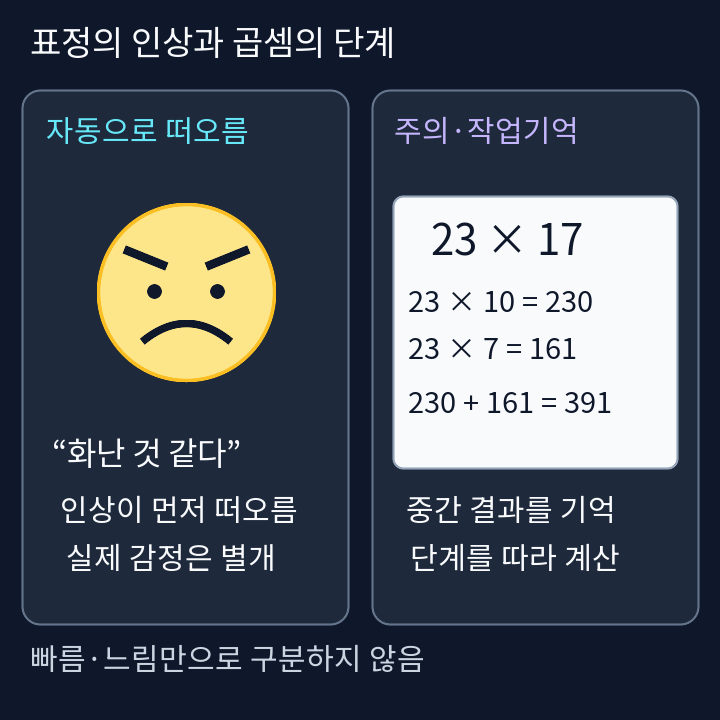
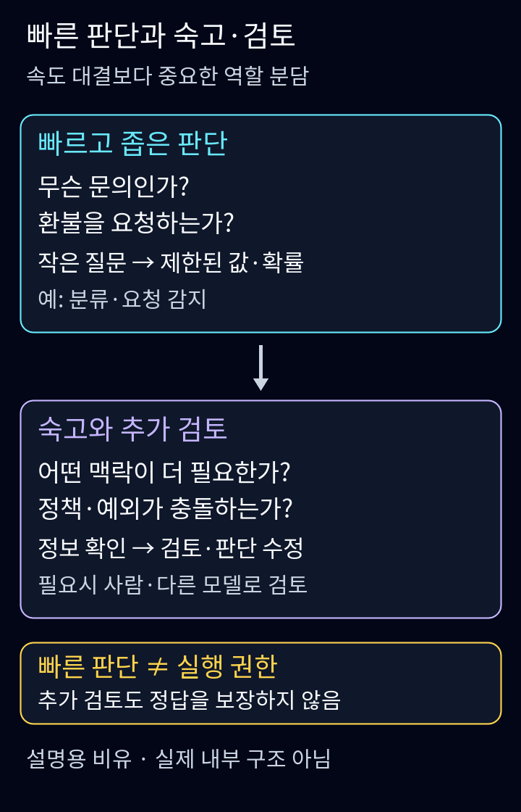
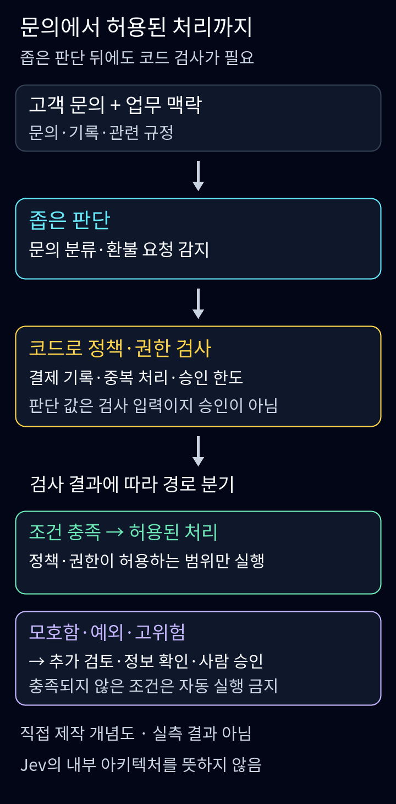

<strong>난이도: 중급</strong>

<nav id="jev-series-nav" aria-label="JEV 9편 연재 목차">
<strong>JEV 탐구 · 9편 읽는 순서</strong>
<ol>
<li><strong aria-current="page">System 1과 역할 분담</strong></li>
<li><a href="/posts/jev-structure-vs-llm/">입출력과 LLM의 차이</a></li>
<li><a href="/posts/jev-type-safety-parallel-processing/">타입 안전과 병렬 처리</a></li>
<li><a href="/posts/jev-designing-small-questions/">작은 질문 설계</a></li>
<li><a href="/posts/jev-overconfidence-calibration/">과신과 확률 보정</a></li>
<li><a href="/posts/jev-strengths-limits-trust/">강점과 한계</a></li>
<li><a href="/posts/jev-alternatives-comparison/">다른 선택지</a></li>
<li><a href="/posts/jev-public-performance-evidence/">공개 성능 근거</a></li>
<li><a href="/posts/jev-adoption-system-design/">조건부 도입</a></li>
</ol>
첫 편 · <a href="/posts/jev-structure-vs-llm/">2편 →</a>
</nav>

고객이 “같은 주문이 두 번 결제됐어요. 확인하고 환불해주세요”라고 썼다고 가정합니다. 문의를 결제팀으로 보내는 판단과 실제 환불은 다릅니다. 후자는 거래 기록·중복 처리·정책·권한 확인이 필요합니다. 이 연재의 문의는 합성 사례이며 API 호출이나 성능 실험 결과가 아닙니다.

TypeSafe는 Jev를 문장 대신 제한된 판단과 확률을 반환하는 System One 모델로 소개합니다.<a href="#source-1">[1]</a> 이름의 인지과학적 배경부터 살펴보되 인간의 사고와 AI의 구현을 동일시하지 않겠습니다.

## 1. System 1과 System 2: 속도보다 중요한 차이

다니엘 카너먼의 《Thinking, Fast and Slow》를 통해 널리 알려진 구분에서 System 1은 빠르고 직관적인 사고, System 2는 느리고 숙고하는 사고를 가리킨다.<a href="#source-1">[1]</a> TypeSafe도 이 구분에서 System One이라는 이름을 가져왔다고 설명한다.<a href="#source-1">[1]</a><a href="#source-2">[2]</a>

### 인물과 책부터 짧게

**다니엘 카너먼(Daniel Kahneman, 1934–2024)**은 심리학자로, 에이머스 트버스키(Amos Tversky)와 판단·의사결정을 연구했다.<a href="#source-8">[8]</a><a href="#source-9">[9]</a>
불확실성 아래 인간의 판단·의사결정에 관한 심리학 연구를 경제학에 접목한 공로로 2002년 노벨경제학상을 받았다.<a href="#source-8">[8]</a>
이중과정 이론 전체를 혼자 만든 인물이라기보다, 《Thinking, Fast and Slow》를 통해 System 1·2를 대중에게 널리 알린 인물로 이해하는 편이 정확하다.<a href="#source-1">[1]</a><a href="#source-11">[11]</a>

<figure>
  
  <figcaption>다니엘 카너먼. 사진: Eirik Solheim / NRKbeta, <a href="https://commons.wikimedia.org/wiki/File:Daniel_Kahneman_(3283955327).jpg">Wikimedia Commons 원본·파일별 권리 정보</a>, <a href="https://creativecommons.org/licenses/by-sa/2.0/">CC BY-SA 2.0</a>. 원본의 비율을 유지해 크기를 줄이고 카메라 메타데이터를 제거·재압축했다. 이 사진에는 본문 라이선스가 아닌 별도 CC BY-SA 2.0 조건이 적용된다.<a href="#source-13">[13]</a></figcaption>
</figure>

<aside aria-label="Thinking, Fast and Slow 텍스트 북카드" style="box-sizing:border-box;max-width:100%;border:1px solid currentColor;border-radius:12px;padding:16px;margin:20px 0;">
  
<strong>Thinking, Fast and Slow — Daniel Kahneman</strong> 2011년 처음 출간된 일반 독자용 책이다.<a href="#source-11">[11]</a>

  
직관의 능력과 편향, 숙고가 일상적인 선택에 미치는 영향을 살펴보는 입문 안내다.<a href="#source-10">[10]</a><a href="#source-11">[11]</a> ‘System 1은 나쁘고 System 2는 좋다’는 이분법으로 읽지는 말자.<a href="#source-5">[5]</a>

  
<a href="https://www.penguin.co.uk/books/56314/thinking-fast-and-slow-by-kahneman-daniel/9780141033570">Penguin 공식 Paperback 판본 안내 · ISBN 9780141033570</a>.<a href="#source-10">[10]</a> 이 카드는 실제 표지가 아닌 텍스트 서지 안내이며, 재사용 허가를 확인하지 못한 표지 이미지는 복제하지 않았다.

</aside>

### 표정의 인상과 곱셈의 단계

찌푸린 표정을 보자마자 ‘화가 난 것 같다’는 인상이 떠오르는 일과, 익숙하지 않은 두 자리 곱셈의 중간 결과를 기억하며 계산하는 일을 비교해보자. 이 대비는 UX DAYS SEOUL 해설과 카너먼 책의 공개 견본에서도 소개된다.<a href="#source-12">[12]</a><a href="#source-11">[11]</a>
아래는 얼굴과 계산 과정을 새로 그린 설명용 예시다. 얼굴에서 떠오른 인상은 상대의 실제 감정이 확인됐다는 뜻이 아니다.

<figure>
  
  <figcaption>표정의 자동적인 인상과 주의·작업기억을 쓰는 단계 계산을 대비한 직접 제작 개념도다. 책의 얼굴 사진이나 그림을 복제한 것이 아니며 실험 결과·뇌 구조·실제 감정 판정도 아니다. 빠름·느림만으로 두 처리 유형을 정의하지 않는다.<a href="#source-5">[5]</a><a href="#source-11">[11]</a> 그림: Clark, <a href="https://creativecommons.org/licenses/by/4.0/">CC BY 4.0</a>. <a href="/assets/img/posts/jev-system-1-vs-system-2/face-and-multiplication.png">원본 이미지 보기</a></figcaption>
</figure>

자동으로 떠오른 판단이 **항상** 숙고의 검사를 거치는 것은 아니다. Evans·Stanovich는 기본 반응에 Type 2 처리가 개입할 수도, 개입하지 않을 수도 있다고 설명한다.<a href="#source-5">[5]</a>
직관만으로 풀기 어려운 문제에서는 더 의도적이고 노력하는 사고가 동원될 수 있으며, 반대로 오랜 훈련을 거친 일부 복잡한 기술은 빠르고 자동적으로 처리될 수 있다.<a href="#source-11">[11]</a><a href="#source-5">[5]</a>
따라서 매번 ‘System 1 → System 2 최종심판’이라는 고정된 직렬 모델을 가정하지 않는다. 아래에서 AI의 검토 조건을 명시적으로 설계하자는 이야기는 이 구분을 참고한 **필자의 소프트웨어 설계 해석**이지, 인간 사고의 필수 단계를 그대로 구현한다는 주장이 아니다.

다만 ‘빠르면 System 1, 느리면 System 2’라는 설명만으로는 부족하다. Evans와 Stanovich의 이중과정 이론 논문은 Type 1의 자율적인 처리와 Type 2의 작업기억 의존성·가설적 사고를 중요한 구분으로 제시한다.<a href="#source-5">[5]</a>

따라서 이 글에서는 두 용어를 **빠르게 떠오르는 판단과 의식적인 검토의 차이를 이해하는 출발점**으로 사용한다. 사람의 머릿속에 정확히 두 개의 독립된 엔진이 있다고 가정하거나, 하나는 늘 틀리고 다른 하나는 늘 옳다고 나누려는 것이 아니다.<a href="#source-5">[5]</a>

## AI에서는 역할 분담의 비유입니다

“Jev는 System1, LLM은 System2”라는 일대일 대응은 쓰지 않습니다. 제품명은 인간 직관의 구현 증거가 아닙니다.<a href="#source-1">[1]</a><a href="#source-5">[5]</a> 필자가 제안하는 것은 좁은 분류 경로와 예외·추가정보를 다루는 검토 경로를 소프트웨어에서 나누는 설계입니다. 사람 머릿속에 독립 엔진 두 개가 있다는 주장도 아닙니다.

<figure>
  
  <figcaption>그림 1. 빠른 판단과 숙고·검토의 역할 분담을 설명하기 위해 직접 제작한 개념도다. 인간의 인지 구조나 Jev의 내부 구조를 묘사한 것이 아니며 실측 성능 비교도 아니다. <a href="#source-1">[1]</a><a href="#source-5">[5]</a> <a href="/assets/img/posts/jev-system-1-vs-system-2/judgment-and-review.png">원본 이미지 보기</a></figcaption>
</figure>

공식 질문 유형은 Choice·Score·Noul입니다.<a href="#source-3">[3]</a> 담당팀·불만 척도·환불 요청 여부를 각각 표현할 수 있습니다. 기존 LLM도 Structured Outputs를 제공하므로 JSON 출력은 Jev의 독점 기능이 아닙니다.<a href="#source-6">[6]</a> TypeSafe의 RLCD·병렬 sampler 설명은 제공자의 설계 주장으로 구분하며 내부 구현을 재현했다고 하지 않습니다.<a href="#source-2">[2]</a>

## 빠른 판단은 실행 권한이 아닙니다

<figure>
  
  <figcaption>그림 2. 공식 워크플로 설명을 참고해 직접 제작한 문의 처리 개념도다. 실제 API 실행 화면·실측 결과·Jev 내부 아키텍처가 아니다. <a href="#source-1">[1]</a><a href="#source-3">[3]</a> <a href="/assets/img/posts/jev-system-1-vs-system-2/inquiry-policy-workflow.png">원본 이미지 보기</a></figcaption>
</figure>

위 그림은 문의 판단 뒤 코드가 거래·정책·권한을 확인하는 설계 예시입니다. 복잡한 사례를 reasoning 모델에 넘기는 것도 정답 보증은 아니며 필요한 사람 승인과 별도 검증을 남깁니다.

제공자가 쓰는 ‘환각 없음’과0%는 스키마 보장에서 나온 설명이며 관측된 업무 오답률0%가 아닙니다.<a href="#source-2">[2]</a> confidence도 분포 요약값이고 Noul에는 별도 confidence 필드가 없습니다. 보정은 여러 예측의 집단 성질이지 개별 답 보증이 아닙니다.<a href="#source-7">[7]</a><a href="#source-1">[1]</a>

회사의 자체 워크플로 성능에는 회사가 만든 과업이고 실제 이득의 높은 쪽일 수 있다는 단서가 붙습니다.<a href="#source-2">[2]</a> 한국어는 영어와 동등한 정확도가 보장되지 않습니다.<a href="#source-4">[4]</a> 따라서 검토·재처리까지 포함한 비용과 오분류를 우리 데이터로 확인해야 합니다. 목표는 모든 단계에 깊은 추론을 강제하는 것도, 빠른 모델에 모든 권한을 주는 것도 아닙니다.

<nav id="jev-series-bottom" aria-label="JEV 9편 연재 목차">
<strong>JEV 탐구 · 9편 읽는 순서</strong>
<ol>
<li><strong aria-current="page">System 1과 역할 분담</strong></li>
<li><a href="/posts/jev-structure-vs-llm/">입출력과 LLM의 차이</a></li>
<li><a href="/posts/jev-type-safety-parallel-processing/">타입 안전과 병렬 처리</a></li>
<li><a href="/posts/jev-designing-small-questions/">작은 질문 설계</a></li>
<li><a href="/posts/jev-overconfidence-calibration/">과신과 확률 보정</a></li>
<li><a href="/posts/jev-strengths-limits-trust/">강점과 한계</a></li>
<li><a href="/posts/jev-alternatives-comparison/">다른 선택지</a></li>
<li><a href="/posts/jev-public-performance-evidence/">공개 성능 근거</a></li>
<li><a href="/posts/jev-adoption-system-design/">조건부 도입</a></li>
</ol>
첫 편 · <a href="/posts/jev-structure-vs-llm/">2편 →</a>
</nav>

## Sources

[1]  <a href="https://docs.typesafe.ai/concepts/system-one">TypeSafe · System One</a>

[2]  <a href="https://typesafe.ai/blog/introducing-system-one-models-and-jev">TypeSafe · Introducing System One Models &amp; Jev</a>

[3]  <a href="https://docs.typesafe.ai/primitives">TypeSafe · Primitives (Questions)</a>

[4]  <a href="https://docs.typesafe.ai/models">TypeSafe · Models</a>

[5]  <a href="https://scottbarrykaufman.com/wp-content/uploads/2014/04/dual-process-theory-Evans_Stanovich_PoPS13.pdf">Evans &amp; Stanovich · Dual-Process Theories of Higher Cognition: Advancing the Debate</a>

[6]  <a href="https://openai.com/index/introducing-structured-outputs-in-the-api">OpenAI · Introducing Structured Outputs in the API</a>

[7]  <a href="https://docs.typesafe.ai/confidence">TypeSafe · Confidence</a>

[8]  <a href="https://www.nobelprize.org/prizes/economic-sciences/2002/kahneman/facts">NobelPrize.org · Daniel Kahneman – Facts</a>

[9]  <a href="https://www.penguinrandomhouse.com/books/89308/thinking-fast-and-slow-by-daniel-kahneman">Penguin Random House · Thinking, Fast and Slow（Audiobook Download）</a>

[10]  <a href="https://www.penguin.co.uk/books/56314/thinking-fast-and-slow-by-kahneman-daniel/9780141033570">Penguin Books · Thinking, Fast and Slow（Paperback, ISBN 9780141033570）</a>

[11]  <a href="https://cdn.penguin.co.uk/dam-assets/books/9780141033570/9780141033570-sample.pdf">Daniel Kahneman · Thinking, Fast and Slow — Penguin official sample</a>

[12]  <a href="https://medium.com/@uxdaysseoul/2%EA%B0%80%EC%A7%80%EC%9D%98-%EC%82%AC%EA%B3%A0-%EB%AA%A8%EB%93%9C-%EC%8B%9C%EC%8A%A4%ED%85%9C-1-%EC%8B%9C%EC%8A%A4%ED%85%9C-2-b22a752163ef">UX DAYS SEOUL · 2가지의 사고 모드 (시스템 1, 시스템 2)</a>

[13]  <a href="https://commons.wikimedia.org/wiki/File:Daniel_Kahneman_%283283955327%29.jpg">Wikimedia Commons · File:Daniel Kahneman (3283955327).jpg</a>
