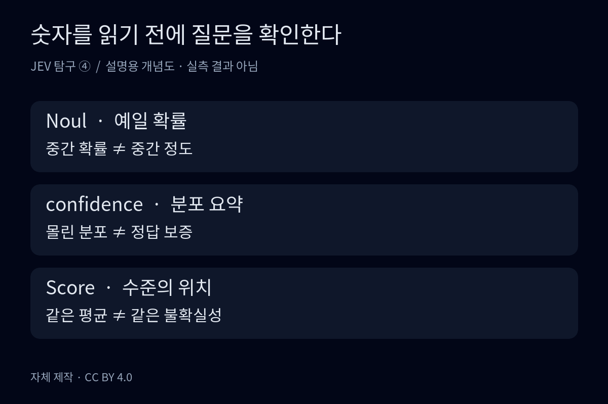
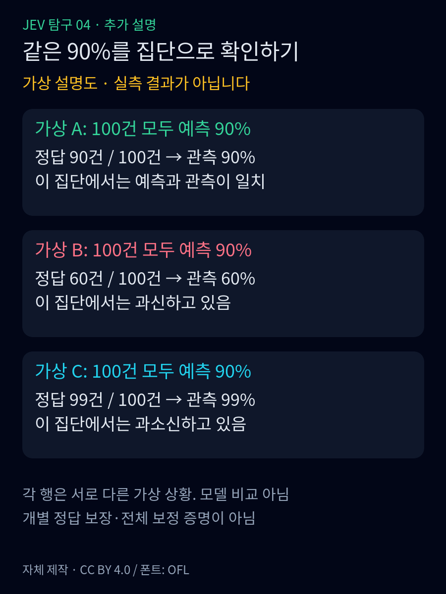

<strong>난이도: 중급</strong>

<nav id="jev-series-nav" aria-label="JEV 9편 연재 목차">
<strong>JEV 탐구 · 9편 읽는 순서</strong>
<ol>
<li><a href="/posts/jev-system-1-vs-system-2/">1. System 1과 역할 분담</a></li>
<li><a href="/posts/jev-structure-vs-llm/">2. 입출력과 LLM의 차이</a></li>
<li><a href="/posts/jev-type-safety-parallel-processing/">3. 타입 안전과 병렬 처리</a></li>
<li><a href="/posts/jev-designing-small-questions/">4. 작은 질문 설계</a></li>
<li><strong aria-current="page">5. 과신과 확률 보정</strong></li>
<li><a href="/posts/jev-strengths-limits-trust/">6. 강점과 한계</a></li>
<li><a href="/posts/jev-alternatives-comparison/">7. 다른 선택지</a></li>
<li><a href="/posts/jev-public-performance-evidence/">8. 공개 성능 근거</a></li>
<li><a href="/posts/jev-adoption-system-design/">9. 조건부 도입</a></li>
</ol>
<a href="/posts/jev-designing-small-questions/">← 4편</a> · <a href="/posts/jev-strengths-limits-trust/">6편 →</a>
</nav>

숫자를 반환한다는 것과 그 숫자가 우리 업무에서 신뢰할 만하다는 것은 다릅니다. 이번 편은 확률·confidence·과신·보정을 분리합니다. 가상 사례와 실제 관측, 회사의 학습 목표와 독립 검증을 구분합니다.

## 확률, confidence, Score는 서로 바꿔 읽으면 안 된다

Noul은 예·아니오 질문에서 '예'일 확률을 반환한다.<a href="#source-6">[6]</a> 예를 들어 "환불을 요청했는가"에 대한 값이 중간에 있다면, 그것은 환불 의향의 세기가 중간이라는 뜻이 아니다. 질문에 예라고 답할지 불확실하다는 뜻이다. 의향의 강도나 불만의 정도를 보고 싶다면 수준을 정의한 Score가 더 맞는다.<a href="#source-5">[5]</a>

현재 문서에서 Choice와 Score에는 `probabilities`와 별도의 `confidence`가 있지만, Noul에는 별도 `confidence`가 없다.<a href="#source-3">[3]</a> Noul용 confidence 필드를 가정해 공통 코드를 짜면 문서와 어긋난다. 필요하면 애플리케이션이 확률로부터 별도 지표를 계산할 수 있지만, 그 값은 반환 필드가 아니라 우리가 만든 파생값이라고 표시해야 한다.

여기서 `confidence`도 "이 답이 실제로 맞을 확률"이라는 별도의 인증서는 아니다. TypeSafe는 반환된 확률 분포로부터 이 값을 계산한다. Choice의 경우 선택지가 세 개이고 가장 큰 확률이 0.6이면 문서의 공식으로 계산한 confidence는 0.4다.<a href="#source-3">[3]</a> 이 숫자는 공식 설명을 위한 계산 예시이며 API 측정값이 아니다. 선택지 수에 따라 계산 기준이 달라지므로 서로 다른 질문에 같은 임계값을 붙이는 것도 신중해야 한다.

Score의 숫자는 또 다르다. 수준 번호를 확률로 가중평균한 위치다.<a href="#source-7">[7]</a> 가령 수준이 0·1·2일 때 전부 1에 몰린 분포와 0·2에 반씩 나뉜 분포는 모두 평균 1을 만든다. 전자는 가운데 수준이라는 판단이 뚜렷하고 후자는 양끝 사이에서 갈린다. 평균만 저장하면 이 차이를 잃는다. 높은 불만 Score를 높은 확신으로 읽거나, 중간 Score를 애매한 판단으로 읽어서는 안 된다.

<figure>
  
  <figcaption>그림 2. 비슷한 숫자라도 질문이 다르다. 데이터나 신뢰도 실측 그래프가 아닌 자체 제작 개념도. <a href="/assets/img/posts/jev-strengths-limits-trust/02-three-numbers.svg">원본 SVG</a> · <a href="https://creativecommons.org/licenses/by/4.0/">CC BY 4.0</a>. · <a href="/assets/img/posts/jev-strengths-limits-trust/02-three-numbers.png">원본 PNG 보기</a></figcaption>
</figure>

## 보정이 잘됐다는 말은 여러 건을 모아 확인한다

Calibration, 즉 확률 보정은 예측 확률과 실제 결과가 얼마나 맞아떨어지는지에 관한 문제다. Guo 등의 논문은 분류 모델에서 실제 정답 가능성을 대표하는 확률 추정치를 다루며, 조사한 현대 신경망들이 잘 보정되지 않는 문제를 보고했다.<a href="#source-2">[2]</a> 이 논문은 JEV 평가 논문이 아니다. JEV가 나쁘거나 좋다는 근거로 가져올 수는 없고, 확률이라는 이름만으로 신뢰성을 보장할 수 없는 이유를 이해하는 자료다.

TypeSafe는 System One 모델을 결과에 맞춰 확률을 최적화하는, 보정된 판단을 위한 모델이라고 설명한다. 같은 페이지에는 보정이 예측 집단에 대해 측정되며 개별 답의 정확성을 보장하지 않는다고 적혀 있다.<a href="#source-1">[1]</a> 앞 문장은 회사가 설명하는 학습 목표이고, 뒤 문장은 제품을 사용할 때 지켜야 할 해석의 한계다. 이 글에서는 한국어 결제 문의에 대한 독립 실측 자료를 확보하지 않았으므로 우리 사례에서 얼마나 보정됐는지는 확인하지 못했다.

실무에서는 정답을 확인할 수 있는 과거 문의를 따로 남겨 두고, 비슷한 확률을 받은 사례들을 모아 예측과 정답 빈도를 비교해야 한다. 단순히 "정확도가 높았다"만으로 끝내지 말고, 잘못 자동 처리한 건과 검토로 보낸 건을 나누어 볼 필요가 있다. 문의 전체에서 그럴듯해 보여도 한국어의 완곡한 요청이나 드문 이중 결제 사례에서 어긋날 수 있기 때문이다. 여기서는 측정 데이터가 없어서 신뢰도 곡선을 그리지 않았다. 보기 좋은 대각선은 검증 기록을 대신하지 못한다.

### 유창한 말투, 자기보고 숫자, 토큰 확률은 다르다

“확실합니다”라는 말투는 언어적 자신감 표현이고, “정답일 확률 90%”는 수치로 생성한 자기보고입니다. 모델이 다음 토큰에 부여하는 조건부 확률은 또 다른 값입니다. 이 셋을 곧바로 ‘업무 정답률’로 바꾸어 읽으면 안 됩니다.<a href="#source-9">[9]</a>
Tian 등의 2023년 연구는 당시 ChatGPT·GPT-4·Claude와 TriviaQA·SciQ·TruthfulQA에서 자기보고 방식과 조건부 확률의 보정 품질을 비교했습니다. 자기보고가 더 나은 결과도 있었으므로 ‘모든 LLM은 필연적으로 과신한다’는 일반화 역시 피해야 합니다.<a href="#source-9">[9]</a>
Kadavath 등의 연구도 적절한 형식의 선택형·참거짓 질문에서 보정 가능성을 보고했지만, 새로운 과업으로 옮길 때의 어려움을 함께 다룹니다. 문장이 유창하거나 숫자를 출력할 수 있다는 사실만으로 새 업무의 신뢰성을 확정할 수는 없습니다.<a href="#source-10">[10]</a>

### 같은 90%라도 실제 결과를 모아 보아야 한다

**다음은 서로 다른 세 가상 평가 상황입니다. 모델 호출·관측 데이터·성능 실측이 아닙니다.** 각 상황에서 모델이 선택한 답 100개에 모두 정답 가능성 90%를 붙였다고 가정합니다.

- 실제로 90개가 맞았다면, 이 집단에서는 예측 90%와 관측 정답률 90%가 일치합니다.
- 60개만 맞았다면, 이 집단에서는 예측이 실제 정답률보다 높아 **과신**한 셈입니다.
- 99개가 맞았다면, 이 집단에서는 예측이 실제 정답률보다 낮아 **과소신**한 셈입니다.

이는 보정의 뜻을 설명하는 산술 예시입니다. 개별 답의 성공 보증도, 표본 100개로 전체 보정을 증명했다는 주장도 아닙니다. Guo 등의 정의 역시 예측 확률을 조건으로 한 집단의 정답 가능성을 다룹니다.<a href="#source-2">[2]</a>

<figure>
  
  <figcaption>추가 그림. <strong>가상 산술 예시 — 실측 결과가 아닙니다.</strong> 각 행은 서로 다른 평가 상황이며 합쳐서 한 모델의 성능표로 읽지 않습니다. 개별 답이나 전체 분포의 보정을 보장하지 않습니다. 개념 근거는 Guo 등입니다.<a href="#source-2">[2]</a> 그림: Clark, <a href="https://creativecommons.org/licenses/by/4.0/">CC BY 4.0</a>. <a href="/assets/img/posts/jev-strengths-limits-trust/05-calibration-groups.svg">SVG 원본</a> · <a href="/assets/img/posts/jev-strengths-limits-trust/05-calibration-groups.png">원본 PNG 보기</a></figcaption>
</figure>

**정확도는 얼마나 맞혔는지, 보정은 붙인 확률이 관측 빈도와 얼마나 맞는지**를 묻습니다. 둘은 같은 지표가 아닙니다. Guo 등의 연구에서도 더 정확한 모델의 확신이 실제 정확도와 잘 맞지 않는 사례가 나옵니다.<a href="#source-2">[2]</a>

### ECE와 Brier도 한 줄 성적표로 끝내지 않는다

Guo 등의 ECE는 예측을 확률 구간(bin)으로 나누고, 각 구간의 **평균 예측 확률과 관측 정답률 차이의 절댓값**을 표본 비중으로 가중평균합니다. `ECE = Σ (구간 표본 수 / 전체 표본 수) × |구간 정답률 − 구간 평균 확률|`입니다.<a href="#source-2">[2]</a>
구간 수·경계와 표본 수를 같이 적어야 해석할 수 있으며, 한 구간의 평균이 맞더라도 그 안의 특정 고객군까지 안전하다는 뜻은 아닙니다. 낮은 ECE만으로 오답을 잘 가려내는 능력까지 보장하지도 않습니다.<a href="#source-2">[2]</a><a href="#source-9">[9]</a>

이진 사건의 Brier score는 `평균[(p − y)²]`로, 예측 확률 `p`와 실제 결과 `y∈{0,1}` 사이의 제곱 오차 평균입니다. 여기서는 이진형 정의를 쓰며, 다중분류의 클래스 합산·정규화와 섞어 비교하지 않습니다.<a href="#source-11">[11]</a>
Brier는 확률 예측의 전체 품질 지표이지 보정 오차만 분리한 값이 아닙니다. 보정뿐 아니라 사례를 구분하는 능력과 사건 빈도도 함께 보아야 합니다.<a href="#source-13">[13]</a>

### 숫자가 자동화의 분기 조건이 될 때

필자의 설계상 주의점은 과신을 잘못된 자동 실행으로 연결하지 않는 것입니다. “90% 이상이면 자동 환불”을 검증 없이 적용하면, 위의 가상 60% 상황에서는 생각보다 많은 오답이 통과합니다. 반대로 과소신은 불필요한 보류를 늘릴 수 있습니다. 먼저 분류·정보 조회와 환불 실행의 권한을 분리하고, 잘못 통과시킨 건수·검토량·손실을 함께 기록하는 편이 낫습니다.

TypeSafe는 RLCD를 **보정된 판단을 위한 강화학습 목표**로 설명하지만, 그 명칭이 우리 한국어 문의의 보정 완료를 뜻하지는 않습니다.<a href="#source-12">[12]</a>
또한 Jev의 `confidence`는 반환 분포에서 계산한 요약값이며, 실제 정답을 수집해 계산한 보정 지표가 아닙니다.<a href="#source-3">[3]</a>
필자는 정답 라벨이 있는 별도 평가 자료에서 업무·언어·모델 버전별로 정확도와 보정을 확인하고, 임계값을 맞춘 자료와 최종 평가 자료를 분리할 것을 권합니다. 입력 분포가 바뀌면 과거의 확률 해석을 그대로 유지할 근거도 다시 점검해야 합니다. 이는 새 과업에서의 보정 어려움과도 연결되는 한계입니다.<a href="#source-10">[10]</a>

<nav id="jev-series-bottom" aria-label="JEV 9편 연재 목차">
<strong>JEV 탐구 · 9편 읽는 순서</strong>
<ol>
<li><a href="/posts/jev-system-1-vs-system-2/">1. System 1과 역할 분담</a></li>
<li><a href="/posts/jev-structure-vs-llm/">2. 입출력과 LLM의 차이</a></li>
<li><a href="/posts/jev-type-safety-parallel-processing/">3. 타입 안전과 병렬 처리</a></li>
<li><a href="/posts/jev-designing-small-questions/">4. 작은 질문 설계</a></li>
<li><strong aria-current="page">5. 과신과 확률 보정</strong></li>
<li><a href="/posts/jev-strengths-limits-trust/">6. 강점과 한계</a></li>
<li><a href="/posts/jev-alternatives-comparison/">7. 다른 선택지</a></li>
<li><a href="/posts/jev-public-performance-evidence/">8. 공개 성능 근거</a></li>
<li><a href="/posts/jev-adoption-system-design/">9. 조건부 도입</a></li>
</ol>
<a href="/posts/jev-designing-small-questions/">← 4편</a> · <a href="/posts/jev-strengths-limits-trust/">6편 →</a>
</nav>

## Sources

[1]  <a href="https://docs.typesafe.ai/concepts/system-one.md">System One</a>

[2]  <a href="https://proceedings.mlr.press/v70/guo17a.html">On Calibration of Modern Neural Networks</a>

[3]  <a href="https://docs.typesafe.ai/confidence.md">Confidence</a>

[5]  <a href="https://docs.typesafe.ai/primitives.md">Primitives</a>

[6]  <a href="https://docs.typesafe.ai/primitives/noul.md">Noul</a>

[7]  <a href="https://docs.typesafe.ai/primitives/score.md">Score</a>

[9]  <a href="https://aclanthology.org/2023.emnlp-main.330">Tian et al. · Just Ask for Calibration</a>

[10]  <a href="https://arxiv.org/html/2207.05221v4">Kadavath et al. · Language Models (Mostly) Know What They Know</a>

[11]  <a href="https://scikit-learn.org/stable/modules/generated/sklearn.metrics.brier_score_loss.html">scikit-learn · brier_score_loss</a>

[12]  <a href="https://docs.typesafe.ai/introduction/machine-learning-primer.md">TypeSafe · AI primer</a>

[13]  <a href="https://scikit-learn.org/stable/modules/calibration.html">scikit-learn · Probability calibration</a>
