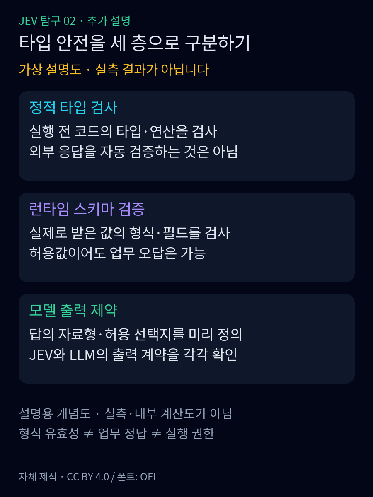
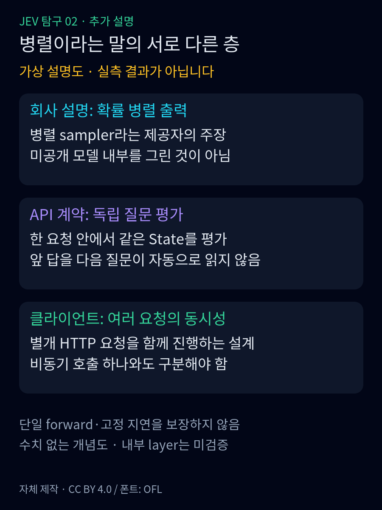

<strong>난이도: 중급</strong>

<nav id="jev-series-nav" aria-label="JEV 9편 연재 목차">
<strong>JEV 탐구 · 9편 읽는 순서</strong>
<ol>
<li><a href="/posts/jev-system-1-vs-system-2/">1. System 1과 역할 분담</a></li>
<li><a href="/posts/jev-structure-vs-llm/">2. 입출력과 LLM의 차이</a></li>
<li><strong aria-current="page">3. 타입 안전과 병렬 처리</strong></li>
<li><a href="/posts/jev-designing-small-questions/">4. 작은 질문 설계</a></li>
<li><a href="/posts/jev-overconfidence-calibration/">5. 과신과 확률 보정</a></li>
<li><a href="/posts/jev-strengths-limits-trust/">6. 강점과 한계</a></li>
<li><a href="/posts/jev-alternatives-comparison/">7. 다른 선택지</a></li>
<li><a href="/posts/jev-public-performance-evidence/">8. 공개 성능 근거</a></li>
<li><a href="/posts/jev-adoption-system-design/">9. 조건부 도입</a></li>
</ol>
<a href="/posts/jev-structure-vs-llm/">← 2편</a> · <a href="/posts/jev-designing-small-questions/">4편 →</a>
</nav>

타입 안전과 병렬이라는 말은 서로 다른 층을 가리킵니다. 이번 편은 공개 계약과 제공자 설명의 경계를 나누고, 실제 내부 구조나 성능을 추정하지 않습니다. 출력 형식과 생성형 LLM의 제약은 <a href="/posts/jev-structure-vs-llm/">2편</a>을 참고합니다.

## 1. 타입 안전은 무엇을 보장하고 무엇을 보장하지 않을까

**정적 타입 검사**는 실행 전에 코드의 값·연산을 검사합니다.<a href="#source-11">[11]</a>
TypeScript의 타입 표기 자체는 실행 동작을 바꾸지 않습니다.<a href="#source-11">[11]</a>
**런타임 스키마 검증**은 실제 받은 데이터의 자료형·필드·범위를 검사합니다.<a href="#source-12">[12]</a>
JSON Schema의 `type`도 지정한 자료형과의 일치를 확인합니다.<a href="#source-12">[12]</a>
**모델 출력 제약**은 낼 수 있는 답을 미리 제한하는 계약입니다.<a href="#source-3">[3]</a>
정적 타입 검사나 업무 정답 보증과는 다릅니다.<a href="#source-3">[3]</a>

Choice의 `choice`는 미리 정의한 선택지 중 하나입니다.<a href="#source-13">[13]</a>
Score는 순서 있는 단계 번호의 확률 가중평균으로, 최하위 단계부터 최상위 단계 번호 사이의 값을 가집니다.<a href="#source-14">[14]</a>
정수 단계 사이의 값도 가능하며, 임의의 백분율 점수라고 읽으면 안 됩니다.<a href="#source-14">[14]</a>
Noul은 예·아니요 그 자체를 문자열로 반환하는 대신, ‘예’일 확률을 0~1로 반환합니다.<a href="#source-15">[15]</a>
불만의 강도나 환불 승인 여부와는 별개입니다.<a href="#source-15">[15]</a>

가령 배송 문의에 `billing`을 골라도 `billing`이 허용 선택지라면 **형식상 유효한 오답**입니다. 이 합성 반례가 보여 주듯 값의 형식·의미·실행 권한은 따로 확인해야 합니다. LLM Structured Outputs도 스키마 제약을 제공하므로 출력 제약이 Jev만의 독점 기능이라는 뜻은 아닙니다.<a href="#source-6">[6]</a>

정상적인 답의 출력 계약과 호출 성공 보장도 구분합니다. TypeSafe SDK에는 연결 실패·timeout·응답의 필수 데이터 누락/구조 오류에 대한 예외가 명시돼 있습니다.<a href="#source-16">[16]</a>
OpenAI의 거부 응답 역시 정상 구조화 답과 구분해 처리해야 하지만, 이것이 Jev에도 같은 `refusal` 필드가 있다는 뜻은 아닙니다.<a href="#source-6">[6]</a>
필자는 오류·누락을 정상값으로 대체하지 않고 보류하도록 권합니다. 유효한 답도 환불 권한 검사는 별도입니다.

<figure>
  
  <figcaption>추가 개념도. 타입 안전의 서로 다른 층을 구분합니다. <strong>설명용 가상 도식이며 실측·Jev 내부 계산도가 아닙니다.</strong><a href="#source-3">[3]</a><a href="#source-11">[11]</a><a href="#source-12">[12]</a> 자체 제작: Clark, <a href="https://creativecommons.org/licenses/by/4.0/">CC BY 4.0</a>. <a href="/assets/img/posts/jev-structure-vs-llm/06-type-boundaries.svg">SVG 원본</a> · <a href="/assets/img/posts/jev-structure-vs-llm/06-type-boundaries.png">원본 PNG 보기</a></figcaption>
</figure>

## 2. 병렬 출력이라는 설명은 어디까지 확인됐을까요?

TypeSafe의 소개글은 Jev가 문자열을 토큰 단위로 차례로 생성하는 대신 확률들을 병렬로 출력한다고 설명합니다.<a href="#source-5">[5]</a>
질문 문서 역시 한 요청 안의 질문들을 병렬 평가한다고 밝힙니다.<a href="#source-5">[5]</a><a href="#source-3">[3]</a>
필자는 두 설명을 각각 출력 방식과 여러 질문의 처리 계약에 관한 설명으로 읽으며, 이를 내부 구현 전체의 공개로 해석하지 않습니다.<a href="#source-3">[3]</a><a href="#source-5">[5]</a>

이를 읽고 ‘질문마다 독립된 작은 신경망이 하나씩 있다’거나 ‘특정한 encoder 구조를 쓴다’고 그리면 문서보다 앞서 나가게 됩니다.<a href="#source-3">[3]</a><a href="#source-5">[5]</a>
회사는 새 모델 아키텍처와 병렬 sampler를 개발했다고 설명하지만, 이번에 읽은 소개글과 문서만으로 구체적인 층 구성이나 파라미터 수, 학습 데이터와 실행 엔진을 재구성할 수는 없습니다.<a href="#source-5">[5]</a>

따라서 이 글에서는 **공개 인터페이스**, **회사의 처리 방식 설명**, **현재 자료로 확인하지 못한 구현**을 다른 칸에 둡니다. 병렬이라는 단어만으로 입력 처리·통신·후속 코드까지 모두 병렬이라거나, 질문을 늘려도 비용과 지연이 전혀 늘지 않는다고 해석하지 않습니다.<a href="#source-3">[3]</a><a href="#source-5">[5]</a>
어떤 조건에서 얼마나 유리한지는 별도 증거의 문제이며 8편에서 검토합니다.

### 병렬 샘플링과 질문 병렬 처리는 어떻게 다를까

**회사 설명의 층:** TypeSafe는 병렬 sampler를 개발했고, 자기회귀 토큰 생성 대신 모든 확률을 병렬로 출력한다고 소개합니다.<a href="#source-5">[5]</a>
이는 제공자의 처리 방식 주장이지, 이번 글에서 내부 알고리즘을 재현한 결과가 아닙니다.<a href="#source-5">[5]</a>
**API 질문의 층:** 한 요청의 여러 질문은 같은 State를 보고 독립적으로 평가됩니다.<a href="#source-2">[2]</a>
앞 질문의 답이 같은 요청 안에서 다른 질문의 맥락으로 들어가지 않는다는 공개 계약입니다.<a href="#source-3">[3]</a>
앞 답으로 새 자료를 조회해야 하는 경우라면 후속 요청이 필요합니다. 질문을 나누는 실제 설계는 4편으로 연결하되 여기서 반복하지 않습니다.<a href="#source-3">[3]</a>
**클라이언트의 층:** 여러 HTTP 요청을 함께 진행하는 애플리케이션의 동시성입니다. SDK의 비동기 호출과 요청 안의 질문 병렬 평가는 다릅니다. `await` 한 번이 여러 요청을 자동 동시 실행하지도 않습니다.<a href="#source-17">[17]</a>

이 세 층을 한 단어로 묶으면 ‘확률 병렬 출력’에서 곧바로 **단 한 번의 forward pass, 특정 layer 구조, 질문을 무한히 늘려도 고정 지연**을 추론하기 쉽습니다. 공개 자료는 그 결론을 입증하지 않습니다. 질문 수에 별도 개수 제한이 없다는 문서 설명에도 요청·질문별 컨텍스트 크기 제한이 붙고, 추가 질문은 토큰을 소비합니다.<a href="#source-3">[3]</a>
따라서 이 글의 그림은 사용 계약을 구분하는 개념도입니다. 회사의 병렬 출력 설명을 실제 네트워크 요청의 동시 실행, 통신·입력 처리까지 포함한 성능 보장으로 확대하지 않습니다.<a href="#source-3">[3]</a><a href="#source-5">[5]</a>

<figure>
  
  <figcaption>추가 개념도. 서로 다른 ‘병렬’의 층입니다. <strong>성능 수치·실측 결과·내부 layer·단일 forward pass를 나타내지 않습니다.</strong><a href="#source-3">[3]</a><a href="#source-5">[5]</a><a href="#source-17">[17]</a> 자체 제작: Clark, <a href="https://creativecommons.org/licenses/by/4.0/">CC BY 4.0</a>. <a href="/assets/img/posts/jev-structure-vs-llm/07-parallel-layers.svg">SVG 원본</a> · <a href="/assets/img/posts/jev-structure-vs-llm/07-parallel-layers.png">원본 PNG 보기</a></figcaption>
</figure>

<nav id="jev-series-bottom" aria-label="JEV 9편 연재 목차">
<strong>JEV 탐구 · 9편 읽는 순서</strong>
<ol>
<li><a href="/posts/jev-system-1-vs-system-2/">1. System 1과 역할 분담</a></li>
<li><a href="/posts/jev-structure-vs-llm/">2. 입출력과 LLM의 차이</a></li>
<li><strong aria-current="page">3. 타입 안전과 병렬 처리</strong></li>
<li><a href="/posts/jev-designing-small-questions/">4. 작은 질문 설계</a></li>
<li><a href="/posts/jev-overconfidence-calibration/">5. 과신과 확률 보정</a></li>
<li><a href="/posts/jev-strengths-limits-trust/">6. 강점과 한계</a></li>
<li><a href="/posts/jev-alternatives-comparison/">7. 다른 선택지</a></li>
<li><a href="/posts/jev-public-performance-evidence/">8. 공개 성능 근거</a></li>
<li><a href="/posts/jev-adoption-system-design/">9. 조건부 도입</a></li>
</ol>
<a href="/posts/jev-structure-vs-llm/">← 2편</a> · <a href="/posts/jev-designing-small-questions/">4편 →</a>
</nav>

## Sources

[2]  <a href="https://docs.typesafe.ai/concepts/state.md">TypeSafe · State</a>

[3]  <a href="https://docs.typesafe.ai/primitives.md">TypeSafe · Primitives (Questions)</a>

[5]  <a href="https://typesafe.ai/blog/introducing-system-one-models-and-jev">TypeSafe · Introducing System One Models &amp; Jev</a>

[6]  <a href="https://developers.openai.com/api/docs/guides/structured-outputs">OpenAI · Structured model outputs</a>

[11]  <a href="https://www.typescriptlang.org/docs/handbook/2/basic-types.html">TypeScript Handbook · The Basics</a>

[12]  <a href="https://json-schema.org/understanding-json-schema/reference/type">JSON Schema · Type-specific Keywords</a>

[13]  <a href="https://docs.typesafe.ai/primitives/choice.md">TypeSafe · Choice</a>

[14]  <a href="https://docs.typesafe.ai/primitives/score.md">TypeSafe · Score</a>

[15]  <a href="https://docs.typesafe.ai/primitives/noul.md">TypeSafe · Noul</a>

[16]  <a href="https://docs.typesafe.ai/sdk/python/api/exceptions.md">TypeSafe Python SDK · Exceptions</a>

[17]  <a href="https://docs.typesafe.ai/sdk/python/usage.md">TypeSafe Python SDK · Usage</a>
