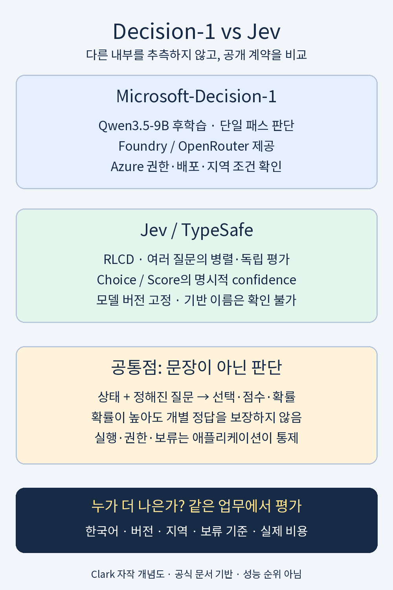

**난이도: 중급 — API·분류·확률의 기초 개념을 다룹니다.**

## 세 줄 요약

- **둘 다 문장 생성보다 코드에 넘길 판단에 집중합니다.** 제한된 질문에 선택·점수·확률을 반환합니다.<a href="#source-3">[3]</a><a href="#source-4">[4]</a>
- **Decision-1은 Azure 운영·공개된 기반 모델, Jev는 병렬 질문·명시적 confidence·버전 선택이 검토 지점입니다.** 기반 공개와 최종 가중치 공개는 다릅니다.<a href="#source-3">[3]</a><a href="#source-6">[6]</a><a href="#source-9">[9]</a>
- **공개 입력 단가는 모두 100만 토큰당 0.042달러, 출력은 무료입니다.** 성능 우열은 같은 업무·버전·지역에서 별도 평가해야 합니다.<a href="#source-1">[1]</a><a href="#source-6">[6]</a><a href="#source-8">[8]</a>

> 자료 기준: **2026년 11월 3일(KST)**. Microsoft 발표일은 **10월 9일**입니다.<a href="#source-1">[1]</a> Jev 초기 소개글의 정확한 발행일은 확정하지 않았으며 최신 문서와 구분했습니다.<a href="#source-2">[2]</a><a href="#source-6">[6]</a> **공개 문서 비교이며, 유료 API 호출·자체 동일 조건 실험은 수행하지 않았습니다.** 업체 성능 주장은 독립 검증과 구분합니다.

## 1. 경쟁하는 지점부터 맞추기

가상 문의 “요금이 두 번 나갔으니 돌려주세요”에는 **분류**와 **환불 실행**이 필요합니다. 두 API는 제한된 질문에 판단을 반환하는 첫 단계의 후보입니다.<a href="#source-3">[3]</a><a href="#source-11">[11]</a> 권한·원장·정책 확인과 실행은 애플리케이션에 남기는 것이 이 글의 설계 원칙입니다. 실제 연결 시험 결과는 아닙니다.

<figure>
  
  <figcaption>그림 1. 자작 비교도이며 내부 구조·실제 화면·성능 순위가 아닙니다. 핵심 내용은 아래 표에도 정리했습니다.<a href="#source-1">[1]</a><a href="#source-4">[4]</a><a href="#source-6">[6]</a> · <a href="/assets/img/posts/microsoft-decision-1-vs-jev/comparison-map.png">비교도 원본 이미지 보기</a></figcaption>
</figure>

## 2. 구조·학습: 공개한 내용의 범위가 다릅니다

> **표 읽기:** 좁은 화면에서 표가 잘리면 표 안을 좌우로 스크롤하세요. 아래 비교표에도 같은 방법을 사용할 수 있습니다.

| 비교 항목 | Microsoft-Decision-1 | Jev |
|---|---|---|
| 기반 모델 | **Qwen3.5-9B 후학습** 명시.<a href="#source-1">[1]</a><a href="#source-9">[9]</a> | 확인한 공식 문서에 **기반 체크포인트명과 파라미터 수 미명시**.<a href="#source-2">[2]</a><a href="#source-6">[6]</a><a href="#source-10">[10]</a> |
| 학습 접근 | 빠른 단일 패스 판단용 후학습. 공개·합성 데이터 사용 설명.<a href="#source-1">[1]</a><a href="#source-9">[9]</a> | 새 아키텍처·병렬 샘플러·**RLCD** 설명.<a href="#source-2">[2]</a><a href="#source-10">[10]</a> |
| 공개 한계 | 목적함수·학습 전체 재현에는 부족.<a href="#source-1">[1]</a><a href="#source-9">[9]</a> | 기반 계보·학습 전체 재현에는 부족.<a href="#source-2">[2]</a><a href="#source-10">[10]</a> |
| 추론·출력 | 한 번의 호출로 선택지 확률 산출(single-pass scoring).<a href="#source-9">[9]</a> | 같은 상태의 여러 질문을 병렬·독립 평가.<a href="#source-4">[4]</a><a href="#source-6">[6]</a> |
| 제공 경로 | Foundry·OpenRouter 호스팅.<a href="#source-1">[1]</a> | TypeSafe `POST /v1/systemone`.<a href="#source-6">[6]</a><a href="#source-11">[11]</a> |

**Qwen의 오픈웨이트가 Decision-1 최종 가중치의 다운로드·자체 호스팅을 뜻하지는 않습니다.**<a href="#source-9">[9]</a> Jev도 기반 이름 미확인을 “전부 처음부터 학습했다”로 해석하면 안 됩니다. 공식 문서는 사전학습 모델→RLCD(Reinforcement Learning for Calibrated Decisions) 경로를 설명합니다.<a href="#source-10">[10]</a> 텍스트 생성 대신 판단에 맞춘 제품이라는 해석이지, 두 내부 구현이 같다는 주장은 아닙니다.

여기서 Jev는 **TypeSafe 상용 모델**입니다.<a href="#source-6">[6]</a> Kev 등 별도 재현 프로젝트의 계보를 대입하지 않았으며, 외부 평가도 기반을 `undisclosed`로 표기합니다.<a href="#source-8">[8]</a>

## 3. 출력·확률 보정: 같은 숫자처럼 보여도 의미를 확인해야 합니다

두 문서는 다음 질문 유형을 안내합니다.<a href="#source-3">[3]</a><a href="#source-4">[4]</a>

| 질문 | Decision-1 문서 | Jev 문서 |
|---|---|---|
| 참인가 | `noul`: 0~1 확률.<a href="#source-3">[3]</a> | `noul`: 0~1 값, 별도 `confidence` 없음.<a href="#source-4">[4]</a><a href="#source-7">[7]</a> |
| 무엇인가 | `choice`: 선택·선택지별 확률.<a href="#source-3">[3]</a> | `choice`, `probabilities`, `confidence`.<a href="#source-4">[4]</a> |
| 어느 정도인가 | `score`: 순서 있는 단계·단계별 확률.<a href="#source-3">[3]</a> | `score`, `probabilities`, `confidence`.<a href="#source-4">[4]</a> |

Microsoft 경로는 Foundry의 `/providers/microsoft/v1/systemone`, TypeSafe는 자체 `/v1/systemone`입니다.<a href="#source-3">[3]</a><a href="#source-6">[6]</a>
유형 이름이 같아도 인증·응답 필드까지 교환 가능하다는 뜻은 아닙니다.<a href="#source-3">[3]</a><a href="#source-6">[6]</a>
SDK 호환성은 시험하지 않았습니다.

**Jev의 confidence는 정답률 실측이 아닌 확률 분포의 요약값**이며 Choice와 Score의 계산도 다릅니다.<a href="#source-7">[7]</a> 공식 예시 `(0.6, 0.3, 0.1)`의 Choice confidence는 `0.4`지만, 이를 “정답일 확률 40%”로 읽으면 안 됩니다.<a href="#source-7">[7]</a>

확률 보정(calibration)은 비슷한 예측 확률이 실제 빈도와 얼마나 맞는지의 문제입니다.<a href="#source-10">[10]</a> Jev는 개별 정답을 보장하지 않으며, Microsoft도 익숙한 유형에서 보정이 가장 강하고 실제 라벨 데이터로 임계값을 검증하라고 안내합니다.<a href="#source-11">[11]</a><a href="#source-3">[3]</a>

TypeSafe의 **“환각 0%”는 스키마 준수 보장이지 실측 내용 오류율 0%가 아닙니다.**<a href="#source-5">[5]</a> 허용된 부서명을 골라도 틀린 부서일 수 있다는 구분입니다.<a href="#source-5">[5]</a>

<figure>
  
  <figcaption>그림 2. “형식이 완벽하다고, 정답까지 완벽하겠느냐.” 원작 Joseph Ducreux·사진 Sailko, Wikimedia Commons <a href="https://creativecommons.org/licenses/by/3.0/">CC BY 3.0</a>.<a href="#source-12">[12]</a> 크롭·크기 조정·문구 추가한 밈이며 실측 결과가 아닙니다. · <a href="/assets/img/posts/microsoft-decision-1-vs-jev/format-is-not-truth.png">밈 원본 이미지 보기</a></figcaption>
</figure>

## 4. 성능: 서로 다른 성적표를 한 경기처럼 읽지 않기

**Microsoft 자체 평가:** 블라인드 처리한 36개 벤치마크·약 15만 문항에서 최고 정확도를 발표했습니다.<a href="#source-1">[1]</a> Jev 정확도·보정 비교 추가 주석도 있지만, 모든 업무·최신 Jev에 대한 우위는 아닙니다.<a href="#source-1">[1]</a>

**TypeSafe 자체 평가:** “193.6배 빠르고 444.6배 저렴”은 System One 워크플로 결과이며, 업체도 개선폭의 상단일 수 있다고 설명합니다.<a href="#source-2">[2]</a> 외부 모델의 평균 예측을 참조 답으로, LLM에는 확률·구조화 출력 래퍼를 썼습니다.<a href="#source-2">[2]</a> **Decision-1과의 동일 조건 직접 비교 배수가 아닙니다.**<a href="#source-2">[2]</a>

**외부 평가:** TypeSafe와 독립 비교를 표방하는 Benchmark Heaven의 JevBench API **기존 ranked 행**입니다.<a href="#source-8">[8]</a>

| 해당 표의 제품·행 | Composite 점수 | 표시된 중앙 지연시간 |
|---|---:|---:|
| Jev 1.13.0 | 71.4 | 0.24초 |
| Jev 1.14.0 | 70.2 | 0.23초 |
| Microsoft-Decision-1 기존 행 | 69.1 | 0.48초 |

Composite는 **정확도 %가 아닌 지능·보정·속도·비용의 결합 지표**입니다.<a href="#source-8">[8]</a> 같은 페이지의 Decision-1 **A2 잠정 재평가·업데이트 가중치 행은 별도**입니다.<a href="#source-8">[8]</a> 업데이트의 **77.0은 `unranked`**이며, 이력에 10월 27일 추출 문제·10월 28일 유료 평가 추가·기준 척도 연결 미완료가 명시돼 있습니다.<a href="#source-8">[8]</a>

따라서 기존·업데이트 행을 섞어 승패나 역전을 단정하지 않습니다. 시점·문제 추출·가중치·척도가 다를 수 있고, 지연에는 네트워크·지역도 영향을 줍니다.<a href="#source-3">[3]</a><a href="#source-8">[8]</a> **벤치마크는 후보를 좁히는 근거이지 업무의 최종 판정은 아닙니다.**

## 5. 가격·가용성: 단가는 같지만 운영 조건은 다릅니다

> **표 읽기:** 좁은 화면에서는 표 안을 좌우로 스크롤하세요. 버전·확장 한도 설명은 표 아래에 있습니다.

| 비교 항목 | Decision-1 | Jev |
|---|---|---|
| 공개 입력 단가 | 100만 토큰당 **0.042달러**.<a href="#source-1">[1]</a> | 100만 토큰당 **0.042달러**.<a href="#source-6">[6]</a> |
| 출력 요금 | 무료.<a href="#source-1">[1]</a> | 무료.<a href="#source-6">[6]</a> |
| 접근·운영 | Foundry 배포·Azure 인증 또는 OpenRouter 경로 확인.<a href="#source-1">[1]</a><a href="#source-3">[3]</a> | 초기 소개는 early access. 실제 접근·조직별 한도 확인 필요.<a href="#source-2">[2]</a><a href="#source-6">[6]</a> |
| 문맥 길이 | 최대 **32K 입력**.<a href="#source-9">[9]</a> | 기본 **요청당 64k·질문당 32k**.<a href="#source-6">[6]</a> |
| 버전 관리 | 발표된 Qwen 기반과 향후 변경 계획 구분.<a href="#source-1">[1]</a> | `jev-latest` **1.13.0**, `jev-preview` **1.14.0**.<a href="#source-6">[6]</a> |

Jev 1.14는 10월 14일 제공됐다는 설명입니다.<a href="#source-6">[6]</a> 별도 헤더로 **요청·질문 한도를 모두 262k**로 늘리는 기능은 기본 비활성이며 속도·정확도 저하 경고가 있습니다.<a href="#source-6">[6]</a> 큰 문맥 한도가 한국어 우위를 뜻하지 않으며, 별칭은 바뀔 수 있어 평가 버전을 고정해야 합니다.<a href="#source-6">[6]</a>

**가상 계산:** 각 서비스의 청구 입력이 각각 1억 토큰이면 발표 단가상 각각 **4.20달러**입니다.<a href="#source-1">[1]</a><a href="#source-6">[6]</a> 실제 결제 실측이 아니며 토큰 집계·요청 구성·재시도·재평가·네트워크·운영비 차이는 별도입니다. **같은 단가 ≠ 같은 업무 총비용**입니다.

## 6. 언제 무엇을 먼저 검토할까

문서에 근거한 선택 가이드이지 성능·도입 성공 보장은 아닙니다.

- **Azure 운영 중:** Decision-1의 Foundry·데이터 존 배포를 검토할 수 있습니다.<a href="#source-3">[3]</a> 지역별 지연·가용성은 별도입니다.
- **여러 독립 질문·confidence 조합:** Jev의 작은 질문·코드 조합 패턴을 검토할 수 있습니다.<a href="#source-4">[4]</a><a href="#source-7">[7]</a> 다른 모델에 불가능하다는 뜻은 아닙니다.
- **한국어·내부 용어 중심:** 둘 다 실제 데이터 평가가 먼저입니다. Jev는 영어 중심 학습·CJK 정확도 차이를 명시하며, Microsoft의 다국어 자체 평가도 한국어 업무 보증은 아닙니다.<a href="#source-6">[6]</a><a href="#source-1">[1]</a>
- **답장·요약·코드·서술형 이유 필요:** 두 제품은 생성형 설명을 출력하지 않으므로 별도 생성 모델을 검토합니다.<a href="#source-3">[3]</a><a href="#source-11">[11]</a>
- **자체 호스팅 필수:** 기반 이름보다 최종 가중치·라이선스·운영 지원 확보 여부를 확인해야 합니다.

환불 예시에서는 같은 한국어 상태·선택지·보류 옵션에 누락 정보·부정 표현·오래된 정책을 넣어 평가하는 방법을 제안합니다. 실제 중복 청구·권한은 원장과 코드·승인 체계가 확인해야 합니다. Jev 공식 예시도 판단과 결정적 코드 검사를 조합합니다.<a href="#source-11">[11]</a>

평가에는 **버전·입력/질문 구성·보류율·오탐/미탐·보정·p50/p95 지연·재시도 포함 비용·데이터 처리 조건**을 기록하는 편이 좋습니다. 향후 실험 제안이며 실행 결과가 아닙니다.

## 결론: 지금 고를 것은 승자보다 평가의 출발점입니다

**타입 안전성 ≠ 내용의 정답성 ≠ 실행 권한**입니다.<a href="#source-5">[5]</a><a href="#source-9">[9]</a> 단가·벤치마크 한 줄보다 실제 업무의 오류 비용·보류 기준을 고정해 비교해야 합니다.

### 확인 한계

자체 API 호출·동일 지역 부하·한국어 정답셋 실험·내부 학습 코드 검증은 하지 않았습니다. Jev 기반 미공개 판단은 **확인한 공식 자료 범위**에 한정합니다. 가격·별칭·지원 지역은 자료 기준일 이후 바뀔 수 있으며 계약·계정 접근성은 미검증입니다. 이미지 라이선스는 웹 추출로 확인했고 직접 HTTP는 403으로 제한됐습니다.

이전 글: [Microsoft Decision-1 소개](/posts/microsoft-decision-1/) · [Jev 구조와 LLM 비교](/posts/jev-structure-vs-llm/) · [Jev 공개 성능 근거](/posts/jev-public-performance-evidence/)

## Sources

[1]  [Microsoft · Introducing Microsoft-Decision-1, our model for fast decision-making](https://commandline.microsoft.com/microsoft-decision-1-model-foundry)

[2]  [TypeSafe AI · Introducing System One Models &amp; Jev](https://typesafe.ai/blog/introducing-system-one-models-and-jev)

[3]  [Microsoft Learn · Deploy and use Microsoft-Decision-1 in Microsoft Foundry](https://learn.microsoft.com/en-us/azure/foundry/foundry-models/how-to/use-foundry-models-microsoft-decision)

[4]  [TypeSafe · Introduction](https://docs.typesafe.ai/introduction)

[5]  [TypeSafe AI · Home](https://typesafe.ai)

[6]  [TypeSafe · Models](https://docs.typesafe.ai/models)

[7]  [TypeSafe · Confidence](https://docs.typesafe.ai/confidence)

[8]  [Benchmark Heaven · JevBench API leaderboard: hosted decision APIs](https://benchmarkheaven.com/jev-models/api)

[9]  [Microsoft Foundry · Microsoft-Decision-1](https://ai.azure.com/catalog/models/Microsoft-Decision-1)

[10]  [TypeSafe · AI primer](https://docs.typesafe.ai/introduction/machine-learning-primer)

[11]  [TypeSafe · System One](https://docs.typesafe.ai/concepts/system-one)

[12]  [Wikimedia Commons · Joseph Ducreux, Self-Portrait in a Mocking Pose — photograph by Sailko](https://commons.wikimedia.org/wiki/File:Joseph_ducreux,_autoritratto_dell%27artista_che_prende_il_giro,_1793,_01.jpg)
