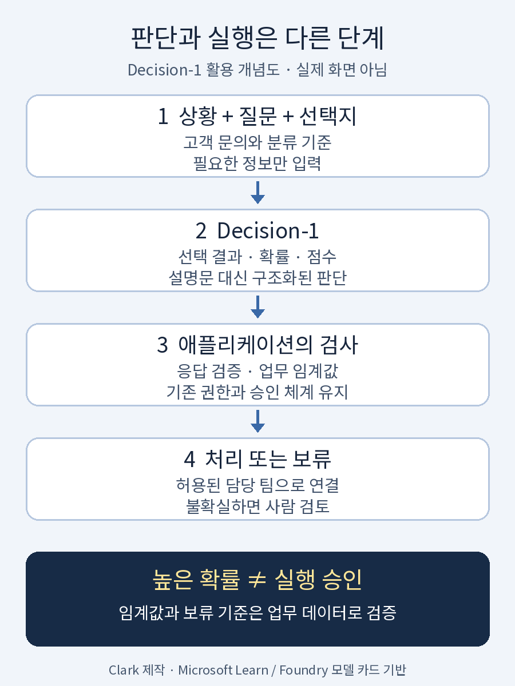

**난이도: 중급 — API와 분류 개념을 알면 더 쉽게 읽을 수 있습니다.**

## 세 줄 요약

- **Microsoft-Decision-1은 글을 생성하는 대신, 정해진 선택지의 확률과 구조화된 판단을 반환하는 모델입니다.**<a href="#source-1">[1]</a><a href="#source-2">[2]</a> 고객 문의 분류, 모델 라우팅, 에이전트 행동 검토 같은 반복 업무가 대상입니다.<a href="#source-1">[1]</a><a href="#source-2">[2]</a>
- 발표 가격은 입력 100만 토큰당 **0.042달러**, 출력 무료입니다.<a href="#source-1">[1]</a><a href="#source-4">[4]</a> Foundry와 OpenRouter에서 제공하지만 일반 채팅 API와는 호출 방식이 다릅니다.<a href="#source-1">[1]</a><a href="#source-4">[4]</a>
- 빠르고 저렴한 판단 계층의 후보이지, 모든 LLM의 대체재나 안전 보증 장치는 아닙니다. 공급자 자체 벤치마크, 외부 측정, 실제 업무 성능을 구분해야 합니다.<a href="#source-1">[1]</a><a href="#source-2">[2]</a><a href="#source-9">[9]</a>

> 자료 확인: **2026년 11월 3일(KST)**. 공식 발표일은 **2026년 10월 9일**입니다.<a href="#source-1">[1]</a> Microsoft 발표·Learn·Foundry 모델 카드와 OpenRouter, 외부 벤치마크를 대조했습니다. 이 글은 문서 기반 분석이며, 유료 API 호출이나 자체 성능 시험은 수행하지 않았습니다.

## 1. 답변을 잘 쓰는 AI보다, 잘 고르는 AI

고객 문의를 담당 부서로 보내는 데 장문의 설명이 꼭 필요하지는 않습니다. 애플리케이션 입장에서는 ‘결제팀인가, 기술팀인가, 사람이 검토해야 하나’가 먼저입니다.

Microsoft-Decision-1은 이런 **닫힌 질문에 점수를 매기는 decision-scoring 모델**입니다.<a href="#source-2">[2]</a><a href="#source-3">[3]</a> 상황인 `state`와 질문·선택지를 보내면, 생성된 설명문 대신 소프트웨어가 처리할 수 있는 수치와 선택 결과를 받습니다.<a href="#source-2">[2]</a> ‘왜 그렇게 생각했는지’라는 서술형 근거는 생성하지 않습니다.<a href="#source-2">[2]</a><a href="#source-3">[3]</a>

기반은 Alibaba의 **Qwen3.5-9B**이며 Microsoft가 후학습했습니다.<a href="#source-3">[3]</a> Foundry 모델 카드에는 텍스트 입력·JSON 출력, **32,768토큰 컨텍스트**, **Preview** 수명주기로 표시돼 있습니다.<a href="#source-3">[3]</a> 기반 모델이 오픈웨이트라는 사실을 Decision-1 자체의 가중치 배포나 자체 호스팅 가능성과 혼동해서는 안 됩니다.

<figure>
  
  <figcaption>그림 1. “어느 팀으로 보낼지만 알려주시오.” 인터넷에서 밈으로 쓰이는 Ducreux 초상화에 이 글의 문구를 새로 넣었습니다.<a href="#source-7">[7]</a> 원작 Joseph Ducreux, 사진 Sailko, Wikimedia Commons의 CC BY 3.0 자료를 The Public Domain Review 경유로 사용했습니다.<a href="#source-7">[7]</a><a href="#source-10">[10]</a> 크롭·크기 조정·문구 추가이며 제품 성능을 입증하는 그림이 아닙니다. <a href="https://creativecommons.org/licenses/by/3.0/">사진 이용허락</a> · <a href="/assets/img/posts/microsoft-decision-1/decision-meme.png">원본 이미지 보기</a></figcaption>
</figure>

## 2. 질문은 세 가지로 나눕니다

Learn 문서는 다음 세 가지 질문 형식을 설명합니다.<a href="#source-2">[2]</a> 동일한 `state`에 여러 질문을 한 번에 묶을 수도 있습니다.<a href="#source-2">[2]</a>

| 형식 | 물어보는 것 | 문서상 반환 내용 | 활용 예시 |
| --- | --- | --- | --- |
| `noul` | 이 조건이 참인가? | 0~1 확률 | 이 답변이 환불을 약속하는가 |
| `choice` | 어느 선택지인가? | 선택 결과와 각 선택지 확률 | 결제·기술·계정 문의 분류 |
| `score` | 어느 수준인가? | 순서가 있는 척도의 값과 각 단계 확률 | 장애 심각도·답변 품질 평가 |

`score`는 임의의 ‘객관적 점수’를 만들어 주는 기능으로 보면 안 됩니다.<a href="#source-2">[2]</a> 문서의 네 단계 척도는 인덱스 0~3의 확률가중 평균이므로, 결과가 단계 사이에 놓일 수 있습니다.<a href="#source-2">[2]</a> 상대 순위와 임계값에 활용하고 업무 데이터로 검증하라는 것이 공식 안내입니다.<a href="#source-2">[2]</a>

**해석:** 이 모델의 장점은 ‘JSON을 반환한다’는 사실 하나보다, 판단을 좁은 질문과 명시적 선택지로 설계하게 한다는 데 있습니다. 반대로 선택지가 잘못됐거나 필요한 정보가 빠졌다면, 구조화된 응답도 올바른 판단을 보장하지 않습니다.

## 3. 어디에 붙이면 좋을까

- **고객지원:** 문의를 분류하고 긴급도를 매긴 뒤 담당 팀으로 보냅니다.<a href="#source-2">[2]</a>
- **모델·도구 라우팅:** 들어온 요청에 맞는 모델, 도구, 에이전트를 고릅니다.<a href="#source-1">[1]</a><a href="#source-2">[2]</a>
- **검색·답변 검수:** 검색 결과의 관련성, 답변이 제공 근거에 부합하는지, 루브릭을 만족하는지 평가합니다.<a href="#source-3">[3]</a>
- **에이전트 가드레일:** 제안된 행동을 검사한 뒤 애플리케이션이 허용·차단·사람 검토를 결정합니다.<a href="#source-2">[2]</a><a href="#source-3">[3]</a> 모델이 직접 권한을 부여하는 것은 아닙니다.<a href="#source-3">[3]</a>

<figure>
  
  <figcaption>그림 2. 모델은 판단 신호를 반환하고, 실행 정책은 애플리케이션이 소유합니다. Clark가 직접 제작한 설명용 개념도이며 실제 제품 화면이나 내부 아키텍처가 아닙니다. 사람 검토와 별도 권한 검사는 운영 설계 제안입니다.<a href="#source-2">[2]</a><a href="#source-3">[3]</a> <a href="/assets/img/posts/microsoft-decision-1/decision-workflow.png">원본 이미지 보기</a></figcaption>
</figure>

## 4. 성능 발표를 읽을 때 주의할 점

### Microsoft 자체 평가

Microsoft는 학습에서 가린 **36개 벤치마크·약 15만 문항** 비교에서 가장 높은 정확도를 기록했다고 발표했습니다.<a href="#source-1">[1]</a> 내장 차트의 정확한 표본은 **147,137문항**, 평균 정확도는 **83.5%**입니다.<a href="#source-1">[1]</a> 같은 차트에서 Decision-1의 지연시간은 **P50 85ms·P95 125ms**, calibration 점수는 **92.2**이며, calibration 순위는 Jev·Quyet 다음인 **3위**입니다.<a href="#source-1">[1]</a>

본문의 ‘H2O-Lightning-4B v1.1보다 2.5배, GPT-6 Sol보다 35배 빠르다’는 표현도 **Microsoft가 제시한 비교 조건 안의 주장**입니다.<a href="#source-1">[1]</a> 각주상 Decision-1은 같은 리전의 Foundry에서 측정했고, 비교 모델 지연시간은 JevBench v1.6.1의 **보정된 중앙값**을 사용했습니다.<a href="#source-1">[1]</a> 따라서 동일 하드웨어·동일 배포 경로의 일괄 실측이라고 읽어서는 안 됩니다. GPT-6 Sol은 이 정확도 차트에서 점수가 없는 `not ranked`이므로, 속도 비교를 정확도 우위로 확대할 수도 없습니다.<a href="#source-1">[1]</a>

### 외부 평가도 있지만, 같은 시험은 아닙니다

Benchmark Heaven의 JevBench는 별도 Azure Foundry 측정을 공개했습니다.<a href="#source-9">[9]</a> **2026년 10월 10일 측정 기록**에는 비공개 1,200개와 공개 300개 관측, 속도 하위표본 124개 요청의 native 중앙값 **459ms**가 기재돼 있습니다.<a href="#source-9">[9]</a> 컨텍스트 한도 실패 21건도 점수 분모에서 제외하지 않았다고 설명합니다.<a href="#source-9">[9]</a>

다만 이 수치를 공식 발표의 85ms와 단순히 나눠 ‘실제로 몇 배 느리다’고 결론 내리지 않습니다. 측정 날짜·경로·질문 집합이 다릅니다.<a href="#source-1">[1]</a><a href="#source-9">[9]</a> 더구나 해당 사이트는 **10월 28일 갱신 가중치의 유료 평가**도 별도 추가했으며, 그 draw의 점수는 기준 척도와 동등화되기 전까지 **순위 밖**으로 표시한다고 밝힙니다.<a href="#source-9">[9]</a> 과거 측정 행을 현재 가중치의 최종 성적으로 대체할 수 없습니다.

**결론:** 외부 측정은 존재하지만, Microsoft의 36개 벤치마크 결과를 그대로 독립 재현한 것은 아닙니다. 공식 수치는 공급자 주장으로, 외부 수치는 그 평가의 조건 안에서 읽는 것이 적절합니다.

## 5. 가격: 출력 무료가 전체 업무 무료는 아닙니다

확인한 공식 발표와 OpenRouter 목록 가격은 다음과 같습니다.<a href="#source-1">[1]</a><a href="#source-4">[4]</a>

| 항목 | 가격·조건 |
| --- | --- |
| 입력 | 100만 토큰당 **0.042달러(USD)** |
| 출력 | **무료** |
| 접근 경로 | Microsoft Foundry / OpenRouter |

예를 들어 **요청당 입력 1,000토큰으로 10만 건**을 처리한다고 가정하면, 입력은 1억 토큰이고 표시 단가 기준 계산값은 **4.20달러**입니다. 이는 이 글의 가상 계산이며 실제 청구액이나 실측 사용량이 아닙니다. `state`뿐 아니라 질문·선택지 등 전체 입력을 예산에 반영하고, 재호출·후속 생성 모델·인프라·세금 등은 별도로 고려해야 합니다.

가격과 실제 선택 가능한 리전·할당량은 도입 시 다시 확인해야 합니다. Learn은 일부 리전의 `DataZoneStandard`와 `GlobalStandard`를 안내하지만, 배포 유형 자체가 더 낮은 지연시간을 보장하지는 않는다고 명시합니다.<a href="#source-2">[2]</a>

## 6. API 예시: 채팅이 아니라 Decisions

다음은 **Learn의 요청 형식을 바탕으로 만든 미실행 JSON 예제**입니다.<a href="#source-2">[2]</a> 가상의 고객 문의를 기술팀·결제팀·사람 검토 중 하나로 분류합니다. 응답 수치나 정확도를 만들어 붙이지 않았습니다.

```json
{
  "model": "<your-deployment-name>",
  "state": "결제는 완료됐지만 API가 계속 500 오류를 반환합니다.",
  "questions": {
    "team": {
      "type": "choice",
      "instructions": "주된 문제를 해결할 담당을 고르세요.",
      "criteria": {
        "billing": "청구, 결제 금액, 환불 문제",
        "engineering": "API 오류, 소프트웨어 결함, 장애",
        "human_review": "정보가 부족하거나 여러 담당의 판단이 필요함"
      }
    }
  }
}
```

Foundry에서는 리소스 엔드포인트 뒤 **`/providers/microsoft/v1/systemone`**으로 요청하며, `model`에는 기반 모델 이름이 아니라 **자신이 만든 배포 이름**을 넣습니다.<a href="#source-2">[2]</a> 인증은 Entra ID 또는 API 키가 필요합니다.<a href="#source-2">[2]</a>

OpenRouter에서는 모델 ID **`microsoft/microsoft-decision-1`**, 엔드포인트 **`https://openrouter.ai/api/alpha/decisions`**를 사용합니다.<a href="#source-4">[4]</a> 일반 Chat Completions SDK에 모델 이름만 바꾸는 방식은 지원되지 않는다고 안내합니다.<a href="#source-4">[4]</a> `alpha` 경로와 제공 상태는 실제 연동 전에 다시 확인해야 합니다.

이후 애플리케이션은 반환 타입·선택지·확률의 유효성을 검사하고, 별도 검증에서 정한 기준을 충족하지 못하면 사람에게 보낼 수 있습니다. 여기서 `human_review`는 이 예제의 설계 선택이지, 선택지를 추가하는 것만으로 오판이 사라진다는 의미는 아닙니다.

## 7. 도입 전에 확인할 제약

1. **텍스트 전용입니다.**<a href="#source-3">[3]</a> 이미지·음성·동영상을 직접 입력하거나 출력하지 않습니다.<a href="#source-3">[3]</a> 화면 조작 데모가 있어도 모델 카드의 멀티모달 지원과 동일시하면 안 됩니다.<a href="#source-1">[1]</a><a href="#source-3">[3]</a>
2. **생성과 설명의 대체재가 아닙니다.** 글쓰기·요약·번역·대화나 판단 이유의 서술이 필요하면 생성형 모델을 조합해야 합니다.<a href="#source-2">[2]</a><a href="#source-3">[3]</a>
3. **확률은 보증서가 아닙니다.** 질문 표현·선택지 순서에 따라 점수가 달라질 수 있고, 익숙하지 않은 업무에서 calibration이 약해질 수 있습니다.<a href="#source-2">[2]</a> 한국어 업무와 사내 분류 체계에서도 별도 검증이 필요합니다.
4. **안전 필터도 실수합니다.** 유해 요청을 놓치거나 정상 요청을 차단할 수 있습니다.<a href="#source-2">[2]</a> 편향도 남을 수 있어 채용·의료·신용 등 사람에게 중대한 영향을 주는 결정의 유일한 판단자로 쓰지 말라는 것이 공식 제한입니다.<a href="#source-2">[2]</a><a href="#source-3">[3]</a>
5. **운영 조건을 고정해야 합니다.** Preview와 지속적인 가중치 갱신을 고려해 평가 날짜·경로·입력·기준을 남기는 편이 좋습니다. OpenRouter는 API 형태를 유지하면서 가중치를 계속 갱신한다고 설명합니다.<a href="#source-3">[3]</a><a href="#source-4">[4]</a>

**이 글의 도입 제안:** 먼저 실제 업무의 라벨 데이터로 기존 규칙·기존 LLM과 비교하고, 오탐·미탐 비용에 맞는 임계값을 정하십시오. 평균 속도만 보지 말고 느린 요청, 오류, 사람 검토율까지 함께 측정하는 것이 좋습니다. 민감 행동은 높은 점수만으로 실행하지 말고 기존 권한·승인 체계를 통과시켜야 합니다.

## 마무리

Decision-1의 의미는 ‘만능 AI가 하나 더 나왔다’보다 **생성과 판단을 다른 도구로 나눌 선택지가 늘었다**는 데 있습니다. 설명문이 필요 없는 반복 분류에서는 시험할 만하지만, 가격표나 공급자 벤치마크만으로 자동화 범위를 정하지 않는 것이 핵심입니다. **무엇을 물을지, 언제 보류할지, 누가 실행을 허용할지는 여전히 애플리케이션의 책임**입니다.<a href="#source-2">[2]</a><a href="#source-3">[3]</a>

## Sources

<p id="source-1" style="scroll-margin-top: 64px;">[1]  <a href="https://commandline.microsoft.com/microsoft-decision-1-model-foundry">Microsoft Command Line · Introducing Microsoft-Decision-1, our model for fast decision-making</a></p>

<p id="source-2" style="scroll-margin-top: 64px;">[2]  <a href="https://learn.microsoft.com/en-us/azure/foundry/foundry-models/how-to/use-foundry-models-microsoft-decision">Microsoft Learn · Deploy and use Microsoft-Decision-1 in Microsoft Foundry</a></p>

<p id="source-3" style="scroll-margin-top: 64px;">[3]  <a href="https://ai.azure.com/catalog/models/Microsoft-Decision-1">Microsoft Foundry · Microsoft-Decision-1 model card</a></p>

<p id="source-4" style="scroll-margin-top: 64px;">[4]  <a href="https://openrouter.ai/microsoft/microsoft-decision-1">OpenRouter · Microsoft-Decision-1 — API Pricing &amp; Providers</a></p>

<p id="source-7" style="scroll-margin-top: 64px;">[7]  <a href="https://publicdomainreview.org/collection/joseph-ducreux-self-portraits">The Public Domain Review · Joseph Ducreux’s Self-Portraits (ca. 1790)</a></p>

<p id="source-9" style="scroll-margin-top: 64px;">[9]  <a href="https://benchmarkheaven.com/jev-models/api">Benchmark Heaven · JevBench API leaderboard: decision API benchmark</a></p>

<p id="source-10" style="scroll-margin-top: 64px;">[10]  <a href="https://commons.wikimedia.org/wiki/File:Joseph_ducreux,_autoritratto_dell%27artista_che_prende_il_giro,_1793,_01.jpg">Wikimedia Commons · Joseph ducreux, autoritratto dell&#x27;artista che prende il giro, 1793, 01.jpg</a></p>
