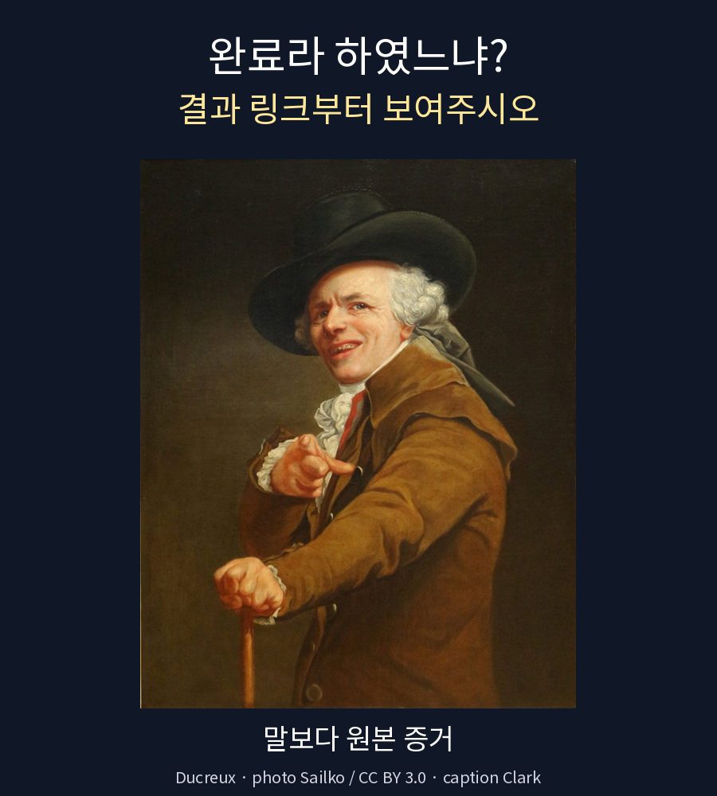
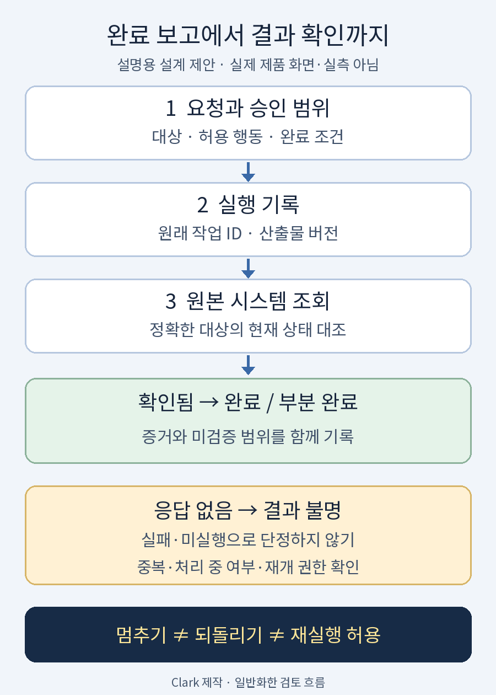

**난이도: 중급 — API 호출과 배포의 흐름을 알면 더 쉽게 읽을 수 있습니다.**

## 세 줄 요약

- **“완료했습니다”는 결과를 확인하라는 신호이지, 그 자체로 완료 증거는 아닙니다.** 요청한 대상·버전·최종 상태를 원래 시스템에서 확인해야 합니다.
- 모델의 confidence, 실행 권한, 도구의 성공 응답, 실제 업무 완료는 서로 다른 질문입니다. 높은 확신으로 권한 검사나 결과 확인을 생략하지 않습니다.
- **시간초과는 미실행의 증거가 아닙니다.** 먼저 상태를 조회하고, 재실행이 허용되며 중복 방지 조건이 확인된 경우에만 재개합니다.<a href="#source-4">[4]</a><a href="#source-5">[5]</a>

> 자료 확인: **2026년 11월 4일(KST)**. 최근 제품 발표는 공식 발표 기준으로 읽었으며, 이 글에서 해당 제품이나 외부 API의 성능·복구 효과를 직접 시험하지 않았습니다. 아래 사례·체크리스트·개념도는 설명을 위한 가상 사례와 설계 제안입니다.

## 1. 이제는 답변보다, 답변 뒤의 행동을 확인할 때입니다

2026년 11월 3일 Honeycomb은 AI SRE 에이전트를 발표했습니다. **발견 사항을 query·trace·deploy에 연결하고, 사실과 가설을 구분하며, 팀이 정한 권한 안에서 행동한다**는 설명입니다. 발표 당시 Personal·Team Agents는 **early access**입니다.<a href="#source-1">[1]</a>

같은 날 CrowdStrike는 Falcon Guardian의 AI Kill Switch를 발표했습니다. 관리자에 의한 중단·재실행 차단·네트워크 차단·감사 기록을 설명하지만, 중단 기능은 **Gateway에서 먼저, endpoint에서는 향후 제공**으로 구분합니다. 당일 제공이라는 문구를 모든 환경의 기능 완성으로 읽으면 안 됩니다.<a href="#source-2">[2]</a>

두 자료는 **기업 공식 홍보 발표**이지 안전성·생산성의 독립 실증이 아닙니다. 여기서 가져올 질문은 이것입니다. **에이전트가 일을 했다고 할 때, 무엇을 보고 믿을 것인가?**

<figure>
  
  <figcaption>그림 1. “완료라 하였느냐? 결과 링크부터 보여주시오.” 인터넷 밈으로 쓰이는 Ducreux 초상화에 이 글의 문구를 새로 넣었습니다.<a href="#source-6">[6]</a> 원작 Joseph Ducreux, 사진 Sailko, Wikimedia Commons의 CC BY 3.0 자료를 The Public Domain Review 경유로 사용했습니다.<a href="#source-6">[6]</a><a href="#source-7">[7]</a> 크롭·크기 조정·문구 추가이며 실제 제품 화면이나 실행 증거가 아닙니다. <a href="https://creativecommons.org/licenses/by/3.0/">사진 이용허락</a> · <a href="/assets/img/posts/ai-agent-completion-verification/completion-meme.png">원본 이미지 보기</a></figcaption>
</figure>

## 2. 가상 사례: 게시 버튼을 눌렀는데 응답이 끊겼습니다

다음은 **실제 장애나 특정 서비스의 동작을 재현한 것이 아닌 가상 사례**입니다.

에이전트에게 “승인한 공지 한 건을 게시해 주세요”라고 요청했습니다. 에이전트는 초안을 저장하고 게시 API를 호출했습니다. 그런데 응답을 기다리던 중 연결이 끊겼습니다. 에이전트가 “실패했으니 다시 게시하겠습니다”라고 말합니다.

여기서 당장 다시 호출하면 안 됩니다. **서버가 게시를 끝냈지만 응답만 돌아오지 않았을 수 있기 때문입니다.** AWS Builders’ Library도 EC2 생성 요청에 응답이 오지 않는 상황에서, 단순 재시도가 중복 자원을 만들 수 있으며 상태 대조가 필요하다고 설명합니다.<a href="#source-4">[4]</a>

아직 처리 중인지, 게시가 끝났는지, 게시 전에 거절됐는지부터 나눠야 합니다. 허용된 조회 경로로 **원래 작업과 연결된 게시물 ID·작업 ID·요청 기록**을 찾습니다. 같은 제목의 기존 글을 성공 결과로 오인하지 않도록 대상·본문 버전·시점도 대조합니다.

## 3. 완료라는 말을 네 가지 질문으로 나눕니다

아래는 이 글에서 제안하는 검토 틀입니다. 특정 제품의 상태 코드가 아닙니다.

| 질문 | 확인할 것 | 대신할 수 없는 것 |
| --- | --- | --- |
| 이 행동이 맞는가? | 입력 자료, 판단 기준, 검토 결과 | 높은 confidence만으로 정답 보장 |
| 이 행동을 해도 되는가? | 사용자 승인, 대상, 허용 행동·범위 | 계정이 기술적으로 접근 가능하다는 사실 |
| 실제로 실행됐는가? | 작업 ID, 결과 ID, 실행 시스템의 상태 | 실행하겠다는 계획이나 호출 시도 |
| 요청한 결과가 맞는가? | 최종 산출물, 버전, 공개·수신 등 수용 조건 | 일부 단계의 성공 응답 |

confidence는 판단 신호이고 권한은 별도 통제입니다. **“게시해도 좋을 확률이 높다”와 “공개 게시하도록 승인받았다”는 다릅니다.**

OWASP의 Excessive Agency 안내도 도구 기능·권한·자율성을 필요한 범위로 줄이고, 고영향 행동에 사람의 승인을 요구하며, 하위 시스템에서 권한을 검증하라고 권고합니다. 허용 여부를 LLM의 판단에만 맡기지 말라는 취지입니다.<a href="#source-3">[3]</a>

판단의 신뢰성과 실행 권한의 차이는 기존 [JEV 글](/posts/jev-strengths-limits-trust/)에서도 다뤘습니다. 여기서는 그 이후, **실행했다고 보고한 일이 실제로 어디까지 도달했는지**에 집중합니다.

## 4. 원본 증거는 ‘요청한 결과’와 같은 층에 있어야 합니다

블로그의 초안 저장, commit, 원격 반영, 배포, 공개 확인은 다릅니다. 발행 요청에 commit만으로는 부족하고, 초안 요청에 공개 게시까지 하면 과잉 실행입니다. **완료 조건에 맞는 증거를 골라야 합니다.**

- **초안 작성:** 요청한 파일의 실제 내용과 저장 위치를 확인합니다.
- **코드 반영:** 정확한 저장소·branch·commit과 변경 파일을 대조합니다.
- **웹 공개:** 해당 버전의 배포 상태와 실제 공개 본문·이미지·링크를 확인합니다.
- **메시지 전달:** 해당 시스템이 제공하는 전송·배달·열람 상태를 구분합니다. 전송 접수를 상대의 열람으로 보고하지 않습니다.

이는 일반적인 설계 예시입니다. 제공되지 않는 증거는 만들어 채우지 말고 **“확인하지 못한 범위”**로 남깁니다. 기록에는 **대상 식별자·버전·확인 시각·최종 상태·미검증 항목**을 연결합니다. 공유할 때는 접근 토큰·개인정보·비공개 본문을 제외합니다.

<figure>
  
  <figcaption>그림 2. 실행 보고와 결과 확인을 분리하는 흐름. Clark가 직접 제작한 설명용 개념도이며 실측 결과·실제 서비스 화면·제품 아키텍처가 아닙니다. 단계와 분기는 이 글의 설계 제안입니다. <a href="/assets/img/posts/ai-agent-completion-verification/completion-evidence-flow.png">원본 이미지 보기</a></figcaption>
</figure>

## 5. timeout 뒤의 재개는 ‘다시 하기’가 아니라 ‘상태 맞추기’입니다

시간초과가 나면 **결과 불명**으로 기록하고 원래 시스템의 상태와 대조합니다. 확인 전에는 성공·실패·미실행을 확정하지 않습니다. 응답 유실과 중복 부작용을 다루는 AWS의 설명을 에이전트 운영에 적용한 제안입니다.<a href="#source-4">[4]</a>

읽기 전용으로 확인 가능한 결과가 있다면 다음처럼 나눕니다.

- **완료가 확인됨:** 그 결과를 검증하고 종료합니다. 같은 행동을 반복하지 않습니다.
- **처리 중임이 확인됨:** 원래 작업을 관찰합니다. 새 작업을 겹쳐 만들지 않습니다.
- **미실행이 확정됨:** 승인·금지 조건과 재시도 규칙을 다시 확인합니다.
- **여전히 불명:** 불명 상태를 유지하고 담당자에게 넘깁니다. 목록에서 바로 보이지 않는다는 이유만으로 미실행이라고 바꾸지 않습니다.

중복 방지에는 **멱등성(idempotency)** 계약이 도움이 됩니다. 같은 요청을 다시 보내도 추가 부작용이 생기지 않도록 서비스가 보장하는 성질입니다. 하지만 요청에 임의의 키를 붙였다고 모든 API가 멱등성을 제공하는 것은 아닙니다.<a href="#source-4">[4]</a>

예를 들어 Stripe 문서는 API v1에서 같은 멱등성 키의 재요청에 저장한 응답을 돌려주며, 여기에는 `500` 오류도 포함된다고 설명합니다. 원래 키가 정리된 뒤 재사용하면 새 요청으로 처리되고, 매개변수도 원래 요청과 대조합니다. API v2는 별도의 재시도 동작을 설명하므로, 버전별 계약도 구분해야 합니다.<a href="#source-5">[5]</a>

재개 전에는 **중복 방지 범위·키 보존 조건·동일 매개변수 조건**을 확인합니다. 새 키나 새 작업 ID로 시작하면 중복 방지가 이어지지 않을 수 있습니다.<a href="#source-4">[4]</a><a href="#source-5">[5]</a> 기술적 재시도 가능성이 승인 취소나 실행 금지를 해제하지는 않습니다. 재개 권한도 별도로 확인합니다.

## 6. 멈췄다는 것과 되돌렸다는 것은 다릅니다

CrowdStrike 발표가 설명하는 중단·재실행 차단·네트워크 차단은 **이후 행동을 막는 통제**로 읽어야 합니다. 그 발표만으로 이미 수행된 외부 변경까지 자동 복원된다고 결론 내릴 근거는 없습니다.<a href="#source-2">[2]</a>

가상 게시 사례에서 에이전트 프로세스를 중단했다고 이미 공개된 글이 사라지는 것은 아닙니다. 게시 취소나 정정은 현재 상태를 확인한 뒤 별도로 판단할 작업입니다. 되돌리기 자체가 새로운 외부 변경이므로 승인과 영향 확인도 필요합니다.

운영 설계에서는 다음 질문을 따로 적어 두는 편이 좋습니다.

1. **중단:** 아직 실행 중인 동작과 예약된 후속 동작을 어떻게 막을 것인가?
2. **영향 확인:** 중단 전에 무엇이 바뀌었고, 아직 처리 중인 외부 작업은 무엇인가?
3. **복구:** 이전 상태로 복원할 수 있는가, 아니면 별도 정정·취소가 필요한가?
4. **재개:** 누가 어떤 근거와 권한으로 남은 작업을 다시 진행하는가?

특정 제품의 기능 목록이 아니라 팀이 정해야 할 질문입니다.

## 7. 그대로 가져다 쓰는 완료 확인 체크리스트

아래는 이 글의 제안 양식입니다. 위험도와 업무에 맞게 줄이거나 확장하되, 빈칸을 성공으로 취급하지 않습니다.

- [ ] **요청 범위:** 초안·실행·공개·전달 중 어디까지 요청했습니까?
- [ ] **권한:** 정확한 대상과 행동에 유효한 승인이 있습니까?
- [ ] **대상·버전:** 어떤 작업·결과·파일·commit인지 식별할 수 있습니까?
- [ ] **원본 확인:** 도구 응답을 요약한 말뿐 아니라 실제 대상 시스템을 읽어 확인했습니까?
- [ ] **수용 조건:** 요청한 본문·이미지·수신 상태 등 최종 결과가 맞습니까?
- [ ] **부분 완료:** 성공한 단계와 남은 단계, 미검증 범위를 나눴습니까?
- [ ] **불명 처리:** timeout을 실패·미실행으로 단정하지 않았습니까?
- [ ] **안전한 재개:** 중복 여부·처리 중 여부·멱등성 조건·재개 권한을 확인했습니까?
- [ ] **중단·복구:** 멈춘 것과 되돌린 것을 구분하고 외부 영향을 확인했습니까?
- [ ] **공유 안전:** 결과 보고에서 개인정보·비밀·불필요한 내부 기록을 제외했습니까?

보고도 “완료했습니다” 한 문장 대신 다음처럼 구성할 수 있습니다. **실제 실행 결과가 아닌 보고 형식 예시**입니다.

> **요청:** 승인한 공지 한 건 공개 게시. 
> **확인한 결과:** 대상 게시물과 승인 본문을 대조하고 공개 페이지를 조회함. 
> **증거:** 게시물 식별자·본문 버전·확인 시각·허용된 결과 링크. 
> **남은 범위:** 확인하지 못한 화면·자산·전달 상태를 명시. 
> **재개 조건:** 추가 변경이 필요하면 현재 상태와 승인 범위를 먼저 확인.

좋은 운영은 **요청한 결과와 위험에 맞춰 증거와 멈출 조건을 정하는 일**입니다. “완료했습니다”를 믿게 만드는 것은 자신감 있는 문장이 아니라, 실제 결과까지 따라갈 수 있는 연결입니다.

## Sources

[1] <a href="https://www.honeycomb.io/blog/honeycomb-introduces-ai-sre-agents">Honeycomb · Honeycomb Introduces AI SRE Agents That Go Beyond Incidents</a>

[2] <a href="https://ir.crowdstrike.com/news-releases/news-release-details/crowdstrike-introduces-ai-kill-switch-ai-safety">CrowdStrike · CrowdStrike Introduces the AI Kill Switch for AI Safety</a>

[3] <a href="https://genai.owasp.org/llmrisk/llm062025-excessive-agency">OWASP · LLM06:2025 Excessive Agency</a>

[4] <a href="https://aws.amazon.com/builders-library/making-retries-safe-with-idempotent-APIs">AWS Builders’ Library · Making retries safe with idempotent APIs</a>

[5] <a href="https://docs.stripe.com/api/idempotent_requests">Stripe · Idempotent requests</a>

[6] <a href="https://publicdomainreview.org/collection/joseph-ducreux-self-portraits">The Public Domain Review · Joseph Ducreux’s Self-Portraits (ca. 1790)</a>

[7] <a href="https://commons.wikimedia.org/wiki/File:Joseph_ducreux,_autoritratto_dell%27artista_che_prende_il_giro,_1793,_01.jpg">Wikimedia Commons · Joseph ducreux, autoritratto dell&#x27;artista che prende il giro, 1793, 01.jpg</a>

