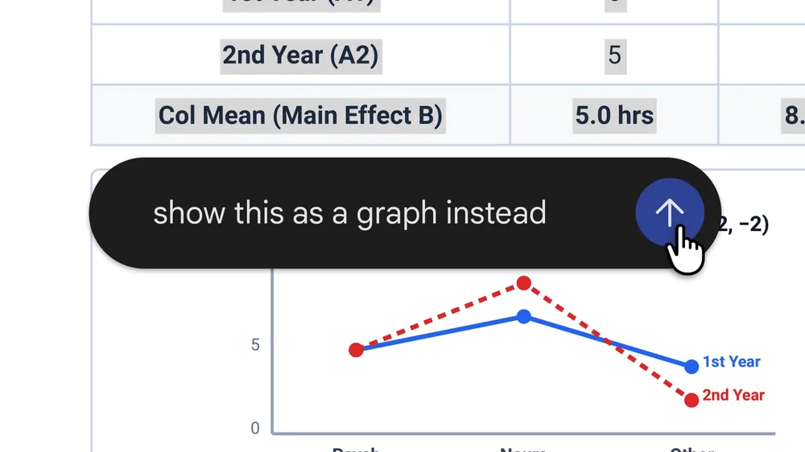

**난이도: 입문 — 문서 작성 업무를 해봤다면 쉽게 읽을 수 있습니다.**

## 세 줄 요약

- Google은 **2026년 10월 29일**, Gemini 앱의 채팅 안에서 파일을 생성·미리보기·편집하는 기능을 발표했습니다.<a href="#source-1">[1]</a> 직접 내용을 고치거나, 텍스트를 선택해 질문하고 Gemini에 수정을 요청하는 흐름입니다.<a href="#source-1">[1]</a>
- **PDF 미리보기·편집은 웹과 모바일**, Google Docs·Google Sheets·슬라이드 덱·Markdown·TXT·코드는 **웹만 지원**한다고 명시했습니다.<a href="#source-1">[1]</a>
- **분석:** 업무의 관심점이 답변을 다른 앱에 옮기는 것에서, 파일을 보며 수정하고 결과를 확인하는 과정으로 넓어집니다. 다만 앱 안에서 편집할 수 있다는 것과 최종 문서가 정확하다는 것은 별개입니다.

> 확인 기준: **2026년 11월 5일(KST)**. 이 글은 Google 공식 발표를 읽은 활용 해설입니다. 직접 Gemini에 파일을 업로드하거나 기능을 사용한 후기가 아닙니다. 기능·제공 범위는 발표 기준이며, 아래 업무 시나리오와 검증 계획은 가상 예시입니다. 실제 시간 절감이나 복잡한 문서의 편집 품질을 측정하지 않았습니다.

## 1. 무엇을 직접 고칠 수 있게 됐습니까?

공식 발표는 Gemini 채팅 안에서 파일을 만들고, 미리 보고, 편집할 수 있다고 설명합니다.<a href="#source-1">[1]</a> 전체 화면으로 펼쳐 직접 텍스트를 입력해 고치거나, 텍스트를 강조 표시해 질문하거나, Gemini에 파일을 다듬도록 요청할 수 있습니다.<a href="#source-1">[1]</a>

Google은 손으로 쓴 강의 노트를 업로드해 PDF 학습 자료를 만들고, 직접 내용을 편집하거나 특정 부분을 선택해 텍스트·시각 요소를 수정하는 예시를 소개했습니다.<a href="#source-1">[1]</a> 이는 **회사가 제시한 시연 사례**이지, 이 글에서 재현한 시험이 아닙니다.

*Google 공식 파일 생성·미리보기·편집 시연의 썸네일입니다. 직접 촬영한 사용 화면이나 재생 가능한 영상이 아닙니다.*<a href="#source-1">[1]</a> [공식 이미지 원본](https://storage.googleapis.com/gweb-uniblog-publish-prod/images/fileGen2.0-thumbnail-16x9.width-1000.format-webp.webp)

**분석:** 실무적으로 중요한 점은 사람이 직접 수정할 영역과 AI에게 요청할 영역을 같은 작업 흐름 안에서 나눌 수 있다는 것입니다. 작은 오탈자는 직접 고치고, 설명을 다시 구성하는 일은 선택 영역을 지정해 요청하는 식의 활용을 생각할 수 있습니다. 이 방식이 실제로 더 빠른지는 작업별로 확인해야 합니다.

## 2. 웹과 모바일의 지원 범위를 섞으면 안 됩니다

다음 표는 **이번 발표에 적힌 파일 미리보기·편집의 지원 범위**입니다.<a href="#source-1">[1]</a> Gemini의 모든 기능에 대한 플랫폼 제한을 뜻하지 않습니다.

| 형식 | 웹 | 모바일 |
| --- | --- | --- |
| PDF | 미리보기·편집 지원<a href="#source-1">[1]</a> | 미리보기·편집 지원<a href="#source-1">[1]</a> |
| Google Docs | 지원<a href="#source-1">[1]</a> | 웹 전용으로 발표<a href="#source-1">[1]</a> |
| Google Sheets | 지원<a href="#source-1">[1]</a> | 웹 전용으로 발표<a href="#source-1">[1]</a> |
| 슬라이드 덱 | 지원<a href="#source-1">[1]</a> | 웹 전용으로 발표<a href="#source-1">[1]</a> |
| Markdown 파일 | 지원<a href="#source-1">[1]</a> | 웹 전용으로 발표<a href="#source-1">[1]</a> |
| TXT 파일 | 지원<a href="#source-1">[1]</a> | 웹 전용으로 발표<a href="#source-1">[1]</a> |
| 코드 | 지원<a href="#source-1">[1]</a> | 웹 전용으로 발표<a href="#source-1">[1]</a> |

Google은 이 기능을 **Gemini 앱이 제공되는 모든 언어의 모든 사용자에게 제공**한다고 밝혔습니다.<a href="#source-1">[1]</a> 이 문장을 모든 국가·계정에서 제한 없이 쓸 수 있다는 보장으로 확대하지는 않겠습니다.

**분석:** 이동 중 PDF를 읽고 수정하는 흐름과, 웹에서 스프레드시트나 슬라이드를 다루는 흐름은 구분해 계획해야 합니다. “모바일에서도 문서 편집 지원”이라는 한 줄만 보면 형식별 차이를 놓치기 쉽습니다.

또한 Google Docs·Google Sheets 지원이라는 발표만으로 모든 `.docx`·`.xlsx`·`.pptx` 파일의 호환성까지 확정할 수는 없습니다. 파일 확장자별 변환, 복잡한 수식·도표·서식 보존과 내보내기 동작은 별도 확인 대상으로 남깁니다. 코드 편집 지원을 코드 실행·테스트 성공 보장으로 해석해서도 안 됩니다.

## 3. 가상 업무 예시: 안내 자료를 다듬는 과정

**아래는 발표 기능을 바탕으로 구성한 가상 시나리오입니다. 실제 업무 자료를 업로드하거나 실행한 기록이 아닙니다.**

한 담당자가 공개 가능한 샘플 메모를 바탕으로 교육 안내 PDF를 만든다고 가정하겠습니다. 형식 차이로 혼동하지 않도록 **웹에서 진행하는 예시**로 두겠습니다.

1. **초안 작성 요청:** 샘플 메모를 안내 자료로 정리해 달라고 요청합니다. 빠진 내용이나 근거 없는 설명이 생겼는지 먼저 확인합니다.
2. **사람의 직접 수정:** 파일을 보며 제목의 오탈자나 표현을 직접 고치는 흐름을 생각할 수 있습니다.
3. **영역을 지정한 AI 수정:** 긴 문단을 선택하고 “핵심 조건은 바꾸지 말고 더 짧게 설명해 달라”고 요청하는 방식입니다.
4. **결과 비교:** 원문 조건과 수정 결과를 대조하고, 바꾸지 말라고 한 항목이 유지됐는지 확인합니다.
5. **전달 전 확인:** 저장·내보내기 방법과 실제 결과 파일의 표시를 확인한 뒤 공유 여부를 판단합니다.

앞의 직접 입력·선택 영역 질문·AI 수정 요청은 공식 발표가 설명한 기능입니다.<a href="#source-1">[1]</a> 여기서 제시한 요청 문구, 확인 순서와 업무 효율은 **검증하지 않은 활용 제안**입니다. 내보내기 방식이나 특정 원본 파일에 자동으로 반영되는 동작까지 발표문만으로 보장하지 않습니다.

**분석:** 이런 흐름의 가치는 복사·붙여넣기 자체를 없앴다는 선언보다, **어디를 수정할지 구체적으로 가리키고 사람이 결과를 확인할 자리를 만든다**는 데서 찾을 수 있습니다. 실제로 작업 전환과 재작업이 줄어드는지는 별도 측정이 필요합니다.

## 4. ‘편집 가능’과 ‘업무 완료’ 사이에 남는 확인

다음은 실제 도입 전에 시험할 항목입니다. **성능 평가 결과나 제품 결함을 관찰한 목록은 아닙니다.**

| 확인할 항목 | 질문 |
| --- | --- |
| 변경 범위 | 선택한 문단만 바뀌었으며 다른 조건은 유지됐습니까? |
| 내용 정확성 | 날짜·수치·이름·인용이 원자료와 일치합니까? |
| 문서 형태 | 표·수식·도표·페이지 구성이 실제 파일에서 유지됩니까? |
| 저장과 전달 | 무엇이 저장됐고, 전달받을 파일에서 같은 내용이 보입니까? |
| 플랫폼 차이 | 해당 형식과 작업을 웹·모바일 중 어디서 수행할 수 있습니까? |

**분석:** 수정한 결과가 자연스럽게 읽힌다는 이유만으로 사실까지 맞는 것은 아닙니다. 요청 전후 버전을 비교하고, 사람의 수정과 AI의 수정을 구분해 확인하는 방식이 좋습니다. 민감한 업무 자료라면 업로드 전에 조직의 승인과 취급 기준부터 확인해야 합니다. 이 글에서는 개인정보나 내부 문서를 조회·입력하지 않았습니다.

발표문은 기능을 소개하지만 파일 크기별 한도, 계정별 설정, 조직 관리자 정책, 모든 문서의 충실도와 측정된 시간 절감까지 설명하는 시험 보고서는 아닙니다. 이 글에서 그 빈칸을 임의의 수치나 보장으로 채우지 않았습니다.

## 5. 비교할 것은 답변 길이보다 최종 결과입니다

**가상 검증 계획:** 공개 가능한 같은 샘플과 수정 요청을 사용해, 답변을 다른 도구로 옮기는 방식과 Gemini 안에서 편집하는 방식을 비교할 수 있습니다. 이는 실제 비교 실험을 수행했다는 뜻이 아닙니다.

살펴볼 항목은 최종 승인까지 걸린 시간, 옮겨 적는 횟수, 잘못 바뀐 부분, 사람이 다시 고친 양입니다. 특히 웹과 모바일의 지원 범위를 맞추고, 결과물의 정확성·서식 확인을 동일하게 유지해야 합니다. 확인 절차를 생략해 짧아진 시간을 곧바로 생산성 향상으로 계산해서는 안 됩니다.

## 결론: 수정할 자리가 생겨도, 확인할 책임은 남습니다

Google이 발표한 변화는 Gemini 채팅 안에서 파일을 생성·미리보기·편집하고, 직접 입력과 선택 영역 기반 질문·수정 요청을 이어가는 기능입니다.<a href="#source-1">[1]</a> PDF는 웹·모바일에서, 나머지 명시 형식은 웹에서 지원한다는 차이를 함께 읽어야 합니다.<a href="#source-1">[1]</a>

**분석:** 제목의 “복붙하는 AI에서 수정하는 AI로”는 답변 생성만이 아니라 수정 과정까지 평가하자는 의미입니다. **어디를 고쳤고, 무엇을 유지했으며, 최종 파일에서 확인됐습니까?** 이 질문에 답할 수 있어야 새로운 편집 기능이 실제 업무 흐름의 개선으로 이어졌는지 판단할 수 있습니다.

## Sources

[1] <a href="https://blog.google/innovation-and-ai/products/gemini-app/edit-files-directly">Google · Edit and preview documents directly in Gemini</a>

