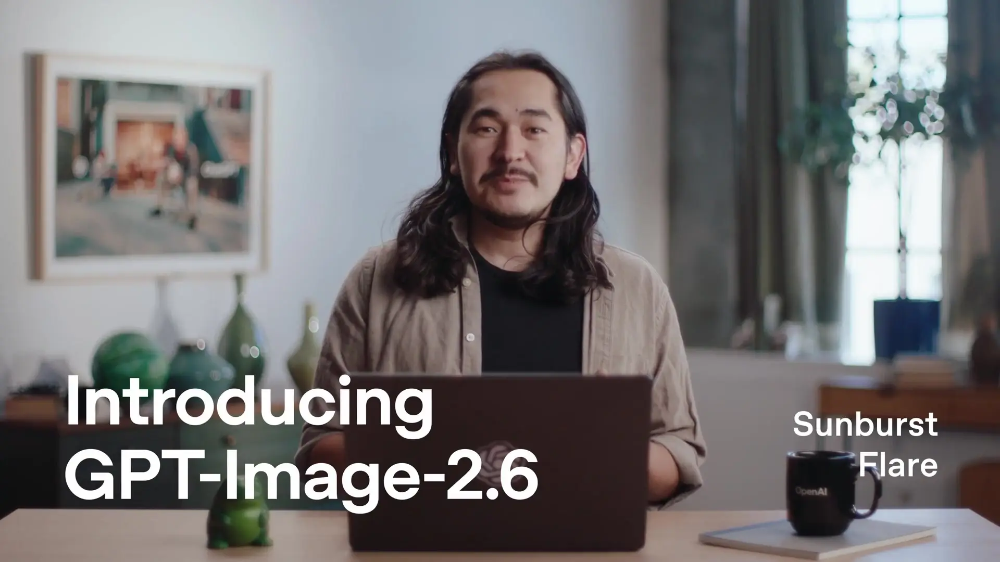
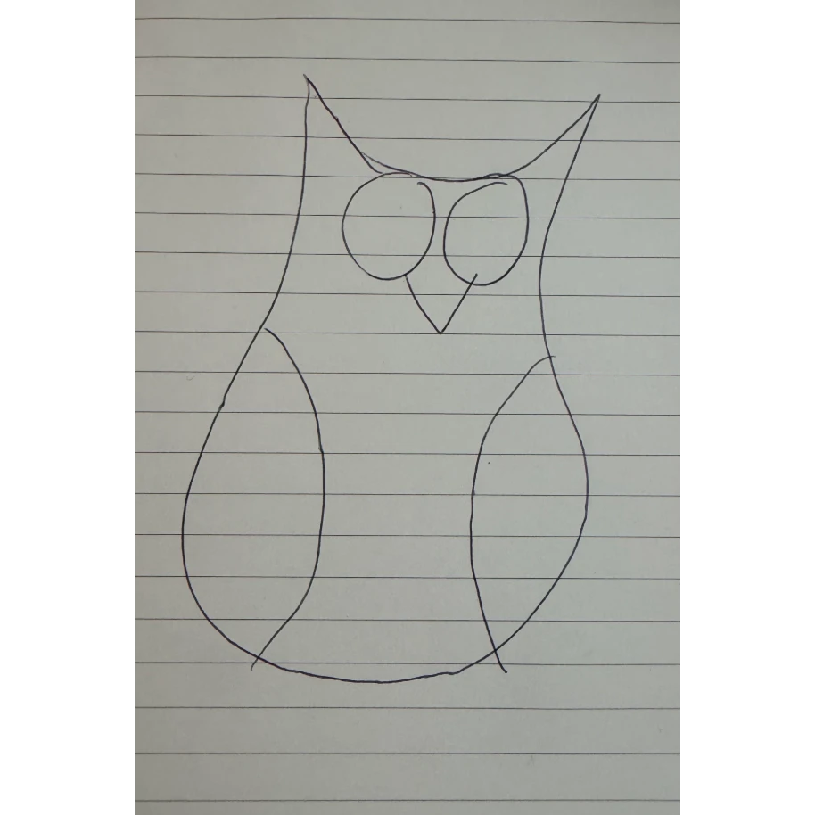

**난이도: 입문 — AI 이미지 생성 경험이 없어도 읽을 수 있습니다.**

## 세 줄 요약

- OpenAI는 **2026년 11월 4일**, ChatGPT·Codex·API에 Images 2.6을 선보이며 생성 속도와 반복 편집의 일관성 개선, GIF 생성 등을 발표했습니다.<a href="#source-1">[1]</a>
- 핵심 변화에는 API의 이미지 마크업·SVG 출력과 새 `complexity` 설정이 포함됩니다.<a href="#source-1">[1]</a> **수정할 위치, 유지할 디테일, 다음 작업에 넘길 형식**을 함께 다루는 방향입니다.
- **분석:** 실무에서 볼 것은 첫 결과물의 인상만이 아닙니다. 수정 요청 뒤에도 제품·캐릭터·문구를 원하는 대로 유지하며 최종 산출물에 도달하는지를 확인할 필요가 있습니다.

> 확인 기준: **2026년 11월 5일(KST)**. 이 글은 최신 공식 발표와 시스템 카드를 읽은 설명·분석입니다. 직접 생성·편집하거나 API를 호출한 사용후기가 아닙니다. 성능 개선과 제공 범위는 OpenAI 발표 기준이며 독립 검증 결과가 아닙니다. 제목의 ‘승부처’는 아래 실무 관점의 해석입니다.

## 1. 무엇이 나왔고, 어디에서 사용할 수 있습니까?

OpenAI는 Images 2.6을 ChatGPT와 Codex의 모든 구독 등급에서 데스크톱·모바일·웹을 통해 전 세계에 제공한다고 발표했습니다.<a href="#source-1">[1]</a> API에는 **GPT‑Image‑2.6 Flare와 Sunburst**를 제공합니다.<a href="#source-1">[1]</a> 모든 구독 등급 제공이라는 표현을 무제한 생성이나 동일한 사용 한도 보장으로 읽어서는 안 됩니다.

회사는 이미지 생성이 이전보다 **50% 빨라졌다**고 설명합니다.<a href="#source-1">[1]</a> Flare는 quality를 low로 설정하면 **최단 6초**에 생성할 수 있다고 밝혔고, Sunburst는 medium·high quality에서 디테일과 편집 간 일관성을 강조합니다.<a href="#source-1">[1]</a>

**분석:** 최단 시간과 내 작업의 평균 시간은 다릅니다. 모델·품질·장면 조건을 고정하지 않고 “항상 6초”라고 기대하거나, 생성 속도 개선을 전체 제작 시간 절감으로 바로 환산할 수는 없습니다. 이 글에서는 API 가격·계정별 한도·한국어 편집 성능을 직접 확인하지 않았습니다.

## 2. 왜 첫 장보다 ‘수정’을 보자는 것입니까?

OpenAI는 편집하면서 캐릭터·제품·브랜드 디테일을 더 일관되게 유지하는 것을 이번 업데이트의 목표로 설명했습니다.<a href="#source-1">[1]</a> ChatGPT에 있던 **이미지 마크업을 API에도 제공**해 특정 변경 위치를 지목할 수 있게 하고, **SVG 출력**도 추가했다고 밝혔습니다.<a href="#source-1">[1]</a>

*OpenAI 공식 편집 시연 영상의 정지 포스터입니다. 이 글의 실험 화면이나 편집 전후 성능 증거가 아닙니다.*<a href="#source-1">[1]</a> [공식 이미지 원본](https://images.ctfassets.net/kftzwdyauwt9/6C35Ie270Re3jvB0PP5c7F/bd7ecd8e7e39c86ee78ad6583e8223ec/images-2-6-editing-poster.jpg?w=3840&q=50&fm=webp)

**분석:** 예를 들어 제품 사진에서 배경만 바꾸려는 작업이라면, 바뀐 배경뿐 아니라 제품 형태·색상·표시 문구가 유지됐는지도 봐야 합니다. 첫 이미지가 매력적이어도 수정 때마다 다른 부분이 달라지면 최종 확인 부담이 남습니다. 이는 점검할 문제를 설명하는 예시이지, Images 2.6에서 그런 오류를 직접 관찰했다는 뜻은 아닙니다.

따라서 비교 질문은 “어느 모델이 더 멋진 첫 장을 만듭니까?”에서 **“같은 수정 요구를 얼마나 정확히 반영하고, 바꾸지 말아야 할 것은 얼마나 보존합니까?”**로 넓어질 수 있습니다.

## 3. quality와 complexity는 같은 조절 손잡이가 아닙니다

공식 설명에서 **quality는 시각적 디테일과 충실도**, **complexity는 요청을 충족하기 위한 계획과 장면에 들어가는 요소의 복잡도**에 관계합니다.<a href="#source-1">[1]</a> 낮은 complexity는 빠른 편집에 적합하며, 요소나 제약이 많은 장면에서는 medium·high를 시도하라는 것이 회사의 안내입니다.<a href="#source-1">[1]</a>

| 제어·출력 | 공식 발표가 설명하는 역할 | 별도로 확인할 점 |
| --- | --- | --- |
| Image markup | 수정할 위치를 구체적으로 지목하는 API 기능<a href="#source-1">[1]</a> | 지정 영역 밖의 요소가 유지되는지 |
| Quality | 시각적 디테일과 충실도 조절<a href="#source-1">[1]</a> | 작은 글자·제품 디테일이 최종 크기에서 읽히는지 |
| Complexity | 요청에 대한 계획과 장면 복잡도 조절<a href="#source-1">[1]</a> | 설정을 높인 결과가 추가 대기·작업 부담에 맞는지 |
| SVG 출력 | 웹·앱·인쇄 등 다음 제작 단계로 넘길 출력 형식<a href="#source-1">[1]</a> | 실제 파일의 구조·편집 가능성·표시 호환성 |

오른쪽 열은 **미실험 점검 항목**입니다. SVG를 내보낸다는 발표만으로 모든 객체가 원하는 레이어나 텍스트로 분리되는지는 확정할 수 없습니다. complexity를 높이는 것이 모든 편집의 정답이라는 뜻도 아닙니다.

## 4. GIF도 ‘만들었다’와 ‘쓸 수 있다’를 나눠 봐야 합니다

Images 2.6에는 GIF 생성이 추가됐으며, OpenAI는 브랜드 마스코트·반응 이미지·애니메이션 스토리보드 같은 활용을 제시했습니다.<a href="#source-1">[1]</a> 아래는 공식 발표가 소개한 **부엉이 스케치와 애니메이션 예시의 정지 포스터**입니다.<a href="#source-1">[1]</a>

*공식 입력 예시: 펜으로 그린 부엉이 스케치입니다.*<a href="#source-1">[1]</a> [공식 이미지 원본](https://images.ctfassets.net/kftzwdyauwt9/7xC8whl4xN2cOTxQSLMfQ8/60b25185d53ca63f000341f0acbfba7a/owl-sketch-square.png?w=3840&q=90&fm=webp)

*공식 애니메이션 예시의 정지 포스터입니다. 이 글에서는 GIF가 재생되지 않으며, 움직임과 반복 연결의 품질을 이 정지 이미지로 판정하지 않습니다.*<a href="#source-1">[1]</a> [공식 이미지 원본](https://images.ctfassets.net/kftzwdyauwt9/3htx622jZc5ImLeWZfZhEX/52551971a364017e1d4c0da98b5e334f/owl-animation-poster.jpg?w=3840&q=50&fm=webp)

**분석:** 실제 도입 때는 프레임 사이의 캐릭터 형태, 반복 시작·끝의 연결, 파일 크기와 사용할 화면의 재생 동작을 확인할 필요가 있습니다. 스틸 이미지가 좋다는 것과 움직이는 결과물의 완성도는 별도로 평가해야 합니다.

안전 측면에서도 시스템 카드는 한 장의 정지 이미지에서는 드러나지 않는 **프레임 간 의미와 움직임의 위험**이 있다고 설명하며, 보호장치가 모든 위반을 포착하지는 못한다고 명시합니다.<a href="#source-2">[2]</a> 새 출력 형식이 곧 안전성 보장이라는 뜻은 아닙니다.

## 5. 실제로 시험한다면 무엇을 기록해야 합니까?

**다음은 검증 계획입니다. 실제 측정 결과나 추천 순위가 아닙니다.** 같은 원본·수정 요청·모델·설정으로 비교해야 의미가 있습니다.

| 시험할 작업 | 남길 기록 |
| --- | --- |
| 배경만 변경 | 제품 형태·색·문구 유지 여부와 원치 않는 변화 |
| 특정 영역만 수정 | 지시한 부분의 반영과 나머지 영역의 보존 여부 |
| 문구·레이아웃 조정 | 정확한 표기, 줄바꿈, 최종 출력 크기에서의 가독성 |
| 같은 캐릭터로 여러 번 편집 | 수정 횟수, 캐릭터 디테일 변화, 재작업 사유 |
| GIF·SVG로 전달 | 움직임·루프 연결 또는 SVG 구조·실제 사용처 호환성 |

최종 승인까지의 시간에는 생성뿐 아니라 수정과 사람의 확인도 포함해 기록하는 편이 좋습니다. 속도를 비교하면서 품질 기준이나 필요한 검사를 낮추면 같은 조건의 개선이라고 보기 어렵습니다.

시스템 카드는 출처 추적을 위해 C2PA 메타데이터와 SynthID 워터마킹을 함께 사용한다고 설명하지만, 출처 증명을 위한 단일한 해결책은 없다고도 밝힙니다.<a href="#source-2">[2]</a> **분석:** 생성물의 출처 신호와 내용의 정확성·브랜드 적합성은 서로 다른 확인 항목으로 두는 것이 좋습니다.

## 결론: 잘 생성하는 것에서, 원하는 상태로 마무리하는 것으로

발표에서 확인되는 방향은 빠른 생성, 편집 일관성, 위치 지정, 출력 형식의 확장입니다.<a href="#source-1">[1]</a> 그 기능이 내 작업에서 얼마나 재작업을 줄이는지는 직접 시험해야 합니다.

**분석:** Images 2.6을 볼 때의 질문은 첫 장의 인상을 넘어설 필요가 있습니다. **“무엇을 바꿨고, 무엇을 유지했으며, 최종 사용처에서 실제로 쓸 수 있습니까?”**가 더 실무적인 평가 기준입니다.

## Sources

[1] <a href="https://openai.com/index/introducing-images-2-6">OpenAI · Introducing Images 2.6</a>

[2] <a href="https://deploymentsafety.openai.com/chatgpt-images-2-6">OpenAI Deployment Safety Hub · ChatGPT Images 2.6 System Card</a>

