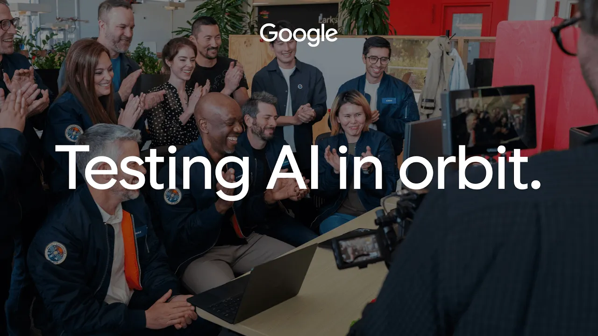

**난이도: 입문 — 우주공학이나 AI 반도체 지식 없이 읽을 수 있습니다.**

## 세 줄 요약

- Google은 **2026년 10월 30일**, Project Suncatcher 시제품 위성의 데이터센터급 TPU에서 첫 AI 응답을 받았다고 발표했습니다.<a href="#source-1">[1]</a>
- 위성에 탑재된 **Gemma 4**에 우주에 관한 하이쿠를 요청하고 지상으로 결과를 내려받았다는 내용입니다.<a href="#source-1">[1]</a> 대규모 학습이나 상용 서비스의 운영 성과와는 구분해야 합니다.
- **분석:** 중요한 진전은 궤도에서 실제 연산과 응답 회수를 확인했다는 점입니다. 열·방사선 아래의 신뢰성, 위성 간 연결, 비용과 환경 효과까지 검증을 마쳤다는 뜻은 아닙니다.

> 확인 기준: **2026년 11월 5일(KST)**. Google 공식 발표 3건을 바탕으로 작성했습니다. 모두 연구 주체의 설명이며 독립적인 재현 시험은 아닙니다. 필자가 위성·TPU를 직접 시험한 리뷰도 아닙니다. 이 글은 지상 전력망 계약이 아니라 궤도 연산 실험의 성과와 남은 검증을 다룹니다.

## 1. 이번에 실제로 무엇을 했습니까?

Google에 따르면 시제품 위성 발사 뒤 호스트와 TPU 트레이에 전원을 공급하고 초기 머신러닝 시험을 진행했습니다.<a href="#source-1">[1]</a> 이어 지상국과 교신할 수 있는 구간에 첫 프롬프트를 올려보냈고, 위성 안의 Gemma 4 모델에 우주를 소재로 한 하이쿠를 생성하도록 요청했습니다.<a href="#source-1">[1]</a>

응답은 위성이 노르웨이 **스발바르**를 지나는 동안 지상으로 내려왔습니다.<a href="#source-1">[1]</a> Google은 이를 데이터센터급 TPU가 궤도에서 생성한 첫 AI 응답이라는 ‘Hello World’ 이정표로 설명했습니다.<a href="#source-1">[1]</a>

_Google 공식 첫 응답 발표에 제공된 영상 썸네일입니다. 이 글은 정지 이미지만 표시하며, 필자의 실험 화면이나 상용 운영을 입증하는 자료가 아닙니다. 출처: Google.<a href="#source-1">[1]</a> [원본 이미지](https://i.ytimg.com/vi_webp/epqzfAi16us/maxresdefault.webp)_

그 뒤에는 우주를 주제로 한 다른 시와 탑재 시스템의 기술 상태를 보고하는 텔레메트리 프롬프트도 시험했다고 밝혔습니다.<a href="#source-1">[1]</a> **응답을 생성한 곳은 위성이고, 그 결과를 받은 곳은 지상**이라는 점이 핵심입니다.<a href="#source-1">[1]</a>

**분석:** 첫 출력은 장비·모델·통신이 연결된 초기 동작의 증거라는 의미가 있습니다. 다만 짧은 텍스트를 한 번 생성하는 것과 오랫동안 많은 요청을 안정적으로 처리하는 것은 다른 검증 과제입니다. 이번 발표를 지상의 데이터센터가 이미 대체됐다는 의미로 확대해서는 안 됩니다.

## 2. 발사·첫 응답·다음 시험의 시계를 나눠 봐야 합니다

아래 날짜는 **각 자료의 발표일**입니다. 첫 응답이 생성된 정확한 시각을 뜻하지 않습니다.

| 발표일 | 공식 발표의 내용 | 읽을 때의 경계 |
| --- | --- | --- |
| 2026년 9월 24일 | 시제품 시험의 목적과 열·방사선·연결 과제를 설명했습니다.<a href="#source-3">[3]</a> | 발사 전 연구 계획과 지상 시험 설명입니다. |
| 2026년 10월 1일 | Planet과 만든 시제품이 SpaceX Transporter-18 임무로 발사됐고 교신을 확인했다고 발표했습니다.<a href="#source-2">[2]</a> | 발사·초기 교신과 장기 안정 운영은 다릅니다. |
| 2026년 10월 30일 | 궤도 TPU에서 첫 AI 응답을 받았다고 공개했습니다.<a href="#source-1">[1]</a> | 첫 출력 성공이지 상용 서비스 실적은 아닙니다. |

10월 30일 발표는 다음 단계로 **궤도에서 열 스트레스와 방사선 노출 아래 TPU 성능을 평가할 시험**을 계속하겠다고 설명합니다.<a href="#source-1">[1]</a> 또한 **2027년 서로 연결된 위성 두 기**를 다음 이정표로 제시했습니다.<a href="#source-1">[1]</a> 이는 향후 계획이지 이미 두 위성의 연결 시험을 완료했다는 뜻이 아닙니다.

## 3. ‘답변이 왔다’ 다음에 열과 방사선을 보는 이유

### 열: 우주라고 저절로 식지는 않습니다

Google은 TPU가 좁은 면적에서 많은 열을 만들며, 진공에는 공기 흐름이 없어 방열판을 통한 열 배출이 필요하다고 설명합니다.<a href="#source-3">[3]</a> 이를 위해 히트파이프와 방열판을 결합하는 접근 등을 연구하고, 지상 열진공 챔버에서 시험했다고 밝혔습니다.<a href="#source-3">[3]</a>

**분석:** 그래서 확인할 것은 단순한 작동 여부뿐 아니라, 부하를 지속할 때 열을 감당하는지입니다. 첫 문장을 생성했다고 해서 냉각 설계의 여유나 장기간 운용 조건까지 확인됐다고 볼 수는 없습니다.

### 방사선: 지상 시험과 실제 궤도 기록은 구분해야 합니다

Google은 양성자 빔 시설에서 AI 작업을 실행하며 비트 오류 등이 작업에 미치는 영향을 살폈다고 설명했습니다.<a href="#source-3">[3]</a> 이는 회사가 보고한 **지상 시험**입니다. 이후 첫 응답 발표에서도 궤도 방사선과 열 스트레스 시험을 앞으로 이어갈 과제로 남겼습니다.<a href="#source-1">[1]</a>

**분석:** 장기간 오류·재시작·성능 변화를 관측하는 자료가 더해져야 실제 운영의 신뢰성을 평가할 수 있습니다. 하이쿠의 문장이 자연스럽다는 사실을 하드웨어 수명이나 방사선 내성의 합격 판정으로 바꾸면 안 됩니다.

## 4. 위성 하나가 답하는 것과 여러 위성이 함께 계산하는 것은 다릅니다

공식 사전 설명은 미래 설계에서 위성들을 묶어 작업을 처리하고, 레이저로 통신하는 방향을 제시합니다.<a href="#source-3">[3]</a> 팀은 매우 짧은 거리에서 높은 대역폭을 유지해야 하며, 움직이는 위성 사이를 정밀하게 연결하는 것이 과제라고 설명했습니다.<a href="#source-3">[3]</a>

**분석:** 따라서 앞으로의 질문은 “우주에서 모델을 실행할 수 있습니까?”에서 “여러 장비가 필요한 속도로 연결되고 안정적으로 협업할 수 있습니까?”로 넓어집니다. 위성 하나의 첫 추론 성공을 분산 학습이나 거대한 궤도 데이터센터의 완성으로 읽어서는 안 됩니다.

2027년 두 위성 시험은 이런 연결 과제를 살펴볼 **계획**으로 소개됐습니다.<a href="#source-3">[3]</a> 일정의 제시와 실제 시험의 성공은 분리해 추적해야 합니다.

## 5. 경제성과 친환경성은 별도의 성적표가 필요합니다

**다음은 상용화 평가를 위한 분석·검토 제안입니다. Google이 입증한 효과나 이 글에서 계산한 수익성·탄소 감축량이 아닙니다.**

| 평가 항목 | 앞으로 확인할 질문 |
| --- | --- |
| 비용 | 발사·위성 제작·운영·교체 비용을 포함해 유효한 연산 결과의 비용은 얼마입니까? |
| 신뢰성 | 열·방사선·통신 문제로 중단된 시간과 오류 복구 비용은 어느 정도입니까? |
| 확장성 | 위성을 늘릴 때 연결 대역폭과 운영 복잡성을 감당할 수 있습니까? |
| 환경 효과 | 장비 제작·발사·교체·수명 종료까지 포함한 영향이 비교 대상보다 줄어듭니까? |
| 비교 조건 | 같은 작업·품질·서비스 수준에서 지상 인프라와 비교한 자료가 있습니까? |

첫 응답 소식은 이 질문들에 대한 답을 대신하지 않습니다. **이 글에서 확인한 첫 응답 발표만으로는 지상보다 저렴하거나 친환경적이라는 결론을 내릴 수 없습니다.** 전력 공급 방식에 기대가 있더라도 전체 시스템의 경제성과 환경 효과는 따로 평가해야 합니다.

분석의 초점을 여기에 두면 발표를 과소평가하지도, 과대평가하지도 않을 수 있습니다. 궤도에서 답변을 회수한 성과는 인정하되, 비용 우위나 환경 편익을 완료된 성과 목록에 미리 올리지 않는 것입니다.

## 결론: ‘가능했다’에서 ‘계속 믿고 쓸 수 있다’로

Google이 공개한 변화는 발사와 초기 가동을 거쳐 **위성 탑재 모델이 응답을 만들고 지상에서 이를 받는 단계에 도달했다**는 것입니다.<a href="#source-1">[1]</a><a href="#source-2">[2]</a>

열·방사선 시험과 위성 간 연결은 앞으로 확인할 단계로 남아 있습니다.<a href="#source-1">[1]</a><a href="#source-3">[3]</a>

**분석:** 다음 소식에서 볼 것은 더 인상적인 시 한 편만이 아닙니다. 시험 조건과 기간, 오류와 중단 기록, 연결 성능, 비용·환경 비교의 근거가 얼마나 구체적으로 공개되는지가 중요합니다. 지금의 정확한 평가는 **“초기 궤도 연산 실험의 진전이며, 상용화와 친환경성의 입증은 별개”**입니다.

## Sources

[1] <a href="https://blog.google/innovation-and-ai/models-and-research/google-research/project-suncatcher-satellite-response">Google · We’ve received our first response from the Project Suncatcher prototype satellite.</a>

[2] <a href="https://blog.google/innovation-and-ai/models-and-research/google-research/project-suncatcher-prototype">Google · Our Project Suncatcher prototype satellite is in orbit.</a>

[3] <a href="https://blog.google/innovation-and-ai/models-and-research/google-research/google-project-suncatcher-facts">Google · Behind Project Suncatcher, our moonshot to put AI in space</a>

