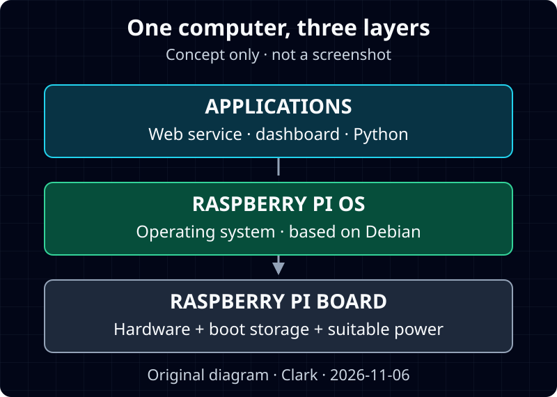

**난이도: 입문 — 컴퓨터 사용 경험만 있으면 읽을 수 있습니다.**

## 먼저 알아둘 세 가지

- 대표적인 라즈베리 파이는 **SBC(Single-Board Computer, 단일 보드 컴퓨터)**입니다.<a href="#source-1">[1]</a>
- 보드 외에 OS가 들어갈 저장장치와 기종에 맞는 전원이 필요합니다.<a href="#source-1">[1]</a>
- **Pico는 Linux 컴퓨터가 아닌 마이크로컨트롤러 보드**입니다.<a href="#source-4">[4]</a>

> 확인 기준: **2026년 11월 6일(KST)**. 공식 문서 기반 가이드입니다. 실제 Raspberry Pi 조립·구동·성능을 검증한 리뷰가 아닙니다. 활용 예시는 설계 아이디어이며 구축 결과가 아닙니다.

## 1. 작은 보드가 컴퓨터가 되는 과정

SBC는 주요 구성요소를 한 장의 기판에 모은 컴퓨터입니다. 예를 들어 Pi 5에는 프로세서·메모리와 USB·네트워크·영상 연결 기능이 있습니다.<a href="#source-3">[3]</a> 보통 OS 이미지를 기록한 microSD 카드를 넣고 주변기기와 전원을 연결해 시작합니다.<a href="#source-1">[1]</a>

**보드=하드웨어, OS=기본 소프트웨어, 웹 서버·Python 프로그램=응용 소프트웨어**로 구분하면 쉽습니다. 공식 운영체제 Raspberry Pi OS는 Debian Linux 기반입니다.<a href="#source-2">[2]</a>

_직접 제작 개념도이며 실제 보드 배치·설치 화면이 아닙니다. 관계 설명의 근거: 공식 문서.<a href="#source-1">[1]</a><a href="#source-2">[2]</a> [원본 도식](/assets/img/posts/raspberry-pi-introduction/hardware-os-apps.svg)_

모니터·키보드·마우스를 붙이는 데스크톱 방식과, 다른 컴퓨터에서 네트워크로 접속하는 **헤드리스** 방식이 가능합니다.<a href="#source-1">[1]</a> 헤드리스는 OS 이름이 아니라 주변기기 없이 원격 사용하는 방식입니다.<a href="#source-1">[1]</a>

## 2. PC·미니PC·Arduino와의 차이

PC·미니PC와 SBC는 완전히 배타적인 분류가 아닙니다. 아래는 성능 순위가 아닌 개념 비교입니다.

| 대상 | 구분할 점 |
| --- | --- |
| PC·미니PC | 어떤 OS·저장장치·전원이 포함된 완제품인지 확인하는 비교 대상입니다. |
| Raspberry Pi SBC | 보드에 저장장치·전원·주변기기를 구성해 사용합니다.<a href="#source-1">[1]</a> |
| Arduino UNO R3 | ATmega328P 기반 마이크로컨트롤러입니다. Arduino 전체가 아닌 이 모델과 비교합니다.<a href="#source-6">[6]</a> |
| Raspberry Pi Pico | MicroPython·C·C++로 프로그램을 올리며 Linux를 실행하지 않습니다. Raspberry Pi OS 설치 대상이 아닙니다.<a href="#source-4">[4]</a> |

**판단 제안:** OS·파일·네트워크 서비스를 다루려는지, 센서 입력과 제어 프로그램을 다루려는지부터 나눠 봅니다. 어느 제품군이 무조건 더 좋다는 뜻은 아닙니다.

## 3. 할 수 있는 일

공식 문서는 SSH 원격 접속·파일 공유와 Python GPIO 제어를 안내합니다.<a href="#source-2">[2]</a><a href="#source-5">[5]</a> 다음은 이를 활용할 **프로젝트 아이디어**입니다.

- **개인 서버:** 집 안의 작은 웹 서비스·파일 공유를 실험합니다.
- **대시보드:** 모니터에 일정·날씨·장치 상태를 표시합니다.
- **IoT:** 센서나 다른 장치의 데이터를 모아 기록합니다.
- **Linux 학습:** 터미널·업데이트·원격 접속을 배웁니다.

처음에는 같은 네트워크의 비민감한 데이터부터 다루기를 권합니다. GPIO 배선은 이 글의 범위 밖입니다. 보드·부품의 전압과 핀 배치를 해당 공식 문서로 확인한 뒤 연결해야 합니다.

## 4. 모델은 목적과 형태부터

공식 제품군에는 일반 SBC, 더 작고 USB 포트가 적은 **Zero**, **키보드 일체형**, 산업·임베디드용 **Compute Module**이 있습니다.<a href="#source-1">[1]</a> Pico는 별도 마이크로컨트롤러 계열입니다.<a href="#source-4">[4]</a>

화면 사용 여부, 필요한 포트·메모리, 실행할 앱과 지원 OS부터 확인합니다. 무선 지원도 모델마다 확인해야 합니다.<a href="#source-1">[1]</a> 이 글은 개인별 모델·가격 상한을 정하는 구매 추천은 아닙니다.

## 5. 보드 외 준비물

| 항목 | 확인 사항 |
| --- | --- |
| 전원 | 정확한 기종의 전압·전류·케이블 조건을 맞춥니다.<a href="#source-1">[1]</a> |
| 저장장치 | 보통 microSD로 시작하며 다른 부팅 방식은 기종별 확인이 필요합니다.<a href="#source-1">[1]</a> |
| 기록 수단 | Imager를 실행할 컴퓨터와 카드 리더 등을 준비합니다.<a href="#source-1">[1]</a> |
| 케이스·냉각 | 보드를 보호하고 부하에 맞는 냉각을 검토합니다. Pi 5는 능동 냉각 시 성능을 가장 잘 발휘한다고 제조사가 안내합니다.<a href="#source-1">[1]</a><a href="#source-3">[3]</a> |
| 네트워크 | 헤드리스라면 원격 접속할 다른 컴퓨터와 네트워크가 필요합니다.<a href="#source-1">[1]</a> |
| 화면·입력장치 | 데스크톱이면 모니터·키보드·마우스·영상 케이블을 준비합니다.<a href="#source-1">[1]</a> |

**놓치기 쉬운 조건:** Pi 5 사양은 USB-C **5V/5A** 전원을 명시합니다.<a href="#source-3">[3]</a> 충전기 총 와트 수만으로 판단하지 않습니다. Pi 5는 Pi 4 케이스에 맞지 않습니다.<a href="#source-3">[3]</a>

현재 공식 저장장치 출발 권장은 Desktop·Full **32GB 이상**, Lite **8GB 이상**입니다.<a href="#source-1">[1]</a> 추가 파일까지 충분하다는 보장은 아닙니다. Pi 4·5는 micro-HDMI, Zero 계열은 mini-HDMI를 사용하며 USB-C 영상 출력은 지원하지 않습니다.<a href="#source-1">[1]</a>

## 6. 적합한 시작과 부적합할 수 있는 기대

**설계 제안:** Linux 학습·작은 서버·단일 대시보드처럼 목표를 좁히면 시작하기 좋습니다. 반대로 특정 Windows 전용 앱 대체, 고사양 게임, 무거운 AI 학습, 무중단 중요 서비스는 지원 소프트웨어·성능·복구 요구를 먼저 따져야 합니다. 이 글은 실측 성능 비교가 아닙니다.

보드 가격만이 아니라 전원·저장장치·냉각·케이블까지 비교하고 중요 자료에는 백업을 계획하기를 권합니다.

→ [Raspberry Pi OS 시작하기: 운영체제 선택부터 설치·첫 설정까지](/posts/raspberry-pi-os-getting-started/)

## Sources

[1] <a href="https://www.raspberrypi.com/documentation/computers/getting-started.html">Raspberry Pi · Getting started</a>

[2] <a href="https://www.raspberrypi.com/documentation/computers/os.html">Raspberry Pi · Raspberry Pi OS</a>

[3] <a href="https://www.raspberrypi.com/products/raspberry-pi-5">Raspberry Pi · Buy a Raspberry Pi 5</a>

[4] <a href="https://www.raspberrypi.com/documentation/microcontrollers/pico-series.html">Raspberry Pi · Pico microcontroller boards</a>

[5] <a href="https://www.raspberrypi.com/documentation/computers/remote-access.html">Raspberry Pi · Remote access</a>

[6] <a href="https://docs.arduino.cc/hardware/uno-rev3">Arduino · UNO R3</a>

