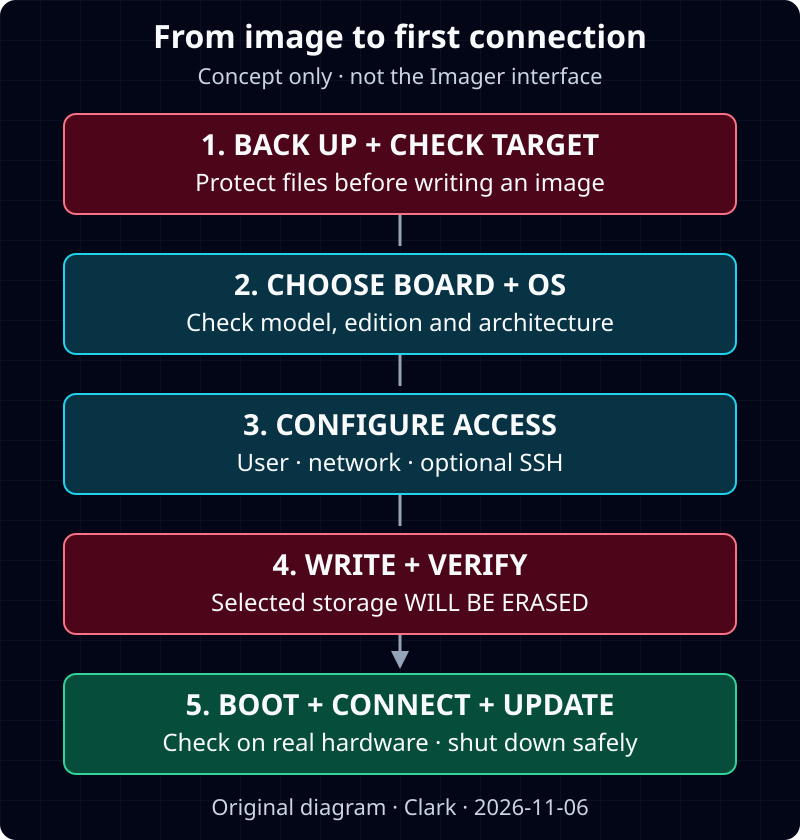

**난이도: 입문 — SSH 접속에서는 터미널을 사용합니다.**

> 확인 기준: **2026년 11월 6일(KST)**. 공식 문서 기반 가이드이며 실제 Pi 설치·접속을 실습해 검증한 글이 아닙니다. 특정 Imager 버전·스크린샷·실행 결과를 꾸미지 않았습니다. 읽기시간과 설치 소요시간은 다릅니다.

## 1. 보드·OS·Debian 구분하기

**Raspberry Pi는 하드웨어, Raspberry Pi OS는 공식 운영체제**입니다.<a href="#source-1">[1]</a><a href="#source-2">[2]</a> OS의 기반은 Debian Linux이며 현재 공식 문서는 최신 계열을 **Trixie**, 이전 계열을 **Bookworm**으로 안내합니다.<a href="#source-2">[2]</a>

Pico는 Linux를 실행하지 않으므로 이 설치 대상이 아닙니다.<a href="#source-4">[4]</a>

하드웨어가 낯설다면 먼저 [라즈베리 파이 소개](/posts/raspberry-pi-introduction/)를 읽어 보드·전원·저장장치를 구분하면 좋습니다.

## 2. Desktop·Lite와 보드 호환 선택

| 구성 | 공식 문서상 차이 |
| --- | --- |
| Desktop | 그래픽 화면과 기본 앱을 제공합니다.<a href="#source-2">[2]</a> |
| Full | 데스크톱에 권장 앱이 더 포함됩니다.<a href="#source-2">[2]</a> |
| Lite | 그래픽 데스크톱 없이 명령줄로 사용합니다.<a href="#source-2">[2]</a> |

화면에서 배우려면 Desktop, 원격 터미널 중심 목적이면 Lite를 검토하는 것이 입문 관점의 제안입니다. **Lite가 언제나 더 쉽다는 뜻은 아닙니다.**

32비트·64비트 지원은 보드에 따라 다르므로 **Imager에서 실제 보드를 먼저 고르고 호환 이미지를 선택**합니다.<a href="#source-1">[1]</a><a href="#source-2">[2]</a> Pi 5는 Trixie·Bookworm을 지원하지만 Bookworm 이전 Raspberry Pi OS는 지원하지 않습니다.<a href="#source-3">[3]</a>

## 3. 준비와 삭제 경고

Imager를 실행할 컴퓨터, microSD 카드와 카드 리더 등을 준비합니다. Imager는 Windows·macOS·Linux용입니다.<a href="#source-1">[1]</a> 현재 공식 출발 권장은 Desktop·Full **32GB 이상**, Lite **8GB 이상**이며 추가 파일 공간은 따로 고려합니다.<a href="#source-1">[1]</a>

> **선택한 저장장치의 기존 데이터가 삭제됩니다.** 먼저 백업하고 카드 이름·용량을 확인합니다.<a href="#source-1">[1]</a> 헷갈리는 외장 디스크는 분리하기를 권합니다. Imager의 **Exclude system drives** 보호 옵션을 유지합니다.<a href="#source-1">[1]</a>


_직접 제작 절차도이며 Imager 화면·실습 결과가 아닙니다. 근거: 공식 문서.<a href="#source-1">[1]</a><a href="#source-2">[2]</a> [원본 도식](/assets/img/posts/raspberry-pi-os-getting-started/install-flow.svg)_

## 4. Imager 설치·기록 순서

1. [공식 소프트웨어 페이지](https://www.raspberrypi.com/software/)에서 컴퓨터에 맞는 Imager를 설치합니다.<a href="#source-1">[1]</a>
2. **Device → OS → Storage**에서 보드·호환 OS·백업한 카드를 선택합니다.<a href="#source-1">[1]</a>
3. **Customisation**에서 호스트명, 지역·시간대, 직접 만들 사용자·암호와 Wi-Fi를 설정합니다. 헤드리스라면 첫 부팅에 연결할 네트워크 설정이 중요합니다.<a href="#source-1">[1]</a>
4. 원격 터미널을 쓴다면 **Remote Access**에서 SSH를 켜고 암호 또는 공개키 인증을 선택합니다.<a href="#source-1">[1]</a> 공개키를 등록하며 **개인키는 접속 컴퓨터에 보관**합니다.<a href="#source-5">[5]</a>
5. 최종 요약에서 대상을 재확인하고 삭제 경고를 이해한 뒤 기록합니다. **기록 후 검증(verification)**도 완료합니다.<a href="#source-1">[1]</a>
6. 저장장치를 안전하게 분리해 Pi에 넣고 주변기기 연결 후 기종에 맞는 전원을 연결합니다.<a href="#source-1">[1]</a>

메뉴 배치는 버전에 따라 달라질 수 있습니다. 이미지 기록 검증은 실제 보드의 부팅 성공과 별개입니다. Desktop에서 사전 설정을 생략했다면 첫 부팅 마법사로 계정·네트워크 등을 설정합니다.<a href="#source-1">[1]</a>

## 5. 같은 네트워크에서 SSH 접속

SSH는 Pi의 터미널에 원격 접속하는 방법이며 기본적으로 비활성화돼 있습니다.<a href="#source-5">[5]</a> 이 글은 외부 포트 개방 없이 같은 로컬 네트워크만 다룹니다.

**접속할 컴퓨터에서** 다음 형식으로 입력합니다.<a href="#source-5">[5]</a>

```bash
ssh myuser@mypi.local
```

`myuser`·`mypi`는 본인이 만든 사용자·호스트명으로 바꿀 예시이며 기본 계정이 아닙니다. `.local`은 mDNS 지원이 필요합니다.<a href="#source-5">[5]</a> 이름으로 못 찾으면 공유기 장치 목록에서 IP를 확인하거나, 화면이 연결된 **Pi의 터미널에서** 주소를 확인합니다.<a href="#source-5">[5]</a>

```bash
hostname -I
```

그 IP로 `ssh 사용자명@IP주소` 형식으로 접속합니다.<a href="#source-5">[5]</a> 최초 서버 신원 질문은 실제 Pi인지 확인한 뒤 진행하기를 권합니다.

## 6. 첫 업데이트·안전한 종료

다음은 **Pi의 터미널 또는 Pi에 연결된 SSH 세션에서** 실행합니다. 네트워크·여유 공간을 확인하고 변경 내역을 읽고 진행합니다.<a href="#source-2">[2]</a>

```bash
sudo apt update
sudo apt full-upgrade
```

패키지 목록을 갱신한 뒤 현재 OS 계열 안에서 업데이트합니다. **Bookworm→Trixie 전환 명령은 아닙니다.** 공식 문서는 메이저 버전 변경에 백업 후 새 이미지 재설치를 권장하며, 시험용 `rpi-update`를 일상 업데이트에 쓰지 않도록 안내합니다.<a href="#source-2">[2]</a>

종료는 Desktop의 **Shutdown** 또는 다음 명령을 사용합니다.<a href="#source-1">[1]</a><a href="#source-7">[7]</a>

```bash
sudo shutdown -h now
```

`now`는 즉시 종료 요청입니다.<a href="#source-7">[7]</a> **OS 종료가 완료된 뒤 전원을 분리**합니다.<a href="#source-1">[1]</a> SSH가 끊겼다는 사실만으로 종료 완료를 단정하지 않기를 권합니다.

## 7. SSH 문제 진단

아래는 공식 접속 조건을 바탕으로 한 **진단 제안**이며 재현 결과나 단일 원인 판정이 아닙니다.<a href="#source-1">[1]</a><a href="#source-5">[5]</a>

| 상황 | 먼저 확인할 항목 |
| --- | --- |
| 이름을 못 찾음 | 호스트명·mDNS를 확인하고 IP로 접속해 봅니다. |
| 연결 시간 초과 | Pi 부팅·네트워크·현재 IP를 확인합니다.<a href="#source-5">[5]</a> |
| 연결 거부 | 접속 대상과 SSH 활성화를 확인합니다. |
| 인증 실패 | 실제 계정, 암호·공개키 중 설정한 방식과 키를 확인합니다. |
| 호스트 키 변경 경고 | 재설치 여부·장치 신원을 확인합니다. 신원 검사를 무조건 끄지 않기를 권합니다. |

**전원·부팅 → 네트워크·주소 → SSH → 계정·인증** 순서로 하나씩 확인하고, 도움 요청에는 암호·개인키를 포함하지 않기를 권합니다.

← [하드웨어 소개: 라즈베리 파이란?](/posts/raspberry-pi-introduction/)

## Sources

<p id="source-1" style="scroll-margin-top:64px;">[1] <a href="https://www.raspberrypi.com/documentation/computers/getting-started.html">Raspberry Pi · Getting started</a></p>

<p id="source-2" style="scroll-margin-top:64px;">[2] <a href="https://www.raspberrypi.com/documentation/computers/os.html">Raspberry Pi · Raspberry Pi OS</a></p>

<p id="source-3" style="scroll-margin-top:64px;">[3] <a href="https://www.raspberrypi.com/products/raspberry-pi-5">Raspberry Pi · Buy a Raspberry Pi 5</a></p>

<p id="source-4" style="scroll-margin-top:64px;">[4] <a href="https://www.raspberrypi.com/documentation/microcontrollers/pico-series.html">Raspberry Pi · Pico microcontroller boards</a></p>

<p id="source-5" style="scroll-margin-top:64px;">[5] <a href="https://www.raspberrypi.com/documentation/computers/remote-access.html">Raspberry Pi · Remote access</a></p>

<p id="source-7" style="scroll-margin-top:64px;">[7] <a href="https://manpages.debian.org/trixie/systemd-sysv/shutdown.8.en.html">Debian · shutdown(8) — systemd-sysv — Debian trixie</a></p>
