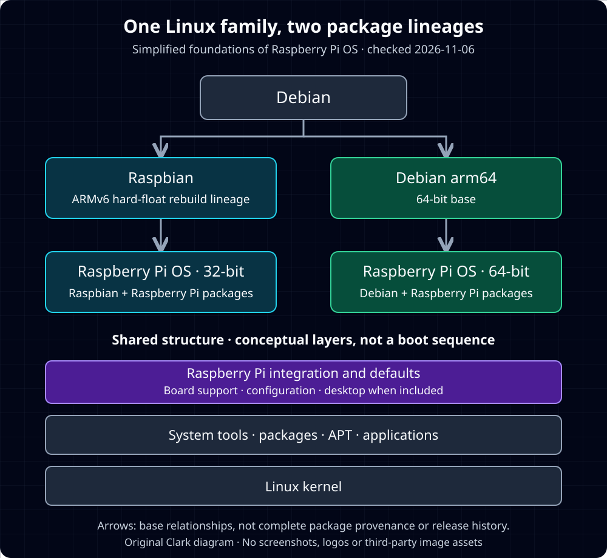

**난이도: 입문 — 리눅스 설치 경험 없이 읽을 수 있습니다.**

> 확인 기준: **2026년 11월 6일(KST)**. 공식 문서 기반 해설이며 실장비 성능·호환성을 시험한 글이 아닙니다.

**Raspberry Pi OS는 Raspberry Pi에 맞춰 구성한 Debian 기반 리눅스 배포판입니다.**<a href="#source-5">[5]</a> 차이는 “리눅스인가”보다 **무엇을 묶고 어떤 보드를 지원하는가**에 있습니다.

하드웨어는 [라즈베리 파이 소개](/posts/raspberry-pi-introduction/), 설치 과정은 [OS 시작하기](/posts/raspberry-pi-os-getting-started/)에서 다룹니다. 여기서는 설계와 선택 기준을 살펴봅니다.

## 1. Linux 커널과 배포판은 다른 층

Debian은 **커널**을 운영체제의 중심으로 설명합니다. 그 위에 기본 도구·응용 프로그램을 구성하고 APT로 패키지를 관리합니다.<a href="#source-1">[1]</a> Linux 커널이 중심 설비라면, 배포판은 메뉴·공급·운영 방식까지 갖춘 식당에 비유할 수 있습니다.

Raspberry Pi OS는 이 기반에 보드용 소프트웨어와 설정을 더합니다.<a href="#source-5">[5]</a><a href="#source-6">[6]</a> 따라서 “Pi OS 대신 리눅스”보다는 **“어떤 리눅스 배포판을 쓸까”**가 정확한 질문입니다.

## 2. 이름 변경만으로 설명할 수 없는 계보

**Raspbian**은 초기 Pi의 ARMv6에서 동작하도록 컴파일 설정을 조정한 Debian Wheezy 비공식 포트로 출발했습니다. 하드웨어 부동소수점 연산을 활용하는 hard-float 구성이었습니다.<a href="#source-2">[2]</a> 공식 2022년 설명도 32비트 Raspbian 기반을 유지한 이유로 기기 간 호환성을 듭니다.<a href="#source-4">[4]</a>

**2020년** Raspberry Pi는 32·64비트 공식 이미지의 이름을 **Raspberry Pi OS**로 정하면서, 초기 64비트 베타는 **Debian arm64 기반**이라고 밝혔습니다.<a href="#source-3">[3]</a> 2022년에는 64비트판을 더 넓은 사용자에게 제공한다고 발표했습니다.<a href="#source-4">[4]</a>

현재 공식 소스 문서도 32비트의 `raspbian.sources`, 64비트의 `debian.sources`, 공통 Raspberry Pi 저장소인 `raspi.sources`를 구분합니다.<a href="#source-6">[6]</a>

_직접 제작 개념도입니다. 전체 패키지 유래나 부팅 순서는 아닙니다. 근거: 공식 자료.<a href="#source-2">[2]</a><a href="#source-3">[3]</a><a href="#source-6">[6]</a> [원본 도식](/assets/img/posts/raspberry-pi-os-linux-differences/lineage-and-layers.svg)_

즉 **32비트는 Raspbian 계보, 64비트는 Debian arm64 기반에 Pi 통합을 더한 관계**로 이해해야 합니다.<a href="#source-3">[3]</a><a href="#source-6">[6]</a> “Raspbian의 단순 개명”으로 모두 묶으면 이 차이를 놓칩니다.

**ARM은 이 OS만의 특징이 아닙니다.** Debian arm64와 Ubuntu의 Pi 지원도 있습니다.<a href="#source-3">[3]</a><a href="#source-10">[10]</a> CPU 아키텍처와 배포판은 다른 선택 축입니다.

## 3. 네 가지 설계 관점

아래에서 **공식 사실**과 **필자 해석**을 구분합니다.

- **교육·입문:** 이름 변경의 공식 설명은 새 사용자가 권장 OS를 쉽게 찾게 하려는 것이었습니다.<a href="#source-3">[3]</a> Desktop에는 Thonny, Full에는 Scratch 등이 포함됩니다.<a href="#source-5">[5]</a> **해석:** 첫 도구 선택의 부담을 줄이는 구성입니다. 학습 효과를 실측했다는 뜻은 아닙니다.
- **자원 제약:** Lite는 그래픽 데스크톱 없는 구성으로 헤드리스·임베디드·구형 모델 용도가 안내됩니다.<a href="#source-5">[5]</a> **해석:** 필요 없는 화면 구성을 빼는 선택입니다. 모든 작업에서 더 빠르거나 더 쉽다는 보장은 아닙니다.
- **하드웨어 통합:** 공식 지원 소프트웨어는 그래픽·카메라·오디오 등을 포함합니다.<a href="#source-6">[6]</a> **해석:** 보드 기능을 쓰는 경로를 한데 연결하는 가치입니다. 모든 외부 장치의 자동 지원을 뜻하지 않습니다.
- **안정성·새 기술:** Debian 출시 주기를 시차를 두고 따르지만, Trixie에서는 Control Centre와 모듈화한 데스크톱 패키지 구성도 도입했습니다.<a href="#source-5">[5]</a><a href="#source-8">[8]</a> **해석:** 안정적인 기반과 필요한 변화를 절충합니다. 무장애나 최신 기능의 즉시 반영을 보장하지는 않습니다.

## 4. Debian·Ubuntu와 같은 것, 다른 것

| 지점 | 이해할 차이 |
| --- | --- |
| 패키지 | APT 경험을 활용할 수 있지만 같은 `.deb`라고 다른 배포판 패키지를 무조건 섞을 수는 없습니다.<a href="#source-1">[1]</a><a href="#source-5">[5]</a><a href="#source-11">[11]</a> |
| 터미널·권한 | Pi OS도 터미널과 관리 작업의 `sudo`를 사용합니다. 전부 별개인 명령 체계는 아닙니다.<a href="#source-5">[5]</a><a href="#source-7">[7]</a> |
| 보드·부팅 | ARM 지원만으로 특정 보드의 부팅까지 보장되지는 않습니다. 실제 모델·이미지 지원 조합을 확인합니다.<a href="#source-5">[5]</a><a href="#source-10">[10]</a> |
| 장치 설정 | Pi OS는 GUI·`raspi-config`·`/boot/firmware/config.txt` 등의 설정 경로를 제공합니다. 다른 배포판의 메뉴와 동일하다고 가정하지 않습니다.<a href="#source-7">[7]</a> |
| 기본 도구·화면 | Desktop·Full·Lite부터 포함 앱과 화면 유무가 다릅니다.<a href="#source-5">[5]</a> |

**시점도 중요합니다.** 확인 시점의 공식 문서는 최신 계열을 Trixie, 이전을 Bookworm으로 안내합니다.<a href="#source-5">[5]</a> Trixie의 Control Centre와 Bookworm의 Raspberry Pi Configuration도 구분됩니다.<a href="#source-7">[7]</a><a href="#source-8">[8]</a> 오래된 가이드는 OS 계열부터 맞춰 읽는 편이 좋습니다.

## 5. 용도별 선택 기준

다음은 공식 구성·지원 자료를 바탕으로 한 **필자의 제안**이며 성능 순위가 아닙니다.<a href="#source-5">[5]</a><a href="#source-10">[10]</a><a href="#source-11">[11]</a>

- **첫 프로그래밍·전자장치 학습:** 공식 보드 설정 경로를 따르려면 Pi OS Desktop을 검토합니다.
- **모니터 없는 서버·센서 수집:** Pi OS Lite를 검토하되 장치·패키지 지원을 먼저 확인합니다.
- **기존 Ubuntu 운영 방식 유지:** 해당 Pi 모델을 지원하는 Ubuntu Server를 검토합니다.
- **Debian 자체 학습:** Debian을 검토하되 보드 부팅·장치 지원을 별도로 확인합니다.
- **기존 프로젝트 유지:** 최신 이름보다 확장 보드·라이브러리가 지원하는 OS 계열을 우선합니다.

**배포판 / Desktop·Lite / 32·64비트 / Trixie 같은 기반 계열은 서로 다른 조건**입니다.<a href="#source-3">[3]</a><a href="#source-5">[5]</a><a href="#source-6">[6]</a> 하나를 골랐다고 나머지까지 자동으로 정해지지는 않습니다.

결론은 간단합니다. **같은 Linux 계열이어도 보드 통합·기본 구성·지원 경로가 다릅니다.** 실장비 테스트나 성능 우월성을 주장하는 글은 아닙니다. 설치가 필요하면 [첫 설정 가이드](/posts/raspberry-pi-os-getting-started/)로 이어가면 됩니다.

## Sources

[1] <a href="https://www.debian.org/intro/about">Debian · About Debian</a>

[2] <a href="https://raspbian.org/RaspbianAbout">Raspbian · About Raspbian</a>

[3] <a href="https://www.raspberrypi.com/news/8gb-raspberry-pi-4-on-sale-now-at-75">Raspberry Pi · 8GB Raspberry Pi 4 on sale now at $75</a>

[4] <a href="https://www.raspberrypi.com/news/raspberry-pi-os-64-bit">Raspberry Pi · Raspberry Pi OS (64-bit)</a>

[5] <a href="https://www.raspberrypi.com/documentation/computers/os.html">Raspberry Pi · Raspberry Pi OS</a>

[6] <a href="https://www.raspberrypi.com/documentation/computers/software-sources.html">Raspberry Pi · Software sources</a>

[7] <a href="https://www.raspberrypi.com/documentation/computers/configuration.html">Raspberry Pi · Configuration</a>

[8] <a href="https://www.raspberrypi.com/news/trixie-the-new-version-of-raspberry-pi-os">Raspberry Pi · Trixie — the new version of Raspberry Pi OS</a>

[10] <a href="https://ubuntu.com/download/raspberry-pi">Ubuntu · Install Ubuntu on a Raspberry Pi</a>

[11] <a href="https://www.debian.org/doc/manuals/debian-faq/choosing.en.html">Debian · Chapter 3. Choosing a Debian distribution</a>

