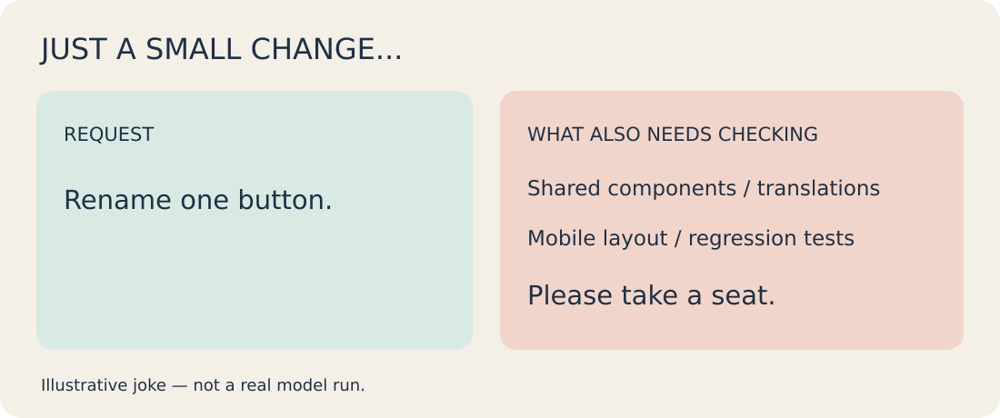
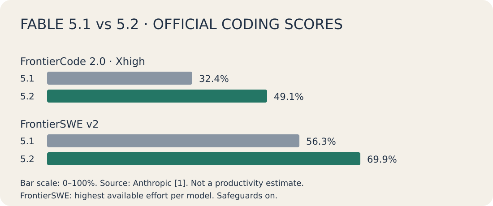
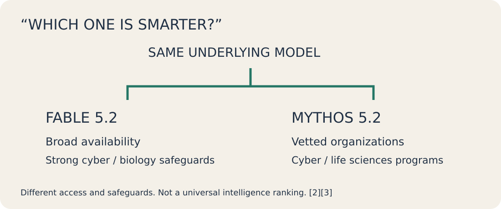
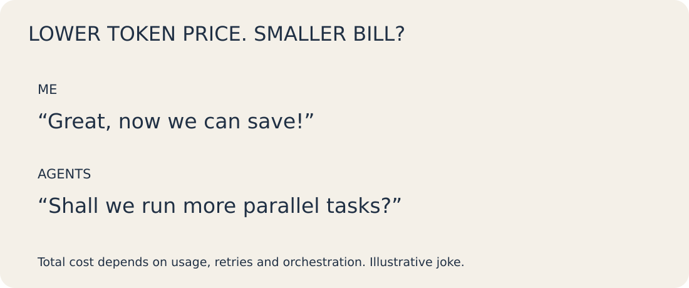

**난이도: 입문 — AI 코딩 도구를 써봤다면 쉽게 읽을 수 있습니다. 벤치마크와 API 가격의 의미를 함께 설명합니다.**

**5.1 대비 달라진 점부터 두 모델의 차이, 실제 이용 조건까지**

AI에게 코드 작성과 문제 해결을 맡기는 것은 다르다. 후자는 원인 분석부터 수정·검증까지 필요하다. Fable·Mythos 5.2의 공식 평가와 사례, 비용·접근 조건을 통해 어디까지 기대할 수 있는지 살펴본다.

> 자료 확인: 2026년 11월 11일 KST. Anthropic 공식 자료를 읽고 정리한 해설이며 직접 사용한 비교 리뷰는 아니다. 성능 수치는 제조사 평가다.

## 1. “버튼 이름만 바꿔주세요”로 끝나지 않는 일

다음은 가상의 개발 상황이다.

결제 화면의 버튼 문구를 바꿔 달란다. 문자열 하나면 끝날 줄 알았는데 다른 서비스도 공용 컴포넌트를 쓴다. 번역·모바일 화면·테스트를 확인하고, 실패가 이번 수정 때문인지 기존 문제인지도 따져야 한다.

모바일에서는 그림을 좌우로 밀어 읽을 수 있습니다.

[원본 SVG 보기](/assets/img/posts/claude-fable-mythos-5-2/01-small-change.svg)

*자체 제작 유머 카드. 특정 모델의 실제 실행 사례가 아닌 가상 상황이다.*

이런 일을 맡길 때 어려운 부분은 문구를 바꾸는 코드가 아니다. 어디까지 영향이 있는지 찾고, 실패한 시도를 되짚고, 확인한 것과 못 한 것을 나눠 보고하는 과정이다. 코드는 몇 줄인데 검토할 일은 줄지 않는다.

Anthropic이 11월 9일 발표한 Fable 5.2와 Mythos 5.2도 복잡한 기술 업무를 강조한다. 회사는 코딩·추론·시각 이해 개선과 함께, 모호한 문제를 오래 붙잡고 하위 에이전트의 작업을 조율하는 능력을 소개했다.<a href="#source-3">[3]</a>

이번 업데이트는 “코드를 얼마나 빨리 쓰나”와 함께 “어려운 작업을 맡겼을 때 사람이 얼마나 자주 개입해야 하나”라는 관점에서 읽어볼 만하다. 다만 후자는 내 프로젝트에서 직접 측정해야 한다.

## 2. 5.2에서 달라진 것: 복잡한 작업과 검증

### 코딩 점수는 올랐다. 업무 생산성은 따로 봐야 한다

공식 비교표에서 Fable 5.1과 5.2의 차이가 드러나는 코딩 지표는 FrontierCode 2.0과 FrontierSWE v2다. FrontierCode 2.0 점수는 32.4%에서 49.1%로, FrontierSWE v2는 56.3%에서 69.9%로 올랐다.<a href="#source-1">[1]</a>

[원본 SVG 보기](/assets/img/posts/claude-fable-mythos-5-2/02-benchmarks.svg)

*출처: Anthropic 공식 비교표.<a href="#source-1">[1]</a> FrontierCode 2.0은 양쪽 모두 Xhigh effort. FrontierSWE v2는 표의 공통 주석상 각 모델의 최고 가용 effort 기준이다. 별도 표시가 없는 Fable 결과는 안전장치를 켠 상태다. 실제 업무 생산성 증가율이 아니다.*

FrontierCode는 모델이 만든 코드 변경을 오픈소스 저장소의 유지관리자가 병합할 만한지 평가하는 벤치마크라고 Anthropic은 설명한다.<a href="#source-3">[3]</a> 단순히 실행되는 코드를 만드는 것보다 실제 개발에 가까운 질문이다. 그래도 특정 평가에서 받은 점수가 우리 팀의 코드 리뷰 시간이나 배포 성공률을 대신해 주지는 않는다.

추론에 쓰는 effort 설정도 같이 봐야 한다. 공식 발표에서 Fable 5.2는 FrontierCode의 High effort에서 45.3%, Xhigh에서 49.1%를 기록했다.<a href="#source-3">[3]</a> 최고 점수만 보고 기본 설정에서도 같은 결과와 비용이 나올 것이라고 기대하면 곤란하다.

### 오래 일하는 모델보다, 잘못된 방향을 고치는 모델

Anthropic은 Fable 5.2가 기존 판단을 의심하고, 스스로 테스트하며, 재현되지 않는 결과를 표시하는 능력을 강조한다.<a href="#source-1">[1]</a> 장시간 작업에서 반가운 대목이다. 처음 세운 가설이 틀렸는데도 그 위에 수정만 쌓이면, 오래 실행한 만큼 정리할 일이 늘어난다.

공식 발표에는 빈 폴더에서 시작해 운영체제 프로토타입을 만든 실험도 나온다. 회사 설명에 따르면 모델은 8일 동안 1,000개 이상의 하위 에이전트를 조율했고, 노트북에서 부팅되는 결과물을 만들었다.<a href="#source-3">[3]</a>

흥미로운 사례지만, 여기서 “이제 운영체제를 혼자 만들어도 된다”는 결론으로 뛰어갈 필요는 없다. 프로토타입이 부팅되는 것과 다양한 하드웨어에서 안정적으로 운영되는 제품은 검증 범위가 다르다. 이 글에서는 해당 실험을 재현하지 않았다.

우리 업무로 가져오면 훨씬 작은 시험으로 시작할 수 있다. 원인이 잘 잡히지 않던 버그 하나를 맡겨 보고, 수정 코드와 함께 재현 절차·테스트 결과·남은 의문을 받는 것이다. 모델이 스스로 쓴 테스트를 통과했다는 보고만으로 종료하지 말고, 원래 증상이 사라졌는지도 확인해야 한다.

## 3. 그런데 Fable과 Mythos는 무엇이 다를까?

이름만 보면 “Fable보다 더 강한 모델이 Mythos인가?” 싶다. 공식 설명은 다르다. **Fable 5.2와 Mythos 5.2는 같은 기반 모델을 공유한다.** Fable에는 사이버보안·생물학 분야의 오용을 막기 위한 강한 안전장치가 있고, Mythos는 검증 프로그램을 거친 기관에 제공된다.<a href="#source-2">[2]</a><a href="#source-3">[3]</a>

[원본 SVG 보기](/assets/img/posts/claude-fable-mythos-5-2/03-models.svg)

*공식 설명을 재구성한 개념도. “둘 중 누가 더 똑똑한데요?”라는 질문보다 먼저 볼 것은 이용 목적과 조건이다.<a href="#source-2">[2]</a><a href="#source-3">[3]</a>*

공식 표에서 일부 항목에 Mythos 점수가 따로 표시되는 이유도 여기에 있다. Anthropic은 해당 차이가 Fable의 안전장치가 개입하는 작업을 반영한다고 설명한다.<a href="#source-2">[2]</a> 따라서 Mythos를 모든 분야에서 더 똑똑한 상위 모델로 소개하거나, 안전장치가 전혀 없는 모델로 그리는 것은 부정확하다.

일반 개발자가 복잡한 앱 수정이나 데이터 분석을 시험한다면 먼저 Fable의 제공 경로를 확인하면 된다. 전문 보안·생명과학 연구를 수행하는 기관이라면 Mythos 접근 프로그램의 심사 조건을 확인할 대상이다.<a href="#source-1">[1]</a><a href="#source-2">[2]</a>

### 연구 사례를 볼 때는 “무엇을 확인했나”까지

연구 분야에서는 계산을 빠르게 만든 사례가 비교적 이해하기 쉽다. Anthropic 제품 페이지에 실린 Discovered Materials의 평가에 따르면 Fable 5.2는 Quantum ESPRESSO의 포논 계산 코드를 최적화했다. 이 회사는 동일 GPU의 기존 코드 대비 평균 약 36배 빠르게 실행됐으며, 자사 벤치마크 13개 사례의 실행 시간이 3.3시간에서 4분 미만으로 줄었다고 밝혔다.<a href="#source-1">[1]</a>

핵심은 기존 계산 코드를 개선한 뒤 정해진 사례로 성능을 확인했다는 작업 방식이다.

물론 이 수치는 제조사 페이지에 소개된 고객 평가다. 해당 코드와 실험을 이 글에서 독립 재현하지 않았고, 모든 물질 계산이나 다른 GPU에서도 같은 속도 향상이 난다는 뜻도 아니다. 계산 결과의 정확성이 유지되는지, 어떤 입력과 환경에서 효과가 있는지는 실제 도입 시 별도로 확인해야 한다.

보안 평가도 비슷하게 읽어야 한다. 공식 CVE Rediscovery 점수는 Mythos 5.1의 78.3%에서 5.2의 89.6%로 올랐다.<a href="#source-2">[2]</a> 이 평가는 이미 공개된 취약점이 수정되기 전의 프로젝트 상태를 주고 모델이 이를 찾아내는지 보는 내부 평가다.<a href="#source-3">[3]</a> 모든 실제 시스템에서 그 비율의 취약점을 찾는다는 보증으로 바꿔 읽을 수는 없다.

## 4. 써보기 전에 확인할 가격과 조건

### 단가는 내려갔다. 청구서까지 내려갈지는 모른다

공식 제품 페이지에 안내된 기본 API 가격은 다음과 같다. 모두 미국 달러이며 토큰 100만 개 기준이다. Claude 구독료와는 별개다.<a href="#source-1">[1]</a><a href="#source-2">[2]</a>

- Fable 5.1: 입력 $10, 출력 $50.<a href="#source-1">[1]</a>
- Fable 5.2: 입력 $8, 출력 $40. 캐시 읽기는 $0.20.<a href="#source-1">[1]</a>
- Fable 5.2 Fast mode: 입력 $16, 출력 $80.<a href="#source-1">[1]</a>
- Mythos 5.2: 입력 $8, 출력 $40부터. Fast mode는 입력 $16, 출력 $80.<a href="#source-2">[2]</a>

Fast mode는 토큰 생성 속도를 최대 2.5배 높인다는 설명이다.<a href="#source-3">[3]</a> 테스트 실행이나 외부 도구의 응답을 기다리는 시간까지 같은 비율로 줄어드는 것은 아니다. 빠르게 답을 받는 가치가 큰 작업과, 밤새 돌아가도 되는 작업을 나눠 선택하는 편이 낫다.

[원본 SVG 보기](/assets/img/posts/claude-fable-mythos-5-2/04-cost.svg)

*자체 제작 비용 밈. 실제 청구서나 모델 실행 결과가 아닌 가상 상황이다.*

총비용을 비교하려면 같은 작업에 사용한 입력·출력 토큰, 재시도, 하위 에이전트 실행을 함께 봐야 한다. 토큰 단가가 낮아져도 더 오래 생각하고 더 많이 시도하면 전체 비용은 늘 수 있다. 반대로 불필요한 시도가 줄어든다면 단가 차이보다 큰 절약이 생길 수도 있다. 어느 쪽인지는 작업을 끝낸 뒤 확인할 일이다.

### 이용 권한과 데이터 보존도 선택 조건이다

Fable 5.2는 Pro·Max·Ultra·Team·Enterprise 사용자와 API 등에 제공된다. Mythos 5.2는 보안 및 생명과학 검증 프로그램을 통한 기관 접근이 기본이다.<a href="#source-1">[1]</a><a href="#source-2">[2]</a>

Fable의 민감 분야 요청은 안전장치에 따라 다른 모델로 전환될 수 있다. 제품 페이지는 API 고객에게 Fallback API 설정이 필요하다고 안내한다.<a href="#source-1">[1]</a> 따라서 특정 요청을 처리한 모델이 무엇인지 확인해야 하며, 일반 코딩에서의 결과를 보안·생물학 작업에 그대로 기대하면 안 된다.

데이터 정책도 놓치기 쉽다. 두 모델의 제품 페이지는 안전 모니터링을 위해 기본적으로 30일 데이터 보존이 필요하다고 안내한다. Enterprise Frontier Safeguards(EFS)는 고객 인프라에 저장된 프롬프트와 응답에서 자동 안전 모니터링을 수행해 zero data retention(ZDR)과 양립하도록 설계됐다.<a href="#source-1">[1]</a><a href="#source-2">[2]</a>

발표문 기준 EFS는 비공개 베타이며, 기존 ZDR을 유지할 수 있는 적격 고객의 예외도 안내돼 있다.<a href="#source-3">[3]</a> 모든 고객이 자동으로 무보존 정책을 적용받는다고 해석해서는 안 된다. 사내 코드나 민감 문서를 넣기 전에는 실제 계약·이용 경로에 적용되는 보존 조건을 확인해야 한다.

## 5. 내 업무에서는 무엇으로 평가할까?

새 모델이 나왔다고 모든 작업을 옮길 필요는 없다. Anthropic도 대부분의 일상적인 코딩·지식 업무에는 Opus 5.5에서 시작하고, 더 어렵고 개방적인 기술 업무에 Fable이나 Mythos를 고려하라고 권한다.<a href="#source-3">[3]</a>

첫 시험 대상으로는 기존 모델이 자주 막혔던 작업이 좋다. 여러 파일에 걸친 버그, 조건이 복잡한 데이터 처리, 원인 분석부터 수정까지 필요한 성능 문제처럼 결과를 확인할 수 있는 일을 고른다. 처음부터 가장 큰 프로젝트를 맡기면 모델의 변화와 업무 자체의 어려움을 분리하기 어렵다.

비교할 때는 입력 자료와 완료 기준을 맞춘다. 사용할 수 있는 도구·권한·실행 환경도 기록한다. 한쪽에는 테스트 실행을 허용하고 다른 쪽에는 코드만 보여줬다면 모델만의 비교가 아니다.

결과를 볼 때는 다음 질문이면 충분하다.

- 원래 문제가 해결됐고, 다른 기능을 깨뜨리지 않았나?
- 사람이 설명을 고치거나 작업을 되돌린 횟수와 시간은 줄었나?
- 코드 작성부터 검토까지 전체 완료 시간은 어땠나?
- 재시도와 하위 에이전트를 포함한 비용은 얼마였나?
- 성공했다고 말한 범위와 실제 증거가 일치하나?

특히 마지막 질문이 중요하다. “테스트 통과”가 전체 테스트인지, 이번에 만든 테스트만인지에 따라 받아들일 수 있는 결과가 다르다. 실행하지 못한 테스트와 확인하지 못한 환경을 분명히 적어 주는 보고가 있어야 다음 작업을 맡기기도 편하다.

버튼 수정에서도 “수정했습니다”보다 영향받은 화면·테스트·미확인 범위가 담긴 결과를 받아야 한다.

Fable·Mythos 5.2의 공식 평가는 그런 복잡한 작업을 더 잘 다룰 가능성을 보여준다. 우리 팀에서의 가치는 같은 일을 맡겼을 때 사람이 다시 확인하고 고치는 부담이 얼마나 달라졌는지로 판단하면 된다. 첫 시험은 큰 선언 대신, 지난번 끝내 해결하지 못한 버그 하나로 시작해도 좋겠다.

## Sources

[1] <a href="https://www.anthropic.com/claude/fable">Anthropic · Claude Fable</a> · 제품 페이지, 개별 게시일 미표시

[2] <a href="https://www.anthropic.com/claude/mythos">Anthropic · Claude Mythos</a> · 제품 페이지, 개별 게시일 미표시

[3] <a href="https://www.anthropic.com/claude-fable-and-mythos-5-2">Anthropic · Introducing Claude Fable 5.2 and Claude Mythos 5.2</a> · 발표: 2026년 11월 9일

