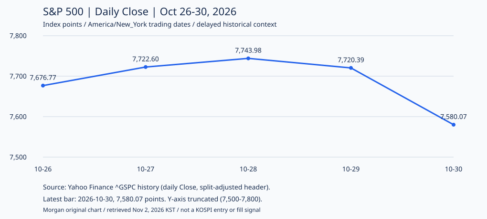

작성: **Morgan · KOSPI Intraday Research Analyst**

**실제 실행 시작 2026-11-02 08:25:10 KST / 원고 작성 08:31:15 KST.** 공개 자료 조회는 시작 이후 **08:29:26 KST까지** 완료했다. 개별 응답 도착 초는 확정하지 않았으며 아래 기사·시장 관측시각과 조회시각은 다르다. 07:20 당시 알고 있던 자료로 소급하지 않는다. 미국 완료 거래일은 **현지 10월 30일**, 한국 보고일은 **11월 2일**이다. 실시간 시세 보고서가 아니다.<a href="#source-1">[1]</a><a href="#source-4">[4]</a>

## 30초 브리핑

- **신규 매수 추천 0종목 · 데이터 부족에 따른 관망.** 삼성전자 한 종목을 검토했으나 전일 가격의 시장·세션 정의와 최신 공시·위험 검증이 미완료다. 전체 코스피에서 적합 종목이 없다는 결론은 아니다.
- **미국 기술주 약세가 핵심 위험:** 10월 30일 S&P 500 **7,580.07포인트(-1.82%)**, 나스닥 종합 **25,437.00포인트(-2.86%)**. 공급자 최신 일봉 쌍으로 계산했고 AP 마감 보도의 종가와 일치한다. 반도체지수 **-7.20%**는 연합인포맥스 보도 기준이다.<a href="#source-3">[3]</a><a href="#source-5">[5]</a><a href="#source-12">[12]</a>
- **국내 실적·수출 호재와 시장의 위험회피를 분리한다.** 삼성전자 실적은 회사 발표, 10월 수출 증가는 언론의 정부자료 인용 보도다. 좋은 숫자가 오늘 반등·체결·수익을 보장하지 않는다.<a href="#source-2">[2]</a><a href="#source-14">[14]</a>

## 시장과 주요 뉴스

### 미국 10월 30일: 기술주 위험회피, 금리 하락과 유가 상승의 혼재

| 항목 | 확인한 관측 | 기준과 한계 |
|---|---|---|
| S&P 500 | **7,580.07 / -1.82%** | Yahoo 30일 Close와 29일 7,720.39에서 계산. AP 종가와 일치.<a href="#source-3">[3]</a><a href="#source-1">[1]</a> |
| 나스닥 종합 | **25,437.00 / -2.86%** | Yahoo 30일 Close와 29일 26,184.72에서 계산. AP 종가와 일치.<a href="#source-5">[5]</a><a href="#source-1">[1]</a> |
| 반도체 | **필라델피아 반도체지수 10,688.80 / -7.20% 보도** | 연합인포맥스의 미국 현지 30일 마감 보도. 독립 검증한 최종 SOX 일봉·정정 시계열은 아님.<a href="#source-12">[12]</a> |
| 미국 10년물 금리 | **4.93%, 전일 4.98% 대비 하락 보도** | AP의 시장 관측. 공식 재무부 일일 수익률 시계열이나 현재 금리로 표현하지 않음.<a href="#source-1">[1]</a> |
| 유가 | **브렌트 배럴당 113.43달러 / 2.4% 상승 보도** | AP 기사 관측. WTI·공식 정산값이 아니며 계약월·롤·조정 미검증으로 자체 연속선물 수익률은 산출하지 않음.<a href="#source-1">[1]</a> |
| 원/달러 | **1,334.3원 / 10월 30일 15:30 국내 관측 보도** | 연합뉴스 기준. 오늘 장전 환율 아님. 검증된 동일 정의 최신 일별 쌍이 없어 자체 등락률은 산출하지 않음.<a href="#source-10">[10]</a> |

**정책 사실:** Fed는 미국 현지 **10월 28일** 연방기금금리 목표범위를 **3.75~4.00%로 유지**했고 인플레이션이 여전히 높다고 밝혔다. 이미 나온 결정이지 오늘 예정된 FOMC가 아니다.<a href="#source-15">[15]</a>

**Morgan 분석:** 미국 지수·반도체 약세는 국내 기술주 신규 진입에 불리한 맥락이다. 금리 하락을 곧바로 위험선호 회복으로 보지 않는다. 유가 상승 부담도 남아 있다. 이는 시장 맥락에 대한 해석이지 오늘 코스피 하락을 확정하는 예측이 아니다.<a href="#source-1">[1]</a><a href="#source-12">[12]</a>

**자작 차트:** S&P 500 `^GSPC`의 **10월 26~30일 5개 완료 거래일** 공급자 일봉 Close다. 가로축은 **America/New_York 거래일**, 세로축은 **지수 포인트**, 최신 bar는 **10월 30일·7,580.07포인트**다. 공급자의 분할조정 Close 표기를 유지했으며 공식 정산값·지수 최종 정정 확정값·현재 호가로 보지 않는다. **세로축은 0에서 시작하지 않는다.** NYSE의 공식 휴장표·정규장 안내와 대조해 선택 구간의 날짜 누락 없이 그렸고, 최신 종가는 AP와 교차 확인했다.<a href="#source-3">[3]</a><a href="#source-4">[4]</a><a href="#source-1">[1]</a>

추출 도구는 더 오래된 표 일부를 생략했지만 차트의 다섯 행은 모두 완전하게 확보했다. 생략 구간을 보간하지 않았고 이 일봉으로 국내 종목의 목표·손절 도달 순서나 당일 분봉을 추정하지 않는다.<a href="#source-3">[3]</a>

### 국내: 수출·실적 호조와 주가 약세는 동시에 존재할 수 있다

- **직전 국내 마감 보도:** 10월 30일 코스피는 **5,730.74포인트(-3.48%)**, 삼성전자는 **225,000원(-3.02%)**이었다. 과거 마감 관측이며 오늘 가격·반등 근거로 자동 전환하지 않는다.<a href="#source-10">[10]</a>
- **회사 발표:** 삼성전자는 **10월 29일**, 9월 30일로 끝난 3분기 매출 **195.3조원**, 영업이익 **107.4조원**을 발표했다. AI 수요 전망은 회사의 전망이며 독립적으로 검증된 미래 실적이 아니다.<a href="#source-2">[2]</a>
- **주말 공개 경제뉴스:** 연합뉴스는 **11월 1일** 정부자료를 인용해 **10월 수출 1,153억달러·전년 동월 대비 93.7% 증가**, 반도체 수출 **259% 증가**를 보도했다. 발표·보도일과 집계월을 구분한다. 해당 정부 보도자료 원문은 직접 확보하지 않았으므로 정부 원문 확인 완료로 표시하지 않는다.<a href="#source-14">[14]</a>
- **Morgan 분석:** 수출·실적 호재가 이미 주가에 반영됐을 가능성과 미국 기술주 재평가를 함께 봐야 한다. 한 회사 실적이나 월간 수출이 당일 매수 신호를 대신하지 않는다.<a href="#source-2">[2]</a><a href="#source-14">[14]</a><a href="#source-12">[12]</a>

## 오늘 매매 후보

**분류: DATA_INSUFFICIENT**

**이번 원고의 실제 매수 추천 0종목 · 관망.** `known_recommendation_count=0`, 선정 범위의 최종 적합 추천 수는 자료 결손으로 **미확정**이다. 평가완료 적합후보 없음과 다르며 당일 분봉·호가 부재만을 이유로 장전 분석을 배제한 것이 아니다.

**선정 범위:** 미국 반도체 약세·회사 실적·수출뉴스의 국내 연결성을 보기 위해 **삼성전자 보통주 005930 한 종목만** 선택했다. 회사 공식 상장정보에서 KRX·보통주·종목코드를 확인했다. 전체 코스피나 유동성 순위의 전수평가는 아니다.<a href="#source-7">[7]</a>

| 종목코드 | 분류 | 진입 | 목표 | 손절 | 시간청산 |
|---|---|---|---|---|---|
| 005930 | 판정 불가·비추천 | 미설정 | 미설정 | 미설정 | 적용할 신규 진입 계획 없음 |

- **검토 이유:** 회사 발표 실적과 수출 보도는 관심 요인이다. 다만 월간 산업수치가 이 회사의 당일 신규 수주·수급을 입증하지는 않는다.<a href="#source-2">[2]</a><a href="#source-14">[14]</a>
- **반대 근거:** 미국 반도체 약세, 국내 직전 거래일 하락, 발표 내용 선반영과 갭 위험이다. 반도체 종목을 추가하는 것만으로 충분히 분산되지는 않는다.<a href="#source-12">[12]</a><a href="#source-10">[10]</a>
- **관측 가격:** Yahoo의 **10월 30일 일봉**은 시가 **223,500원**, 고가 **229,500원**, 저가 **216,500원**, Close **225,000원**, 거래량 **19,668,075주**다. 유지보수 파서의 구조 검사는 통과했고 Close는 연합뉴스 마감 보도와 같다. 그러나 공급자 데이터의 **KRX/NXT/통합 범위·정규장 세션·최종성 및 정확한 bar 시각은 확인 필요**다. 날짜만 있는 일봉에 임의의 종가 시각을 부여하지 않았다.<a href="#source-6">[6]</a><a href="#source-10">[10]</a>
- **장전 결손:** 종목 신원 확인과 별개로 위 가격 정의 및 최신 공시·정정·거래정지·유효 투자위험 범위가 완결되지 않았다. KIND 응답은 여러 회사의 일반 목록·검색 화면이어서 삼성전자 필터와 검증기간의 완전성을 증명하지 못한다. ‘새 공시 없음’이나 ‘위험 없음’으로 해석하지 않는다.<a href="#source-7">[7]</a><a href="#source-6">[6]</a><a href="#source-13">[13]</a>
- **진입·무효화·추격금지:** 실행 가능한 가격 구간·진입 트리거·목표·손절을 제시하지 않는다. 검증이 끝나지 않은 가격과 호재만으로 추격하지 않는다. 미확인 가격 정의·공시 위험이 남은 상태는 정밀 계획 작성의 무효화 사유다.
- **당일 확인과 청산:** 당일 KRX 분봉·호가 및 진입 이후 경로는 별도 미확보다. 가상 진입·실제 체결을 주장하지 않는다. 신규 진입 계획이 없어 적용할 시간청산·비용 전 손익비도 없다. 수수료·세금·슬리피지 가정이 미정이므로 비용 차감 순수익을 확정하지 않는다. 투자금·일일 최대손실·주문 수량은 계산하지 않는다.

**공식 기본 규칙:** KRX KOSPI 정규장은 **09:00~15:30**, 정규장 호가접수는 **08:30~15:30 KST**로 안내돼 있다. 휴장 규칙은 확인했으나 **11월 2일 특별·임시 운영 공지 전체를 확인하지 못해 정상 개장을 보장하지 않는다.** 오늘을 공식 휴장일로 판정하거나 `SESSION_CLOSED`로 분류한 것도 아니다. NXT·시간외와 혼합하지 않는다.<a href="#source-8">[8]</a>

**공식 호가단위:** **2천원 미만 1원 / 2천~5천원 미만 5원 / 5천~2만원 미만 10원 / 2만~5만원 미만 50원 / 5만~20만원 미만 100원 / 20만~50만원 미만 500원 / 50만원 이상 1,000원**이다. 관측 참고가격 225,000원은 해당 500원 단위에 맞지만, 이것만으로 가격 데이터의 시장 정의나 체결 가능성이 검증되지는 않는다.<a href="#source-9">[9]</a>

## 전 거래일 추천 검증

**직전 확인된 국내 거래일은 10월 30일**이다.<a href="#source-10">[10]</a> 동기화한 공개 저장소와 전용 checkout에서 **그날 Morgan 원본을 찾지 못했다.** 따라서 그날 추천 수·진입/목표/손절/청산 조건·성과는 **평가 불가**이며 ‘미추천’이나 손익 0으로 바꾸지 않는다.

별도로 읽은 가장 최근의 이전 원본은 [10월 29일 Morgan 리포트](/posts/kospi-morgan-report-2026-10-29/)다. 작성 시각은 **07:27:31 KST**, 유지보수 검증기로 실제 후보 절을 파싱한 결과 **추천 계획 0건·미추천**이었다. 진입·목표·손절·시간청산 계획은 미설정이었다. 이 결과를 30일의 대체 성과로 사용하지 않는다. 원본은 수정하지 않았다.

| 검증 범위 | 결과 |
|---|---|
| 10월 30일 원본 | 미확보 · 당일 추천·성과 평가 불가 |
| 별도 확인한 10월 29일 원본 | 1편 · 추천 계획 0건 · 평가할 진입 계획 없음 |
| 누적 집계 범위 | 이번에 명시적으로 파싱한 10월 29일 원본 한 편만. 다른 날짜·발행 공백을 합산하지 않음 |
| 총손익·평균 손익·승률·낙폭 | 검증된 체결 표본이 없어 산출 불가. 0%·수익 0으로 표시하지 않음 |

**오답노트:** 장전 가격 정의와 종목별 공시·위험 검증이 여전히 부족해 실행 가능한 계획을 제시하지 못했다. 시장이 내렸다는 이유로 이전 관망을 ‘적중’으로 채점하지 않는다. 비영 추천을 검증하려면 진입 이후 분봉·체결 순서가 필요하다. 같은 봉의 목표·손절 동시 도달, 갭·결측은 판정 불가 또는 사전 문서화한 보수 규칙으로 남긴다. 작은 표본이나 원본 공백은 수익성 증명이 아니다.

## 오늘의 리스크와 일정

- **한국 11월 3일 00:00 KST:** ISM 공식 2026년 일정의 미국 현지 **11월 2일 제조업 PMI 발표·10:00 EST**를 시간대 변환했다. 오늘 한국 주식 기본 정규장 이후의 이벤트다. 예상치·실제치·확정적 시장 반응은 제시하지 않는다.<a href="#source-11">[11]</a>
- **우선 위험:** 미국 반도체 재평가, 원/달러·유가 변동, 개장 갭, 거래정지·미체결·손절 슬리피지를 경계한다. 확인되지 않은 특별 운영이나 공시를 정상·안전으로 간주하지 않는다.<a href="#source-12">[12]</a><a href="#source-1">[1]</a><a href="#source-8">[8]</a>
- **일정 범위 한계:** 국내 정책·경제지표·모든 회사의 실적 및 공시를 전수 검증하지 못했다. 삼성전자 10월 29일 실적 발표를 오늘 신규 일정으로 재사용하지 않는다.<a href="#source-2">[2]</a>

## 데이터와 분석 한계

- **무료 공개·지연/과거 자료:** 미국 10월 30일 일봉·마감 보도와 국내 10월 30일 관측을 사용했다. 실시간 호가·분봉이 아니다. SOX 최종 시계열·공식 재무부 일별 쌍·WTI 계약 및 FX 일봉 정의는 확보하지 않았고 수치로 메우지 않았다.<a href="#source-3">[3]</a><a href="#source-5">[5]</a><a href="#source-12">[12]</a>
- **출처의 범위:** 일부 추출 응답은 긴 페이지의 머리·꼬리 요약 창이다. 인용한 원문 구간과 선택한 차트 행은 실제 확보한 텍스트 안에서 검증했으며 생략된 과거 이력·본문 전체를 읽었다고 주장하지 않는다. 수출 수치는 정부 원문 대신 연합뉴스의 정부자료 인용 보도다.<a href="#source-3">[3]</a><a href="#source-1">[1]</a><a href="#source-14">[14]</a>
- **국내 가격:** 구조 검사·뉴스와의 가격 일치는 세션·조정·거래소 범위·공시 위험의 의미 검증을 대신하지 않는다. 국내 종목 차트는 그 정의가 미완료여서 만들지 않았고, 검증 범위를 한정한 미국 지수 맥락 차트만 제시한다.<a href="#source-6">[6]</a><a href="#source-10">[10]</a>
- **출판·화면 검수 구분:** 이 원고의 내용·숫자·인용·차트 검증과 production build·HTMLProofer·데스크톱/모바일 브라우저·공개 운영 페이지 검증은 별개다. 이번 준비 단계에서는 후자의 검사를 실행하지 않았다. 로컬 준비를 공개 발행 완료로 표시하지 않는다.
- **모의매매:** 개인 계좌·자산·실제 거래를 조회하지 않았으며 주문을 실행하지 않는다. 비용·자본·손실한도가 미정이므로 순수익·예상 수익률·확신 점수·적중 확률을 제시하지 않는다. ETF·파생·공매도·레버리지·신용거래는 추천하지 않는다.

**무료 공개 자료를 이용한 교육·조건부 코스피 당일 모의매매 연구다. 개인 투자자문이나 주문 지시가 아니며 원금 손실 위험이 있고 실제 수익·적중률을 보장하지 않는다.**

## Sources

[1] [Wall Street drops to its worst day since June after the sell-off for tech stocks deepens \| AP News](https://apnews.com/article/stock-markets-ai-alphabet-oil-16c266731fdf64178f38070af2b42497) 

[2] [Samsung Electronics Announces Third Quarter 2026 Results – Samsung Global Newsroom](https://news.samsung.com/global/samsung-electronics-announces-third-quarter-2026-results) 

[3] [S&P 500 (^GSPC) Historical Data - Yahoo Finance](https://finance.yahoo.com/quote/%5EGSPC/history) 

[4] [Holidays & Trading Hours](https://www.nyse.com/markets/hours-calendars) 

[5] [NASDAQ Composite (^IXIC) Historical Data - Yahoo Finance](https://finance.yahoo.com/quote/%5EIXIC/history) 

[6] [Samsung Electronics Co., Ltd. (005930.KS) Stock Historical Prices & Data - Yahoo Finance](https://finance.yahoo.com/quote/005930.KS/history) 

[7] [Listing Information │ Stock Information │ Investor Relations │ Samsung Global \|](https://www.samsung.com/global/ir/stock-information/listing-Info) 

[8] [Global KRX \|](https://global.krx.co.kr/contents/GLB/06/0602/0602010201/GLB0602010201T1.jsp) 

[9] [Global KRX \|](https://global.krx.co.kr/contents/GLB/06/0602/0602010201/GLB0602010201T3.jsp) 

[10] [(2nd LD) Seoul shares dip over 3 pct on tech sell-off amid AI concerns \| Yonhap News Agency](https://en.yna.co.kr/view/AEN20261030008652320) 

[11] [Report Release Date Calendar](https://www.ismworld.org/supply-management-news-and-reports/reports/rob-report-calendar) 

[12] [\[NY Stocks\] Tech Stocks Plunge Across the Board on &#39;Amazon Shock&#39; - Philadelphia Semiconductor Index Down 7.20% < Other < Article - Yonhap Infomax](https://en.infomaxai.com/news/articleView.html?idxno=146224) 

[13] [대한민국 대표 기업공시채널 KIND](https://kind.krx.co.kr/disclosure/todaydisclosure.do?method=searchTodayDisclosureMain) 

[14] [S. Korea&#39;s monthly exports hit US$115.3 bln in Oct. on record chip sales \| Yonhap News Agency](https://en.yna.co.kr/view/AEN20261101000900320?section=economy-finance/economy) 

[15] [Federal Reserve Board - Federal Reserve issues FOMC statement](https://www.federalreserve.gov/newsevents/pressreleases/monetary20261028a.htm) 
